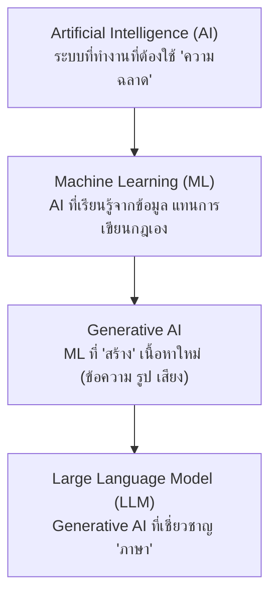
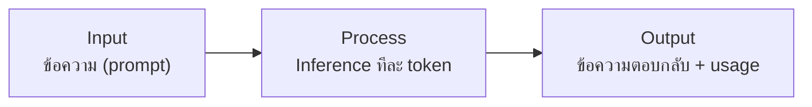
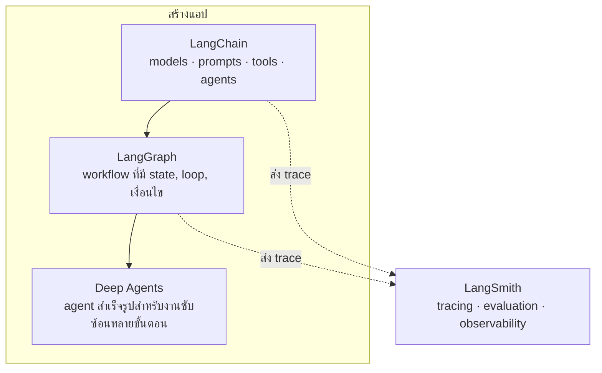

# Part 01 — Introduction to LangChain

ระดับ: Beginner · เวลา: 45–60 นาที · ตัวอย่าง: `examples/part-01/` · Workshop: `workshops/part-01/`

## 1. Introduction

ก่อนเขียนโค้ด เราต้องรู้ก่อนว่า **LLM** คืออะไร ทำอะไรได้/ไม่ได้ และ **LangChain** เข้ามาช่วยตรงไหน
ถ้าไม่เข้าใจจุดนี้ คนมักใช้ LangChain กับงานที่ไม่จำเป็น หรือคาดหวังให้ LLM ทำสิ่งที่มันทำไม่ได้ (เช่น "จำ" บทสนทนาเอง)

**ปัญหาที่ต้องแก้:** การทำ AI application ไม่ได้มีแค่ "ส่งข้อความหา model" — เราต้องจัดการ prompt, ประวัติบทสนทนา,
หลาย provider, tool calling และการประกอบหลายขั้นตอนเข้าด้วยกัน

## 2. Learning Objectives

เมื่อจบ Part นี้ ผู้เรียนจะ **เข้าใจ**
- ความสัมพันธ์ของ AI, Machine Learning, Generative AI และ LLM
- LLM ทำงานอย่างไรในภาพรวม และข้อจำกัดของมัน
- ความต่างของ AI Model / AI Application / AI Workflow / AI Agent
- LangChain คืออะไร แก้ปัญหาอะไร และ LangGraph, LangSmith, Deep Agents เกี่ยวข้องกันอย่างไร

และ **สามารถ**
- เรียก LLM ได้ทั้งแบบ direct API และผ่าน LangChain
- ตัดสินใจได้ว่างานแบบไหนควรใช้ LLM ตรงๆ, LangChain หรือ LangGraph

## 3. Concept Explanation

### 3.1 AI → ML → Generative AI → LLM



- **AI (ปัญญาประดิษฐ์):** ระบบที่ทำงานที่ปกติต้องใช้ความฉลาดของมนุษย์
- **Machine Learning:** แทนที่จะเขียนกฎ if/else เอง เราให้ระบบเรียนรู้รูปแบบจากข้อมูลตัวอย่าง
- **Generative AI:** ML ที่ผลิตผลลัพธ์ใหม่ ไม่ใช่แค่จำแนกหมวดหมู่
- **LLM (โมเดลภาษาขนาดใหญ่):** โมเดลที่ฝึกด้วยข้อความมหาศาล เพื่อทำนาย "token ถัดไป" จนเขียน/ตอบ/สรุปได้

### 3.2 LLM ทำงานอย่างไรในภาพรวม

LLM คือฟังก์ชันที่ **รับข้อความ → คืนข้อความ** ภายในมันทำนาย token ทีละตัวต่อเนื่องกัน

| คำศัพท์ | ความหมาย |
|---|---|
| **Token** | หน่วยย่อยของข้อความที่ model อ่าน (อาจเป็นคำ/ส่วนของคำ/ตัวอักษร) ภาษาไทยมักใช้ token มากกว่าอังกฤษ |
| **Context Window** | จำนวน token สูงสุดที่ model รับได้ในครั้งเดียว (prompt + คำตอบรวมกัน) |
| **Inference** | การ "ใช้งาน" model ที่เทรนเสร็จแล้วเพื่อสร้างคำตอบ |
| **Text Generation** | การสร้างข้อความต่อเนื่องทีละ token |
| **Stateless** | model **ไม่จำ** การเรียกครั้งก่อน — ทุกครั้งต้องส่งบริบททั้งหมดไปใหม่ |
| **Hallucination** | model ตอบมั่นใจแต่ผิด/แต่งข้อมูลขึ้นมา |

**ข้อจำกัดของ LLM:** ความรู้หยุดที่ช่วงเวลาที่เทรน (knowledge cutoff), ไม่รู้ข้อมูลส่วนตัวขององค์กร,
hallucinate ได้, คำตอบไม่ deterministic, เรียก function/DB ในแอปของเราเองไม่ได้ และมีค่าใช้จ่ายตาม token

### 3.3 Model, Application, Workflow, Agent

| แนวคิด | คืออะไร | ใครตัดสินใจขั้นตอน |
|---|---|---|
| **AI Model** | ตัว LLM เอง (รับข้อความ คืนข้อความ) | — |
| **AI Application** | โปรแกรมที่ใช้ model เป็นส่วนหนึ่ง (UI, ข้อมูล, logic) | นักพัฒนา |
| **AI Workflow** | ลำดับขั้นตอนที่ **เรากำหนดตายตัว** เช่น สรุป → แปล → จัดรูปแบบ | โค้ดของเรา |
| **AI Agent** | model **ตัดสินใจเอง** ว่าจะเรียก tool อะไร กี่ครั้ง จนกว่างานเสร็จ | LLM (ใน loop) |

## 4. Problem Demonstration

ตัวอย่าง **01-02** เรียก TokenMe (gateway ที่ใช้รูปแบบ request เดียวกับ OpenAI) ด้วย `fetch` ล้วนๆ ไม่ใช้ library:

```bash
pnpm play 1-2
```

สิ่งที่เราต้องจัดการเองทั้งหมด: URL ของ provider, header `Authorization`, รูปแบบ body (`messages` ที่มี `role`/`content`),
การเช็ก HTTP error และรู้ว่าคำตอบอยู่ที่ `choices[0].message.content`

ยังไม่นับปัญหาที่จะตามมาเมื่อแอปโตขึ้น:

1. **Prompt:** ต่อ string ไปเรื่อยๆ จนดูแลยาก
2. **Conversation history:** ต้องเก็บ/ตัดข้อความเอง
3. **หลาย provider:** แต่ละเจ้ามี request/response format, streaming, tool calling ต่างกัน
4. **Tool calling:** ต้องแปลง function → schema → ตรวจ → เรียก → ส่งผลกลับ
5. **การประกอบ workflow:** เชื่อมหลายขั้นตอนเข้าด้วยกันเอง

## 5. Solution — LangChain

**LangChain** คือ **framework** (ไม่ใช่ AI model) สำหรับสร้าง AI application ด้วยแนวคิดหลัก 2 ข้อ:

- **Model Abstraction:** ใช้ interface เดียวกัน (`model.invoke(...)`) กับทุก provider
- **Component Composition:** ประกอบ prompt, model, parser, tool, agent เป็นชิ้นส่วนที่ต่อกันได้

เทียบ **ก่อน/หลัง** (ตัวอย่าง **01-03**):

| | Direct API | LangChain |
|---|---|---|
| เรียก model | `fetch(url, { headers, body })` เขียนต่อ provider | `model.invoke(question)` |
| อ่านคำตอบ | `data.choices[0].message.content` | `messageText(response)` / `response.content` |
| เปลี่ยน provider | แก้ URL, key, model, อาจต้องแก้ format | เปลี่ยนชื่อ provider |

```bash
pnpm play 1-3
```

**ข้อดี:** โค้ดสลับ provider ง่าย, มีของสำเร็จรูป (tools, memory, RAG, agent), ecosystem ใหญ่
**ข้อจำกัด:** มี abstraction เพิ่ม (ต้องเรียนรู้), API เปลี่ยนเร็ว, บางฟีเจอร์เฉพาะ provider ยังต้องใช้ option พิเศษ
**ไม่จำเป็นต้องใช้ LangChain เมื่อ:** แอปแค่เรียก model 1 ครั้งกับ 1 provider แบบง่ายมาก, หรือต้องการควบคุม HTTP ระดับต่ำ

## 6. Visual Explanation

### Input → Process → Output ของ LLM



### LangChain Ecosystem



| เครื่องมือ | หน้าที่ |
|---|---|
| **LangChain** | ชิ้นส่วนพื้นฐาน: model, prompt, tool, `createAgent()` |
| **LangGraph** | runtime ที่อยู่ใต้ agent: state, checkpoint, loop, เงื่อนไข, human-in-the-loop |
| **LangSmith** | ดู trace, debug, ประเมินคุณภาพ |
| **Deep Agents** | agent พร้อมใช้ (planning, sub-agent, filesystem) สำหรับงานใหญ่ |

หลักสูตรนี้เน้น **LangChain** และ LangSmith เบื้องต้น; LangGraph เป็นขั้นต่อไป

## 7. Coding Examples

รันด้วย `pnpm play <part>-<example>` (ต้องมี `.env` ที่ตั้ง `TOKENME_API_KEY`; 01-03 เทียบ provider เพิ่มด้วย `GROQ_API_KEY` และ `DEEPSEEK_API_KEY` — ตัวไหนไม่มี key จะถูกข้าม)
ผลลัพธ์ด้านล่างเป็น *ตัวอย่างผลลัพธ์ — LLM ไม่ได้ตอบเหมือนเดิมทุกครั้ง* (ตรวจกับ TokenMe `deepseek-ai/deepseek-v4.1-flash-1017`, Groq `openai/gpt-oss-20b` และ DeepSeek `deepseek-flash`)

### 01-01 Basic LLM Input and Output
- **Input:** ข้อความ "อธิบาย LLM ใน 1 ประโยค" · **Process:** `model.invoke()` · **Output:** ข้อความ + จำนวน token

```
INPUT : อธิบาย LLM ใน 1 ประโยค
OUTPUT: LLM (Large Language Model) คือแบบจำลอง AI ขนาดใหญ่ที่เรียนรู้จากข้อความจำนวนมหาศาลเพื่อเข้าใจและสร้างภาษาได้อย่างเป็นธรรมชาติ เช่น ใช้ตอบคำถาม สรุป หรือเขียนเนื้อหา
TOKENS: {
  output_tokens: 155,
  input_tokens: 41,
  total_tokens: 196,
  input_token_details: { audio: undefined, cache_read: 0 },
  output_token_details: { audio: undefined, reasoning: 106 }
}
```
สังเกต: output token (155) มากกว่าคำตอบที่เห็นมาก เพราะโมเดลเป็น reasoning model ที่ "คิด" ก่อนตอบ (reasoning 106 token) และนับ token ส่วนนั้นด้วย

### 01-02 Direct Model API Concept
- เรียก TokenMe ด้วย `fetch` — ดู "ภาระ" ที่ต้องจัดการเอง

```
ANSWER: LLM (Large Language Model) คือโมเดล AI ขนาดใหญ่ที่เรียนรู้รูปแบบภาษาจากข้อความจำนวนมหาศาล เพื่อทำนายคำถัดไปและสร้างข้อความที่ต่อเนื่องได้ เช่น ตอบคำถาม เขียนเนื้อหา หรือสรุปข้อมูล
FINISH: stop | total tokens: 213
```

### 01-03 Direct API vs LangChain Concept
- ถามคำถามเดียวกันกับหลาย provider ทั้งสองวิธี

```

=== tokenme ===
Direct   : กรุงเทพมหานคร (กรุงเทพฯ)
LangChain: กรุงเทพมหานคร

=== groq ===
Direct   : กรุงเทพมหานคร (Bangkok)
LangChain: กรุงเทพฯ

=== deepseek ===
Direct   : กรุงเทพมหานคร
LangChain: กรุงเทพมหานคร
```

## 8. Common Mistakes

| ข้อผิดพลาด | สาเหตุ | วิธีตรวจ/แก้ |
|---|---|---|
| คิดว่า LLM "จำ" บทสนทนาก่อนหน้า | ลืมว่า LLM stateless | ส่งประวัติทั้งหมดในทุก request (Part 04) |
| เชื่อคำตอบทุกอย่าง | Hallucination | ให้ข้อมูลอ้างอิง (RAG, Part 16) และตรวจผลลัพธ์ |
| ใช้ LangChain กับงานเล็กมาก | ไม่ประเมินความจำเป็น | ถ้าเรียกครั้งเดียวกับ provider เดียว ใช้ SDK/fetch ตรงๆ ก็พอ |
| เอา API key ใส่ในโค้ด | สะดวกชั่วคราว | เก็บใน `.env` และใส่ `.gitignore` (Part 02) |
| error `Missing env var TOKENME_API_KEY` | ยังไม่ได้สร้าง `.env` | `cp .env.example .env` แล้วใส่ key |

## 9. Best Practices

- เลือกเครื่องมือตามความซับซ้อนของงาน: เรียก model ตรงๆ → LangChain → LangGraph
- แยก "สิ่งที่ LLM ทำ" ออกจาก "สิ่งที่โค้ดต้อง deterministic" (คำนวณ ตรวจสิทธิ์ ใช้โค้ดปกติ)
- **Security:** อย่า commit key; อย่าเชื่อ input จากผู้ใช้/โมเดลโดยไม่ตรวจ
- **Cost:** token = เงิน/โควตา — ขอให้ตอบสั้นเมื่อพอ และดู `usage_metadata`
- **Maintainability:** ถ้าต้องสลับ provider ภายหลัง ให้ใช้ abstraction ตั้งแต่ต้น

## 10. Exercises

**Basic:** แก้ 01-01 ให้ถามคำถามอื่น (เช่น "Token คืออะไร") แล้วดูว่า `input_tokens` เปลี่ยนอย่างไร
**Intermediate:** แก้ 01-02 ให้ส่ง `messages` 2 ข้อความ (system + user) แล้วเปรียบเทียบคำตอบ
**Challenge:** เขียนฟังก์ชัน `askDirect` ให้รองรับ `temperature` และ `max_tokens` แล้วเทียบว่าเขียนเท่ากันใน LangChain ง่ายกว่าอย่างไร

## 11. Workshop

ดู [`workshops/part-01/README.md`](../../workshops/part-01/README.md) — วิเคราะห์แอปตัวอย่าง 5 แบบ ว่าควรใช้ LLM ตรงๆ, LangChain หรือ LangGraph

## 12. Summary

- AI ⊃ ML ⊃ Generative AI ⊃ LLM
- LLM: ข้อความเข้า → ข้อความออก, stateless, มี context window, hallucinate ได้
- Model ≠ Application ≠ Workflow ≠ Agent
- LangChain = framework ที่ให้ Model Abstraction + Component Composition
- LangGraph = state/loop/เงื่อนไข · LangSmith = trace/evaluation · Deep Agents = agent พร้อมใช้
- API ที่ใช้ใน Part นี้: `model.invoke()`, `AIMessage.content`, `usage_metadata`

## 13. Knowledge Check

1. (Concept) ทำไมแชตบอทต้องส่งประวัติบทสนทนาทั้งหมดไปทุกครั้ง? (คำใบ้: stateless)
2. (Concept) Workflow กับ Agent ต่างกันที่ "ใครเป็นผู้ตัดสินใจขั้นตอน"อย่างไร?
3. (Code reading) ใน 01-02 ถ้า `res.ok` เป็น false จะเกิดอะไรขึ้น และทำไมต้องเช็กเอง?
4. (Practical) แอปแปลภาษาที่เรียก model ครั้งเดียวกับ provider เดียว ควรใช้ LangChain ไหม? เพราะอะไร?
5. (Practical) แอปที่ต้อง "วนค้นหาข้อมูลจนกว่าจะเจอ และรอให้ผู้ใช้อนุมัติก่อนลบ" ควรใช้เครื่องมืออะไร?

## 14. Next Part

Part 02 จะสร้างโปรเจกต์ TypeScript จากศูนย์ ตั้งค่า environment variables และเรียก Chat Model ด้วย
`initChatModel()` เป็นครั้งแรก — เปลี่ยนจาก "เข้าใจแนวคิด" เป็น "ลงมือเขียนเอง"
