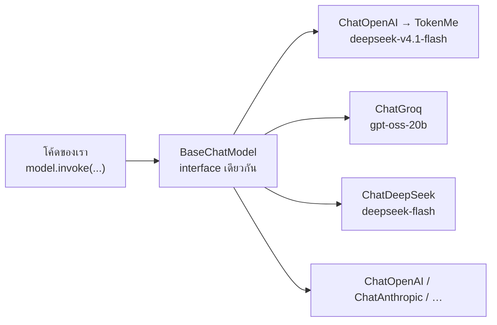

# Part 03 — Chat Models & Model Configuration

ระดับ: Beginner · เวลา: 60 นาที · ตัวอย่าง: `examples/part-03/` · Workshop: `workshops/part-03/`

## 1. Introduction

Part 02 เรียก model ได้แล้ว แต่ model แต่ละตัวต่างกันที่ความเร็ว คุณภาพ ราคา และพฤติกรรม
Part นี้สอนปรับ **configuration**, อ่าน **metadata/token usage**, และ **เลือก/สลับ** model กับ provider
**ปัญหา:** ถ้าไม่เข้าใจ config เราจะเจอคำตอบว่างเปล่า ค่าใช้จ่ายบานปลาย หรือผูกติดกับ provider เดียว

## 2. Learning Objectives

เข้าใจ Chat Model abstraction และ config หลัก (model name, temperature, maxTokens, timeout, maxRetries, baseUrl)
อ่าน `AIMessage` metadata/token usage ได้ เลือก model ให้เหมาะกับงาน และสลับ model/provider ได้โดยแก้โค้ดน้อยที่สุด

## 3. Concept Explanation

### 3.1 Chat Model และ Abstraction

- **Language Model (แบบเก่า):** รับ string คืน string
- **Chat Model:** รับ **ลิสต์ของ message** (system/human/ai) คืน `AIMessage` — ทุก provider หลักเป็นแบบนี้
- **`BaseChatModel`:** class แม่ของ Chat Model ทุกตัวใน LangChain มี interface ร่วมกัน (`invoke`, `stream`, `batch`, `bindTools`, `withStructuredOutput`)
- **Model Abstraction:** โค้ดเรียก `model.invoke(...)` เหมือนกัน ไม่ว่าข้างหลังเป็น TokenMe, Groq, DeepSeek, OpenAI, Anthropic หรือ Google

### 3.2 Provider vs Model

**Provider** = ผู้ให้บริการ/ช่องทางเรียก (TokenMe, Groq, DeepSeek, OpenAI, Anthropic, Google, OpenRouter, Ollama ฯลฯ)
**Model** = ตัว model ที่ provider โฮสต์ (`deepseek-ai/deepseek-v4.1-flash-1017`, `openai/gpt-oss-20b`) — model เดียวกันอาจมีหลาย provider (เช่น gpt-oss บน Groq หรือ OpenRouter)

| กลุ่ม | ตัวอย่าง |
|---|---|
| Provider ตรง | OpenAI, Anthropic, Google, DeepSeek, Groq |
| Gateway/รวมหลายเจ้า | OpenRouter |
| OpenAI-compatible | provider ที่ใช้ API format แบบ OpenAI (ตั้ง `baseUrl`) — เช่น TokenMe ที่ repo นี้ใช้เป็นค่าเริ่มต้น |
| Local | Ollama, LM Studio (รันบนเครื่อง) |

### 3.3 Configuration

| Config | ความหมาย | หมายเหตุ |
|---|---|---|
| `model` | ชื่อ model | ต้องตรงกับ provider |
| `temperature` | ความสุ่ม (0 = นิ่ง, สูง = หลากหลาย) | reasoning model บางตัวไม่รองรับ/ไม่แนะนำให้ปรับ |
| `maxTokens` | เพดาน token ของคำตอบ | reasoning model นับ token ที่ "คิด" รวมด้วย |
| `timeout` | ms ที่รอ provider | กัน request ค้าง |
| `maxRetries` | ลองใหม่เมื่อ error ชั่วคราว | ค่าสูง = หน่วงนานเมื่อมีปัญหา |
| `baseUrl` | ที่อยู่ API | ใช้กับ gateway/OpenAI-compatible/local |
| option เฉพาะ provider | เช่น `reasoningEffort` ของ Groq, `chat_template_kwargs.enable_thinking` ของ TokenMe | ไม่ portable ข้าม provider |

### 3.4 Response

`AIMessage` มี `content`, `content` แบบ blocks (บาง model), `response_metadata` (finish_reason, id, model, usage ดิบจาก provider),
`usage_metadata` (`input_tokens`, `output_tokens`, `total_tokens` แบบมาตรฐานของ LangChain)

**finish_reason:** `stop` = จบปกติ · `length` = ชน `maxTokens` (คำตอบอาจถูกตัดหรือว่าง) · `tool_calls` = model ขอเรียก tool

### 3.5 Model Characteristics และการเลือก

- **Deterministic vs Non-deterministic:** LLM ไม่การันตีผลเหมือนเดิม แม้ `temperature: 0`
- **Capability:** context window, reasoning, tool calling, structured output, multimodal — แต่ละ model ไม่เท่ากัน ตรวจจากเอกสาร provider
- **เลือกตามงาน:** Fast model (งานง่าย/ปริมาณมาก) · Reasoning model (งานซับซ้อน) · เทียบ **Cost / Latency / Quality**

## 4. Problem Demonstration

รัน `pnpm play 3-3` — กรณี (ก) เปิดโหมดคิดของ TokenMe (ค่าเริ่มต้น) ที่ `maxTokens` ต่ำ จะได้ **คำตอบว่าง** ทั้งที่ไม่มี error:

```
ก) เปิดโหมดคิด             maxTokens=60
  finish_reason: length
  output_tokens: 60 | reasoning: 59
  ความยาวคำตอบ: 0 ตัวอักษร (ว่าง! token หมดไปกับการคิด)
```

สาเหตุ: โมเดลเป็น **reasoning model** ใช้ token คิดก่อนตอบ และนับรวมใน `maxTokens` — เราเห็นปัญหานี้จริงตอนทดสอบหลักสูตรนี้
(แม้ตั้ง 300 ก็ยังว่าง เพราะการคิดใช้ไป 299 token)

## 5. Solution

- ปิดโหมดคิดเมื่องานไม่ต้องใช้ (`thinking: false` ใน `createChatModel` — ส่ง option เฉพาะ provider ให้ถูกตัว) และเผื่อ `maxTokens` ให้พอ
- เช็ก `finish_reason` เสมอ ถ้าเป็น `length` ถือว่าคำตอบไม่สมบูรณ์
- รวม config เป็นฟังก์ชันเดียว — ใน repo นี้คือ `createChatModel()` (`src/models/index.ts`): TokenMe ส่ง `chat_template_kwargs.enable_thinking: false`, DeepSeek ส่ง `thinking: {type:"disabled"}`, Groq gpt-oss ใช้ `reasoningEffort: "low"` เป็นค่าเริ่มต้น

```ts
// src/models/index.ts (ย่อ)
const model = await createChatModel({ temperature: 0, maxTokens: 3000, thinking: false }); // ค่าเริ่มต้น provider = tokenme
```

**ข้อจำกัดของ abstraction:** interface เหมือนกัน แต่ option เฉพาะ provider (เช่น `reasoningEffort`), ชื่อ model, ขีดความสามารถ และรูปแบบ usage metadata ยังต่างกัน
ต้องทดสอบเมื่อสลับ provider (เช่น Groq ไม่รายงาน `output_token_details.reasoning` แต่ TokenMe/DeepSeek รายงาน)

## 6. Visual Explanation



| | เร็ว/ถูก | ช้า/แพง |
|---|---|---|
| **งานง่าย** (จัดหมวด สรุปสั้น) | ✅ Fast model | เกินความจำเป็น |
| **งานยาก** (เหตุผลหลายขั้น, โค้ด) | อาจไม่พอ | ✅ Reasoning / model ใหญ่ |

## 7. Coding Examples

รัน `pnpm play 3-N` (ต้องมี `TOKENME_API_KEY`; 03-07 และ workshop เทียบ `GROQ_API_KEY` / `DEEPSEEK_API_KEY` ด้วย — ตัวไหนไม่มี key จะถูกข้าม)
ผลลัพธ์ที่ให้ไว้คือ *ตัวอย่างผลลัพธ์ — LLM ไม่ได้ตอบเหมือนเดิมทุกครั้ง* (ตรวจกับ TokenMe `deepseek-ai/deepseek-v4.1-flash-1017`, Groq `openai/gpt-oss-20b`, DeepSeek `deepseek-flash`)

### 03-01 Configure Chat Model — ตั้ง temperature, maxTokens, timeout, maxRetries, option เฉพาะ provider
```
ชื่อ: **ส้มจี๊ด**

เหตุผล: "จี๊ด" เป็นคำที่ฟังดูน่ารัก สดใส และมีเสียงสูงเหมือนแมวสีส้มที่ขี้เล่น ช่างพูด ช่างอ้อน อีกทั้งยังจำง่ายและเรียกแล้วรู้สึกเอ็นดู
```

### 03-02 Compare Temperature — temperature 0 vs 1.5 อย่างละ 3 รอบ
```
--- temperature = 0 ---
รอบ 1: ฟ้าครึ้มคาเฟ่
รอบ 2: ฟ้าครึ้มคาเฟ่
รอบ 3: กลิ่นฝนคาเฟ่

--- temperature = 1.5 ---
รอบ 1: คาเฟ่ตะวันฉาย
รอบ 2: โมเมนต์คอฟฟี่
รอบ 3: ınละมุนคาเฟ่
```
สังเกต: temperature สูงมากทำให้คำตอบหลากหลายแต่เริ่มเพี้ยน (บางรอบมีตัวอักษรแปลกปน) และ temperature 0 ก็ไม่การันตีว่าซ้ำเป๊ะทุกรอบ

### 03-03 Limit Output Tokens — เปิด/ปิดโหมดคิด
```
ก) เปิดโหมดคิด             maxTokens=60
  finish_reason: length
  output_tokens: 60 | reasoning: 59
  ความยาวคำตอบ: 0 ตัวอักษร (ว่าง! token หมดไปกับการคิด)

ก) เปิดโหมดคิด             maxTokens=300
  finish_reason: length
  output_tokens: 300 | reasoning: 300
  ความยาวคำตอบ: 0 ตัวอักษร (ว่าง! token หมดไปกับการคิด)

ข) ปิดโหมดคิด              maxTokens=30
  finish_reason: length
  output_tokens: 30 | reasoning: 0
  ความยาวคำตอบ: 75 ตัวอักษร 

ข) ปิดโหมดคิด              maxTokens=300
  finish_reason: length
  output_tokens: 300 | reasoning: 0
  ความยาวคำตอบ: 666 ตัวอักษร 
```
สังเกต: ปิดโหมดคิดแล้ว `reasoning: 0` และ token ทั้งหมดกลายเป็นคำตอบ (`finish_reason: length` ใน 2 กรณีหลังหมายถึงชนเพดานที่เราตั้งไว้เองจงใจ — คำตอบถูกตัดแต่ไม่ว่าง)

### 03-04 Inspect Response Metadata
```
content: 2
id: undefined
finish_reason: stop
model: undefined
keys ของ response_metadata: [
  'tokenUsage',
  'finish_reason',
  'normalized_finish_reason',
  'model_provider',
  'model_name',
  'usage'
]
tool_calls: []
```
สังเกต: `id` และ `model` เป็น `undefined` เพราะ TokenMe ใส่ชื่อ model ไว้ใน `response_metadata.model_name` — อย่าสมมติชื่อ field ของ provider

### 03-05 Inspect Token Usage
```
prompt สั้น (6 ตัวอักษร)
  usage_metadata: {
  output_tokens: 39,
  input_tokens: 34,
  total_tokens: 73,
  input_token_details: { audio: undefined, cache_read: 0 },
  output_token_details: { audio: undefined, reasoning: 22 }
}
  completion_tokens_details: { reasoning_tokens: 22 }

prompt ยาว (90 ตัวอักษร)
  usage_metadata: {
  output_tokens: 1342,
  input_tokens: 53,
  total_tokens: 1395,
  input_token_details: { audio: undefined, cache_read: 0 },
  output_token_details: { audio: undefined, reasoning: 909 }
}
  completion_tokens_details: { reasoning_tokens: 909 }
```
สังเกต: prompt สั้นมากแต่ `input_tokens` ยังเกิน 30 เพราะ provider/แม่แบบ chat เติม token ระบบเข้าไปด้วย และ `output_tokens` รวม token ที่ใช้คิด (`reasoning`)

### 03-06 Switch Model — deepseek-v4.1-flash vs qwen3.8-27b
```
=== deepseek-ai/deepseek-v4.1-flash-1017 ===
เวลา: 4362 ms | token: {"output_tokens":369,"input_tokens":50,"total_tokens":419,"input_token_details":{"cache_read":0},"output_token_details":{"reasoning":295}}
Recursion คือการที่ปัญหาหนึ่งเรียกตัวเองซ้ำ ๆ แต่ทำโจทย์ให้เล็กลงทุกครั้งจนกว่าจะง่ายพอที่จะตอบได้ทันที. เหมือนกับแกะตุ๊กตาลูกโซ่ทีละชั้นจนเจอตัวเล็กสุด แล้วค่อย ๆ ใส่กลับคืนมา.

=== unsloth/qwen3.8-27b-nvfp4 ===
เวลา: 15516 ms | token: {"output_tokens":517,"input_tokens":28,"total_tokens":545,"input_token_details":{"cache_read":0},"output_token_details":{"reasoning":423}}
ลองนึกภาพว่าพ่อให้ไปบอกแม่ → แม่ให้ไปบอกป้า → ป้าให้ไปบอกน้า… แต่ละคนทำสิ่งเดียวกันคือ "บอกให้คนถัดไปทำต่อ" แต่สุดท้ายมีคนบอกว่า "พอแล้ว ไม่ต้องบอกต่อ"

Recursion ก็เหมือนอย่างนั้นแหละ คือการทำสิ่งเดิมซ้ำแล้วซ้ำไป แต่แต่ละรอบจะ "เล็กลง" หรือ "ใกล้จุดหมายขึ้น" จนในที่สุดมันหยุดได้ 🪞
```
สังเกต: prompt เดียวกัน ต่าง model ใช้เวลาและ token ต่างกันมาก (4.4 วินาที/369 token เทียบ 15.5 วินาที/517 token) — ควรวัดเองก่อนเลือก

### 03-07 Switch Provider — TokenMe vs Groq vs DeepSeek
```
=== tokenme ===
เวลา: 3675 ms | token: {"output_tokens":372,"input_tokens":50,"total_tokens":422,"input_token_details":{"cache_read":0},"output_token_details":{"reasoning":289}}
Recursion คือการที่ฟังก์ชันหนึ่งเรียกตัวเองซ้ำ ๆ เพื่อแก้ปัญหาที่ใหญ่ให้เล็กลง เหมือนตุ๊กตาลูกโซ่ที่ข้างในมีตัวมันเองอีกตัว  
แต่ต้องมีจุดหยุดที่ชัดเจน ไม่งั้นจะเรียกตัวเองไปเรื่อย ๆ ไม่จบเหมือนกระจกสองบานส่องกัน

=== groq ===
เวลา: 623 ms | token: {"input_tokens":93,"output_tokens":106,"total_tokens":199}
Recursion คือการให้โปรแกรมทำงานตัวเองซ้ำ ๆ แบบเหมือนกับการเอาแกะเล็ก ๆ มาบรรจุในกระเป๋า แล้วบอกว่า “ถ้าแกะเล็ก ๆ ยังมีอีก ให้ทำเหมือนเดิมต่อ” จนกระทั่งแกะเล็ก ๆ หายไป แล้วโปรแกรมก็จะกลับมาเสร็จสิ้นขั้นตอนทั้งหมด.

=== deepseek ===
เวลา: 3067 ms | token: {"output_tokens":391,"input_tokens":50,"total_tokens":441,"input_token_details":{"cache_read":0},"output_token_details":{"reasoning":290}}
Recursion คือการแก้ปัญหาโดยใช้วิธีเดิมซ้ำ ๆ กับปัญหาที่เล็กลงกว่าเดิม เช่น ถามว่า “ตุ๊กตาซ้อนตุ๊กตามีกี่ตัว?” ก็เปิดตัวนอกสุดแล้วถามคำถามเดิมกับตุ๊กตาที่เหลือข้างใน. ต้องมีจุดหยุดเสมอ เช่น เจอตัวสุดท้ายแล้วหยุด ไม่อย่างนั้นจะถามซ้ำไปเรื่อย ๆ ไม่จบ.
```
สังเกต: โค้ดเหมือนเดิม แต่ latency, ขนาด token และรูปแบบ usage ต่างกัน (Groq เร็วที่สุดและไม่รายงาน reasoning)

## 8. Common Mistakes

| ข้อผิดพลาด | สาเหตุ | ตรวจ/แก้ |
|---|---|---|
| คำตอบว่างเปล่าไม่มี error | reasoning model ใช้ token คิดจนชน `maxTokens` | เช็ก `finish_reason === "length"`; เพิ่ม `maxTokens`; ปิด/ลดโหมดคิด (`thinking: false` หรือ `reasoningEffort`) |
| คิดว่า `temperature: 0` = ผลเหมือนเดิมเสมอ | ความ non-deterministic ระดับระบบ | อย่าเขียน test ที่เทียบข้อความเป๊ะ |
| `usage_metadata` บางฟิลด์เป็น `undefined` | provider รายงานไม่ครบ | เช็ก optional chaining; อย่าสมมติรูปแบบ |
| สลับ provider แล้วพัง | option เฉพาะ provider / ชื่อ model ผิด | แยก option เฉพาะ provider ไว้ที่ factory (`createChatModel`) |
| ตั้ง `maxRetries` สูง ทำให้ค้างนาน | retry ซ้ำเมื่อ provider ล่ม | ตั้ง `timeout` ร่วมด้วย |

## 9. Best Practices

- รวมการสร้าง model ไว้ที่เดียว (factory) — เปลี่ยน model/provider จุดเดียว (Maintainability)
- เช็ก `finish_reason` และ `usage_metadata` เป็นนิสัย (Cost/Quality)
- ใช้ model เล็ก/เร็วกับงานง่าย; ใช้ใหญ่เฉพาะที่จำเป็น (Cost/Latency)
- ตั้ง `timeout` และ `maxRetries` ให้เหมาะกับ UX (Performance)
- เก็บชื่อ model/key ใน env หรือ config ไม่ hardcode (Security/Maintainability)

## 10. Exercises

**Basic:** รัน 03-02 แล้วลอง `temperature` 0.7 อธิบายความต่างจาก 0 และ 1.5
**Intermediate:** แก้ 03-03 ให้ตรวจ `finish_reason` แล้วพิมพ์เตือนอัตโนมัติเมื่อคำตอบถูกตัด
**Challenge:** เขียนฟังก์ชัน `invokeComplete(model, prompt)` ที่ถ้า `finish_reason === "length"` ให้เรียกซ้ำด้วย `maxTokens` สองเท่า (สูงสุด 3 ครั้ง)

## 11. Workshop

ดู [`workshops/part-03/README.md`](../../workshops/part-03/README.md) — เปรียบเทียบ prompt เดียวกันข้ามหลาย config/model/provider

## 12. Summary

- Chat Model = interface ร่วม (`BaseChatModel`) ที่ซ่อนความต่างของ provider
- Config หลัก: model, temperature, maxTokens, timeout, maxRetries, baseUrl + option เฉพาะ provider
- อ่าน `finish_reason`, `usage_metadata` ทุกครั้งที่ต้องดูคุณภาพ/ต้นทุน
- Reasoning model ใช้ token คิด — ระวัง `maxTokens` ต่ำเกินไป
- API: `initChatModel`, `createChatModel` (ของ repo), `AIMessage.usage_metadata/response_metadata`

## 13. Knowledge Check

1. (Concept) Provider กับ Model ต่างกันอย่างไร? ยกตัวอย่าง model เดียวกันที่มีหลาย provider
2. (Concept) ทำไม `finish_reason: "length"` ควรถูกถือเป็นสัญญาณเตือน?
3. (Code reading) ใน 03-03 ถ้า `maxTokens=60` (กรณี ก) แล้วความยาวคำตอบเป็น 0 แต่ `reasoning` เกือบเท่า `output_tokens` แปลว่าอะไร?
4. (Practical) งานจัดหมวดหมู่อีเมลวันละ 10,000 ฉบับ ควรเลือก model แบบไหน เพราะอะไร?
5. (Practical) ถ้าเปลี่ยนจาก Groq เป็น TokenMe/DeepSeek แล้วโค้ดที่ใช้ `reasoningEffort` พัง ควรแก้อย่างไร?

## 14. Next Part

Part 04 ใช้ Chat Model นี้กับ **messages** (System/Human/AI) เพื่อสร้างบทสนทนาหลายรอบ และเข้าใจว่าทำไม model ถึง "จำ" เองไม่ได้
