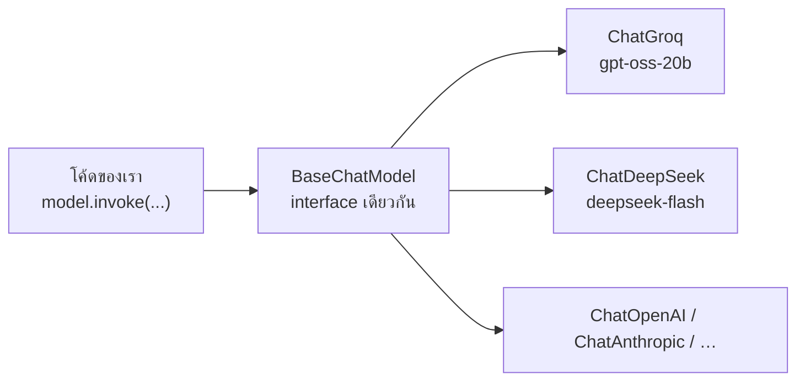

# Part 03 — Chat Models & Model Configuration

ระดับ: Beginner · เวลา: 60 นาที · ตัวอย่าง: `examples/part-03/` · Workshop: `workshops/part-03/`

## 1. Introduction

Part 02 เรียก model ได้แล้ว แต่ model แต่ละตัวต่างกันที่ความเร็ว คุณภาพ ราคา และพฤติกรรม
Part นี้สอนปรับ **configuration**, อ่าน **metadata/token usage**, และ **เลือก/สลับ** model กับ provider
**ปัญหา:** ถ้าไม่เข้าใจ config เราจะเจอคำตอบว่างเปล่า ค่าใช้จ่ายบานปลาย หรือผูกติดกับ provider เดียว

## 2. Learning Objectives

เข้าใจ Chat Model abstraction และ config หลัก (model name, temperature, maxTokens, timeout, maxRetries, baseUrl)
อ่าน `AIMessage` metadata/token usage ได้ เลือก model ให้เหมาะกับงาน และสลับ model/provider ได้โดยแก้โค้ดน้อยที่สุด

## 3. Concept Explanation

### 3.1 Chat Model และ Abstraction

- **Language Model (แบบเก่า):** รับ string คืน string
- **Chat Model:** รับ **ลิสต์ของ message** (system/human/ai) คืน `AIMessage` — ทุก provider หลักเป็นแบบนี้
- **`BaseChatModel`:** class แม่ของ Chat Model ทุกตัวใน LangChain มี interface ร่วมกัน (`invoke`, `stream`, `batch`, `bindTools`, `withStructuredOutput`)
- **Model Abstraction:** โค้ดเรียก `model.invoke(...)` เหมือนกัน ไม่ว่าข้างหลังเป็น Groq, DeepSeek, OpenAI, Anthropic หรือ Google

### 3.2 Provider vs Model

**Provider** = ผู้ให้บริการ/ช่องทางเรียก (Groq, DeepSeek, OpenAI, Anthropic, Google, OpenRouter, Ollama ฯลฯ)
**Model** = ตัว model ที่ provider โฮสต์ (`openai/gpt-oss-20b`, `deepseek-flash`) — model เดียวกันอาจมีหลาย provider (เช่น gpt-oss บน Groq หรือ OpenRouter)

| กลุ่ม | ตัวอย่าง |
|---|---|
| Provider ตรง | OpenAI, Anthropic, Google, DeepSeek, Groq |
| Gateway/รวมหลายเจ้า | OpenRouter |
| OpenAI-compatible | provider ที่ใช้ API format แบบ OpenAI (ตั้ง `baseUrl`) |
| Local | Ollama, LM Studio (รันบนเครื่อง) |

### 3.3 Configuration

| Config | ความหมาย | หมายเหตุ |
|---|---|---|
| `model` | ชื่อ model | ต้องตรงกับ provider |
| `temperature` | ความสุ่ม (0 = นิ่ง, สูง = หลากหลาย) | reasoning model บางตัวไม่รองรับ/ไม่แนะนำให้ปรับ |
| `maxTokens` | เพดาน token ของคำตอบ | reasoning model นับ token ที่ "คิด" รวมด้วย |
| `timeout` | ms ที่รอ provider | กัน request ค้าง |
| `maxRetries` | ลองใหม่เมื่อ error ชั่วคราว | ค่าสูง = หน่วงนานเมื่อมีปัญหา |
| `baseUrl` | ที่อยู่ API | ใช้กับ gateway/OpenAI-compatible/local |
| option เฉพาะ provider | เช่น `reasoningEffort` ของ Groq | ไม่ portable ข้าม provider |

### 3.4 Response

`AIMessage` มี `content`, `content` แบบ blocks (บาง model), `response_metadata` (finish_reason, id, model, usage ดิบจาก provider),
`usage_metadata` (`input_tokens`, `output_tokens`, `total_tokens` แบบมาตรฐานของ LangChain)

**finish_reason:** `stop` = จบปกติ · `length` = ชน `maxTokens` (คำตอบอาจถูกตัดหรือว่าง) · `tool_calls` = model ขอเรียก tool

### 3.5 Model Characteristics และการเลือก

- **Deterministic vs Non-deterministic:** LLM ไม่การันตีผลเหมือนเดิม แม้ `temperature: 0`
- **Capability:** context window, reasoning, tool calling, structured output, multimodal — แต่ละ model ไม่เท่ากัน ตรวจจากเอกสาร provider
- **เลือกตามงาน:** Fast model (งานง่าย/ปริมาณมาก) · Reasoning model (งานซับซ้อน) · เทียบ **Cost / Latency / Quality**

## 4. Problem Demonstration

รัน `pnpm play 3-3` ในรูปแบบเดิมที่ไม่ตั้ง reasoning effort ด้วย gpt-oss ที่ `maxTokens` ต่ำ จะได้ **คำตอบว่าง** ทั้งที่ไม่มี error:

```
maxTokens=150
  finish_reason: length
  output_tokens: 150
  ความยาวคำตอบ: 0 ตัวอักษร (ว่าง! token หมดไปกับการคิด)
```

สาเหตุ: gpt-oss เป็น **reasoning model** ใช้ token คิดก่อนตอบ และนับรวมใน `maxTokens` — เราเห็นปัญหานี้จริงตอนทดสอบหลักสูตรนี้
(แม้ตั้ง 1000 ก็ยังเจอว่างเป็นบางครั้ง)

## 5. Solution

- ตั้ง `reasoningEffort: "low"` (option เฉพาะ Groq + gpt-oss) และเผื่อ `maxTokens` ให้พอ
- เช็ก `finish_reason` เสมอ ถ้าเป็น `length` ถือว่าคำตอบไม่สมบูรณ์
- รวม config เป็นฟังก์ชันเดียว — ใน repo นี้คือ `createChatModel()` (`src/models/index.ts`) ใช้ `reasoningEffort: "low"` เป็นค่าเริ่มต้นกับ gpt-oss

```ts
// src/models/index.ts (ย่อ)
const model = await createChatModel({ provider: "groq", temperature: 0, maxTokens: 3000 });
```

**ข้อจำกัดของ abstraction:** interface เหมือนกัน แต่ option เฉพาะ provider (เช่น `reasoningEffort`), ชื่อ model, ขีดความสามารถ และรูปแบบ usage metadata ยังต่างกัน
ต้องทดสอบเมื่อสลับ provider (เช่น DeepSeek รายงาน `output_token_details.reasoning` ต่างจาก Groq)

## 6. Visual Explanation



| | เร็ว/ถูก | ช้า/แพง |
|---|---|---|
| **งานง่าย** (จัดหมวด สรุปสั้น) | ✅ Fast model | เกินความจำเป็น |
| **งานยาก** (เหตุผลหลายขั้น, โค้ด) | อาจไม่พอ | ✅ Reasoning / model ใหญ่ |

## 7. Coding Examples

รัน `pnpm play 3-N` (ต้องมี `GROQ_API_KEY`; 03-07 และ workshop ใช้ `DEEPSEEK_API_KEY` ด้วย — ถ้าไม่มีจะข้าม)
ผลลัพธ์ที่ให้ไว้คือ *ตัวอย่างผลลัพธ์ — LLM ไม่ได้ตอบเหมือนเดิมทุกครั้ง* (ตรวจกับ Groq `openai/gpt-oss-20b`, DeepSeek `deepseek-flash`)

### 03-01 Configure Chat Model — ตั้ง temperature, maxTokens, timeout, maxRetries, reasoningEffort
```
**ชื่อ:** โอริโอ

**เหตุผลสั้น ๆ:**
โอริโอเป็นชื่อที่เล่นกับสีขาว-ดำของขนแมว …
```

### 03-02 Compare Temperature — temperature 0 vs 1.5 อย่างละ 3 รอบ
```
--- temperature = 0 ---
รอบ 1: บัวกาแฟ (Bua Coffee)
รอบ 2: บัวกาแฟ (Bua Coffee)
รอบ 3: บัวกาแฟ (Bua Coffee)

--- temperature = 1.5 ---
รอบ 1: กาแฟสู่ฝัน (Kaffè Sūu Than)
รอบ 2: Caféโคตรใส่ใจ
รอบ 3: สายน้ำพุ่งกาแฟเมล่าถังกาแฟ
```
สังเกต: temperature สูงมากทำให้คำตอบหลากหลายแต่เริ่มเพี้ยน

### 03-03 Limit Output Tokens
```
maxTokens=30   finish_reason: length  output_tokens: 30   ความยาวคำตอบ: 37 ตัวอักษร
maxTokens=300  finish_reason: length  output_tokens: 300  ความยาวคำตอบ: 670 ตัวอักษร
maxTokens=3000 finish_reason: stop    output_tokens: 991  ความยาวคำตอบ: 2221 ตัวอักษร
```

### 03-04 Inspect Response Metadata
```
content: 1 + 1 เท่ากับ **2**.
id: chatcmpl-0eca21cf-…
finish_reason: stop
model: openai/gpt-oss-20b
keys ของ response_metadata: [ 'tokenUsage', 'finish_reason', 'id', 'model', 'usage', … ]
tool_calls: []
```

### 03-05 Inspect Token Usage
```
prompt สั้น (6 ตัวอักษร)
  usage_metadata: { input_tokens: 75, output_tokens: 56, total_tokens: 131 }
  completion_tokens_details: { reasoning_tokens: 21 }
prompt ยาว (90 ตัวอักษร)
  usage_metadata: { input_tokens: 96, output_tokens: 570, total_tokens: 666 }
```
สังเกต: prompt "สวัสดี" สั้นมาก แต่ `input_tokens` = 75 เพราะ provider/แม่แบบ chat เติม token ระบบเข้าไปด้วย

### 03-06 Switch Model — gpt-oss-20b vs gpt-oss-120b
```
=== openai/gpt-oss-20b ===   เวลา: 811 ms | output 164 tokens
=== openai/gpt-oss-120b ===  เวลา: 921 ms | output 150 tokens
```

### 03-07 Switch Provider — Groq vs DeepSeek
```
=== groq ===      เวลา: 624 ms  | token: {"input_tokens":93,"output_tokens":150,…}
=== deepseek ===  เวลา: 3693 ms | token: {"output_tokens":323,"input_tokens":50,…,"output_token_details":{"reasoning":245}}
```
สังเกต: โค้ดเหมือนเดิม แต่ latency, ขนาด token และรูปแบบ usage ต่างกัน

## 8. Common Mistakes

| ข้อผิดพลาด | สาเหตุ | ตรวจ/แก้ |
|---|---|---|
| คำตอบว่างเปล่าไม่มี error | reasoning model ใช้ token คิดจนชน `maxTokens` | เช็ก `finish_reason === "length"`; เพิ่ม `maxTokens`; ลด `reasoningEffort` |
| คิดว่า `temperature: 0` = ผลเหมือนเดิมเสมอ | ความ non-deterministic ระดับระบบ | อย่าเขียน test ที่เทียบข้อความเป๊ะ |
| `usage_metadata` บางฟิลด์เป็น `undefined` | provider รายงานไม่ครบ | เช็ก optional chaining; อย่าสมมติรูปแบบ |
| สลับ provider แล้วพัง | option เฉพาะ provider / ชื่อ model ผิด | แยก option เฉพาะ provider ไว้ที่ factory (`createChatModel`) |
| ตั้ง `maxRetries` สูง ทำให้ค้างนาน | retry ซ้ำเมื่อ provider ล่ม | ตั้ง `timeout` ร่วมด้วย |

## 9. Best Practices

- รวมการสร้าง model ไว้ที่เดียว (factory) — เปลี่ยน model/provider จุดเดียว (Maintainability)
- เช็ก `finish_reason` และ `usage_metadata` เป็นนิสัย (Cost/Quality)
- ใช้ model เล็ก/เร็วกับงานง่าย; ใช้ใหญ่เฉพาะที่จำเป็น (Cost/Latency)
- ตั้ง `timeout` และ `maxRetries` ให้เหมาะกับ UX (Performance)
- เก็บชื่อ model/key ใน env หรือ config ไม่ hardcode (Security/Maintainability)

## 10. Exercises

**Basic:** รัน 03-02 แล้วลอง `temperature` 0.7 อธิบายความต่างจาก 0 และ 1.5
**Intermediate:** แก้ 03-03 ให้ตรวจ `finish_reason` แล้วพิมพ์เตือนอัตโนมัติเมื่อคำตอบถูกตัด
**Challenge:** เขียนฟังก์ชัน `invokeComplete(model, prompt)` ที่ถ้า `finish_reason === "length"` ให้เรียกซ้ำด้วย `maxTokens` สองเท่า (สูงสุด 3 ครั้ง)

## 11. Workshop

ดู [`workshops/part-03/README.md`](../../workshops/part-03/README.md) — เปรียบเทียบ prompt เดียวกันข้ามหลาย config/model/provider

## 12. Summary

- Chat Model = interface ร่วม (`BaseChatModel`) ที่ซ่อนความต่างของ provider
- Config หลัก: model, temperature, maxTokens, timeout, maxRetries, baseUrl + option เฉพาะ provider
- อ่าน `finish_reason`, `usage_metadata` ทุกครั้งที่ต้องดูคุณภาพ/ต้นทุน
- Reasoning model ใช้ token คิด — ระวัง `maxTokens` ต่ำเกินไป
- API: `initChatModel`, `createChatModel` (ของ repo), `AIMessage.usage_metadata/response_metadata`

## 13. Knowledge Check

1. (Concept) Provider กับ Model ต่างกันอย่างไร? ยกตัวอย่าง model เดียวกันที่มีหลาย provider
2. (Concept) ทำไม `finish_reason: "length"` ควรถูกถือเป็นสัญญาณเตือน?
3. (Code reading) ใน 03-03 ถ้า `maxTokens=150` แล้วความยาวคำตอบเป็น 0 แปลว่าอะไร?
4. (Practical) งานจัดหมวดหมู่อีเมลวันละ 10,000 ฉบับ ควรเลือก model แบบไหน เพราะอะไร?
5. (Practical) ถ้าเปลี่ยนจาก Groq เป็น DeepSeek แล้วโค้ดที่ใช้ `reasoningEffort` พัง ควรแก้อย่างไร?

## 14. Next Part

Part 04 ใช้ Chat Model นี้กับ **messages** (System/Human/AI) เพื่อสร้างบทสนทนาหลายรอบ และเข้าใจว่าทำไม model ถึง "จำ" เองไม่ได้
