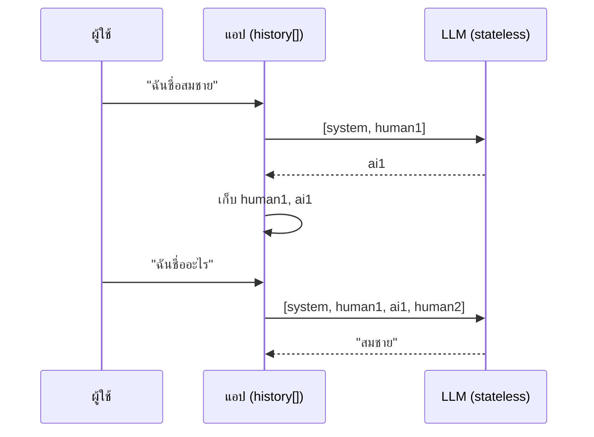

# Part 04 — Messages & Conversation

ระดับ: Beginner · เวลา: 60–90 นาที · ตัวอย่าง: `examples/part-04/` · Workshop: `workshops/part-04/`

## 1. Introduction

แชตบอตที่ "จำ" ได้ดูเหมือนว่า model จำเอง แต่จริงๆ ไม่ใช่ — แอปของเรา **ส่งประวัติทั้งหมดไปใหม่ทุกครั้ง**
Part นี้สอนโครงสร้าง **Message** ที่ model ใช้อ่านบทสนทนา และวิธีจัดการประวัติด้วยตัวเอง
**ปัญหา:** ถ้าไม่เข้าใจเรื่องนี้ จะงงว่าทำไมบอตลืมชื่อผู้ใช้ และทำไมค่าใช้จ่ายเพิ่มขึ้นเรื่อยๆ เมื่อคุยนาน

## 2. Learning Objectives

เข้าใจ role ของ message แต่ละชนิด, ทำไม LLM stateless, และ memory คือการจัดการ context ของแอป
ทำได้: สร้าง messages array, เพิ่ม/รีเซ็ตประวัติ, ตัดประวัติเมื่อยาว, สร้าง CLI chatbot หลายรอบ

## 3. Concept Explanation

### 3.1 Message คืออะไร
Message = ข้อความ 1 ก้อนที่มี **role** (ใครพูด), **content** (เนื้อหา — string หรือ array ของ content blocks เช่น text/รูป) และ **metadata**

| ชนิด | role (`.type`) | ใช้ทำอะไร |
|---|---|---|
| `SystemMessage` | `system` | กำหนดบทบาท พฤติกรรม ข้อจำกัด สไตล์ของ AI |
| `HumanMessage` | `human` | ข้อความจากผู้ใช้ |
| `AIMessage` | `ai` | คำตอบจาก model (มี `usage_metadata`, `tool_calls`) |
| `ToolMessage` | `tool` | ผลลัพธ์ของ tool ที่ส่งกลับให้ model (Part 09) |

### 3.2 SystemMessage
ใช้เขียน **คำสั่งระยะยาว**: บทบาท ("ครูสอนเขียนโปรแกรม"), พฤติกรรม, ข้อจำกัด ("ตอบไม่เกิน 3 ประโยค"), สไตล์ ใส่ไว้ต้น array เสมอ

### 3.3 Conversation และ Stateless
- **Single-turn:** ถาม 1 ครั้ง ตอบ 1 ครั้ง
- **Multi-turn:** คุยหลายรอบ — ข้อความหลังอาศัยบริบทข้อความก่อน
- **LLM stateless:** แต่ละ `invoke()` เป็นอิสระ model ไม่เก็บอะไรจากครั้งก่อน
  → **ความจำ = array ที่แอปเก็บ แล้วส่งกลับทั้งก้อนทุกครั้ง**

### 3.4 Context Management
ประวัติยิ่งยาว → `input_tokens` ยิ่งเยอะ → ช้าและแพง และชน **context window limit** ได้
วิธีเบื้องต้น: **Message Trimming** — เก็บเฉพาะข้อความล่าสุด (คง system ไว้ และเริ่มที่ human เสมอเพื่อให้ลำดับ human/ai ถูกต้อง)

## 4. Problem Demonstration

ตัวอย่าง **04-05** ถามสองรอบโดยไม่ส่งประวัติ:

```
รอบ 1 | คุณ: สวัสดี ฉันชื่อสมชาย
       AI: สวัสดีครับ สมชาย! ยินดีที่ได้รู้จักครับ …
รอบ 2 | คุณ: ฉันชื่ออะไร
       AI: ฉันไม่ทราบว่าคุณชื่ออะไรนะครับ/ค่ะ คุณช่วยบอกฉันได้ไหม?
→ model ไม่รู้ เพราะเราไม่ได้ส่งรอบ 1 ให้มัน (stateless)
```

## 5. Solution

เก็บประวัติเองใน `history: BaseMessage[]` แล้วส่งทั้งก้อน (04-06):

```ts
history.push(new HumanMessage(userText));       // 1) เพิ่มข้อความผู้ใช้
const reply = await model.invoke(history);       // 2) ส่ง "ทั้งประวัติ"
history.push(new AIMessage(messageText(reply))); // 3) เก็บคำตอบ
```

| ก่อน (04-05) | หลัง (04-06) |
|---|---|
| ส่งแค่คำถามล่าสุด → ลืม | ส่งทั้ง array → จำได้ |
| ความจำอยู่ที่ไหน? ไม่มี | ความจำอยู่ในตัวแปร `history` ของแอป |

## 6. Visual Explanation



Before vs After:

```
Before:  invoke([human2])                    → ไม่รู้ชื่อ
After :  invoke([system, h1, ai1, human2])   → รู้ชื่อ
```

## 7. Coding Examples

รัน `pnpm play 4-N` ผลลัพธ์ด้านล่างเป็น *ตัวอย่างผลลัพธ์ — LLM ไม่ได้ตอบเหมือนเดิมทุกครั้ง* (ตรวจกับ Groq `openai/gpt-oss-20b`)

> **หมายเหตุ provider:** ค่าเริ่มต้นของ repo ตอนนี้คือ **TokenMe** (`TOKENME_API_KEY`) — ทุกตัวอย่างถูกรันซ้ำบน TokenMe แล้วผ่าน แต่ข้อความ/ตัวเลข token/เวลาที่แสดงด้านล่างบันทึกไว้จากการรันบน Groq จึงจะไม่ตรงกับที่คุณเห็นเป๊ะ (ไม่ใช่ข้อผิดพลาด)

### 04-01 HumanMessage — สร้าง HumanMessage, ส่งเป็น array, ดูโครงสร้าง multimodal
```
type: human
content: ช่วยบอกวิธีทำไข่เจียว 3 ขั้นตอน ขั้นตอนละ 1 บรรทัด

AI: 1. ตอกไข่ลงในชามคนให้เข้ากันกับเกลือและพริกไทยเล็กน้อย;
2. ใส่น้ำมันลงในกระทะแล้วรอให้ร้อนพอแล้วเทไข่ลงไป …
3. พับไข่ครึ่งทางแล้วทอดต่อจนมีสีทองและกรอบ …

โครงสร้าง multimodal content: [{"type":"text","text":"รูปนี้คืออะไร"},{"type":"image_url","image_url":{"url":"https://example.com/cat.png"}}]
```

### 04-02 SystemMessage — เทียบ "ไม่มี" กับ "มี" system message
ไม่มี system → ตอบยาวหลายหัวข้อ/ตาราง (ย่อไว้) · มี system (ครู + อุปมาร้านอาหาร + ไม่เกิน 3 ประโยค):
```
API คือเมนูอาหารที่ร้านสั่งให้ทำ: คุณบอกว่าต้องการ “สลัดผัก” แล้วร้านจะจัดเตรียมให้ตามนั้น
เมนูนั้นมีวิธีสั่งชัดเจน (เช่น “ขนาดกลาง” หรือ “ไม่ใส่น้ำสลัด”) เพื่อให้ร้านเข้าใจได้ทันที
เมื่อร้านทำเสร็จแล้วคุณจะได้จานสลัดตามที่สั่ง ไม่ต้องเข้าไปทำเองเลย.
```

### 04-03 AIMessage — ดูโครงสร้าง, นำกลับมาใช้, สร้างเอง
```
เป็น AIMessage: true
type: ai
content: มะม่วง (มะม่วงสีเหลือง)
tool_calls: []
usage: { input_tokens: 86, output_tokens: 63, total_tokens: 149 }

ต่อบทสนทนา: ส้มโอ (ส้มโอสีแดง)

สร้างเอง: ai → กล้วย
```

### 04-04 Multiple Messages — สอนรูปแบบด้วยตัวอย่างบทสนทนา (system + human/ai สลับกัน)
```
ส่งไป 6 messages → 🐳
```

### 04-05 Stateless Conversation — (ดูหัวข้อ 4)

### 04-06 Manual Conversation History
```
คุณ: สวัสดี ฉันชื่อสมชาย และชอบกินส้มตำ
AI : สวัสดีครับ สมชาย! ส้มตำอร่อยดีครับ 😋

คุณ: ฉันชื่ออะไร
AI : คุณชื่อสมชายครับ.

คุณ: และฉันชอบกินอะไร
AI : คุณชอบกินส้มตำครับ.

จำนวน messages ในประวัติ: 7
```

### 04-07 Reset Conversation
```
คุณ: ฉันชื่ออะไร
AI : คุณชื่อสมชายครับ

--- reset: ล้างประวัติแล้ว ---

คุณ: ฉันชื่ออะไร
AI : ขออภัย ฉันไม่ทราบชื่อของคุณครับ/ค่ะ.
```

### 04-08 Interactive CLI Chatbot
รันจริง: `pnpm play 4-8` หรือทดสอบแบบจำลองการพิมพ์:
```bash
printf 'ฉันชื่อสมชาย\nฉันชื่ออะไร\n/reset\nฉันชื่ออะไร\n/exit\n' | pnpm play 4-8
```
```
คุณ > AI  > ยินดีที่ได้รู้จักครับ! สวัสดีครับสมชาย!
AI  > คุณชื่อสมชายครับ!
(ล้างประวัติแล้ว)
AI  > ขออภัย ฉันไม่ทราบชื่อของคุณครับ/ค่ะ 😅
ลาก่อน!
```
คุณสมบัติ: `/reset`, `/exit`, ตัดประวัติด้วย `trimMessages` (คง system, เริ่มที่ human), ถ้า turn ใดล้มเหลวจะแจ้ง error แล้วคุยต่อได้ และไม่พังเมื่อ stdin ปิด (Ctrl+D / pipe)

## 8. Common Mistakes

| ข้อผิดพลาด | สาเหตุ | ตรวจ/แก้ |
|---|---|---|
| บอตลืมทุกอย่าง | ไม่ส่งประวัติ / สร้าง array ใหม่ทุกรอบ | ประกาศ `history` นอกฟังก์ชัน และ push ทุกรอบ |
| ลำดับ role ผิด (human ติดกัน / ai ติดกัน) บางครั้ง provider ปฏิเสธ | push ไม่ครบ หรือไม่ลบข้อความที่ล้มเหลว | `history.pop()` เมื่อ turn ล้มเหลว; ตัดประวัติให้เริ่มที่ human |
| เก็บ `AIMessage` ทั้งก้อนที่ content เป็น array | ใช้ `.content` ตรงๆ แล้วเกิด `[object Object]` | ใช้ `messageText(reply)` |
| `SystemMessage` ไม่อยู่ต้น array | ใส่ผิดตำแหน่ง/ถูกตัดทิ้งตอน trim | ใช้ `includeSystem: true` |
| ค่าใช้จ่ายพุ่งตามความยาวแชต | ส่งประวัติทั้งหมดไม่จำกัด | trim / สรุปประวัติ (Part 12) |
| คิดว่าใส่ข้อมูลลับใน system แล้วผู้ใช้ไม่เห็น | system ไม่ใช่ที่เก็บความลับ | อย่าใส่ข้อมูลลับ; ผู้ใช้อาจหลอกถามได้ (Part 05) |

## 9. Best Practices

- **Readability:** ห่อ "เพิ่ม human → เรียก → เพิ่ม ai" ไว้ในฟังก์ชันเดียว (`chat()`)
- **Cost:** จำกัดความยาวประวัติ; ดู `input_tokens` ที่โตขึ้นตามแต่ละรอบ
- **Maintainability:** แยก system prompt เป็นค่าคงที่/ไฟล์ (Part 05)
- **Security:** ถือว่า HumanMessage คือ input ที่ไม่น่าเชื่อถือ; อย่าใส่ความลับใน system prompt
- **Reliability:** จัดการ error ต่อ turn เพื่อให้เซสชันไม่ตาย

## 10. Exercises

**Basic:** แก้ 04-02 ให้ SystemMessage กำหนดให้ตอบเป็นภาษาอังกฤษเท่านั้น แล้วถามเป็นภาษาไทย
**Intermediate:** เพิ่มคำสั่ง `/undo` ใน 04-08 ให้ลบคู่ human/ai ล่าสุดออกจากประวัติ
**Challenge:** เปลี่ยน `tokenCounter` ใน 04-08 จากนับจำนวนข้อความเป็นนับตัวอักษร (หรือประมาณ token) แล้วตั้ง `maxTokens` ตามนั้น

## 11. Workshop

ดู [`workshops/part-04/README.md`](../../workshops/part-04/README.md) — CLI Chatbot ที่คุยต่อเนื่องและจดจำข้อมูล

## 12. Summary

- Message = role + content + metadata; ชนิดหลัก System/Human/AI/Tool
- LLM stateless → memory = ประวัติที่แอปจัดการและส่งซ้ำทุกครั้ง
- ลำดับ message สำคัญ; reset = ล้าง array (คง system)
- ประวัติยาว = token/cost/ชน context window → ตัดด้วย `trimMessages`
- API: `SystemMessage`, `HumanMessage`, `AIMessage`, `trimMessages`, `model.invoke(messages[])`

## 13. Knowledge Check

1. (Concept) ทำไม "ความจำของแชตบอต" จึงไม่ได้อยู่ใน LLM?
2. (Concept) `SystemMessage` ต่างจาก `HumanMessage` อย่างไรในแง่ของการใช้งาน?
3. (Code reading) ใน 04-06 ถ้าลืมบรรทัด `history.push(new AIMessage(...))` จะเกิดอะไรขึ้นกับรอบถัดไป?
4. (Practical) บทสนทนายาว 200 รอบทำให้ error "context length exceeded" ควรแก้อย่างไรเบื้องต้น?
5. (Practical) ถ้า turn หนึ่งเรียก API ล้มเหลว ควรจัดการ `history` อย่างไรเพื่อไม่ให้ลำดับเพี้ยน?

## 14. Next Part

Part 05 พาเขียน system prompt/ข้อความให้เป็นระบบด้วย **Prompt Templates** — แยก prompt ออกจากโค้ด ใส่ตัวแปร ใช้ซ้ำ และเริ่มรู้จักความเสี่ยง prompt injection
