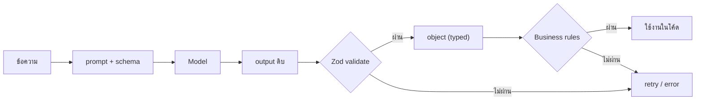

# Part 06 — Structured Output & Zod Schema

ระดับ: Beginner–Intermediate · เวลา: 90 นาที · ตัวอย่าง: `examples/part-06/` · Workshop: `workshops/part-06/`

## 1. Introduction

LLM ตอบเป็นข้อความ แต่โปรแกรมต้องการ **ข้อมูล** (ตัวเลข, enum, array) เพื่อนำไปคำนวณ บันทึก หรือแสดงผล
Part นี้สอนให้ model ตอบเป็น object ตาม **schema** ที่เรากำหนดด้วย **Zod** และตรวจสอบก่อนใช้
**ปัญหา:** ถ้าไม่มี schema เราต้องเดาโครงสร้างจากข้อความ (regex / `JSON.parse`) ซึ่งเปราะบาง

## 2. Learning Objectives

เข้าใจ unstructured/structured output, schema, runtime vs compile-time ·
ทำได้: เขียน Zod schema, ใช้ `withStructuredOutput()`, จัด classification ด้วย enum, ดึง nested object/array, ใช้ optional/nullable, ตรวจกฎธุรกิจ, จัดการ output ที่ไม่ถูกต้องด้วย retry

## 3. Concept Explanation

### 3.1 ชนิดของ Output
Unstructured = ข้อความอิสระ · Semi-structured = มีรูปแบบคร่าวๆ (markdown, bullet) · **Structured** = object ที่โปรแกรมอ่านได้แน่นอน (`{ price: 350 }`)

### 3.2 Schema
**Schema** = คำอธิบายรูปร่างข้อมูล: field อะไร ชนิดอะไร จำเป็นหรือไม่
- **JSON Schema:** มาตรฐานภาษากลาง (provider ใช้ส่งให้ model)
- **TypeScript type:** ตรวจตอน compile เท่านั้น — **หายไปตอนรัน** จึงตรวจข้อมูลจริงจาก AI/API ไม่ได้
- **Zod (runtime schema):** ตรวจตอนรันจริง **และ** ให้ type ผ่าน `z.infer`

### 3.3 Zod สำคัญที่ใช้
`z.string()`, `z.number()`, `z.boolean()`, `z.object()`, `z.array()`, `z.enum([...])`, `.optional()` (ไม่มีก็ได้), `.nullable()` (เป็น null ได้), `.describe("…")` (บอก model ความหมาย field),
`.parse()` (ผิด = throw), `.safeParse()` (ไม่ throw: คืน `{success, data | error}`), `z.infer<typeof schema>`

### 3.4 `withStructuredOutput()` และ Strategy
`model.withStructuredOutput(schema)` คืน model ที่ `invoke()` แล้วได้ **object ที่ผ่านการตรวจ** (ไม่ใช่ `AIMessage`)
กลไกข้างใน (strategy) ขึ้นกับ provider/model:

| Strategy | ทำงานอย่างไร |
|---|---|
| **Native structured output** (`jsonSchema`) | provider บังคับ output ตาม JSON Schema โดยตรง |
| **Tool-based** (`functionCalling`) | แปลง schema เป็น tool ที่ model "เรียก" แล้วใช้ arguments เป็นผลลัพธ์ |
| **JSON mode** (`jsonMode`) | บังคับให้เป็น JSON ที่ถูกต้อง แต่ไม่บังคับรูปร่าง — prompt ต้องมีคำว่า JSON |

**Provider compatibility ที่ตรวจจริงกับหลักสูตรนี้:**

| Provider / model | default | functionCalling | jsonSchema | jsonMode |
|---|---|---|---|---|
| TokenMe `deepseek-v4.1-flash` (ค่าเริ่มต้นของ repo) | ✅ | ✅ | ✅ | ✅ (ตรวจกับ 06-04 และ eval ของ capstone) |
| Groq `openai/gpt-oss-20b` | ✅ | ✅ | ✅ | ⚠️ ต้องมีคำว่า "json" ใน prompt |
| DeepSeek `deepseek-flash` (thinking เปิด — ค่าเริ่มต้น) | ❌ `Thinking mode does not support this tool_choice` | ❌ | ❌ `unavailable` | ⚠️ ต้องมีคำว่า JSON |
| DeepSeek `deepseek-flash` + **ปิด thinking** (`thinking: false`) | ✅ | ✅ | — | ✅ |

> ใน repo นี้ `createChatModel({ provider: "deepseek", thinking: false })` ปิด thinking ให้ (ส่ง `thinking: { type: "disabled" }` ไปที่ DeepSeek)

### 3.5 Validation สองชั้น
1. **Schema validation:** รูปร่าง/ชนิดถูกไหม
2. **Business rule validation:** ค่าสมเหตุสมผลตามกฎธุรกิจไหม (ราคา > 0, ไซซ์ไม่ซ้ำ) — schema ตรวจไม่ครบ
และถ้าไม่ผ่านต้องมีแผน: retry (บอก model ว่าผิดตรงไหน), fallback, หรือ throw

## 4. Problem Demonstration

**06-01** ขอข้อมูลสินค้าแล้วได้ markdown ทั้งก้อน เราต้องใช้ regex ดึงราคา (พังเมื่อ format เปลี่ยน):
```
คำตอบ:
**ข้อมูลสินค้า:**
- **ชื่อสินค้า:** เสื้อสีดำ
- **ราคา:** 350 บาท
- **ไซซ์:** M, L

ดึงราคาด้วย regex: 350
```
**06-02** ขอ "JSON" แล้ว `JSON.parse()` — รูปแบบที่ผิดเจอได้จริง:
```
✅ JSON สะอาด
❌ ห่อด้วย markdown → Unexpected token '`', "```json …
❌ มีคำนำหน้า → Unexpected token 'ไ', "ได้เลยครับ"...
❌ ใช้ single quote → Expected property name or '}' in JSON …
❌ ตัดกลางคัน → Expected ',' or '}' after property value …
```
และต่อให้ parse ได้ ก็ไม่มีอะไรรับประกัน**ชนิดของค่า** (`price` อาจเป็น string)

## 5. Solution

ใช้ Zod schema + `withStructuredOutput()` ให้ framework จัดการ prompt/parse/validate:

```ts
const productSchema = z.object({
  name: z.string().describe("ชื่อสินค้า ไม่รวมสีและราคา"),
  price: z.number().describe("ราคาเป็นบาท"),
  sizes: z.array(z.string()).describe("ไซซ์ที่มี"),
});
const model = (await createChatModel()).withStructuredOutput(productSchema);
const product = await model.invoke("ดึงข้อมูลสินค้า: เสื้อสีดำราคา 350 บาท มีไซซ์ M และ L");
// product: { name: string; price: number; sizes: string[] }  ← TypeScript รู้ type
```

| ก่อน | หลัง |
|---|---|
| string → regex / `JSON.parse` | object ตาม schema |
| ชนิดไม่รับประกัน | ตรวจชนิดตอนรัน + type-safe |
| format พังเงียบๆ | ผิดรูปแบบ = error ชัดเจน |

## 6. Visual Explanation



## 7. Coding Examples

รัน `pnpm play 6-N` ผลลัพธ์ที่ให้คือ *ตัวอย่างผลลัพธ์ — LLM ไม่ได้ตอบเหมือนเดิมทุกครั้ง* (ตรวจกับ Groq `openai/gpt-oss-20b`; 06-04 ตรวจกับ DeepSeek ด้วย)

> **หมายเหตุ provider:** ค่าเริ่มต้นของ repo ตอนนี้คือ **TokenMe** (`TOKENME_API_KEY`) — ทุกตัวอย่างถูกรันซ้ำบน TokenMe แล้วผ่าน แต่ข้อความ/ตัวเลข token/เวลาที่แสดงด้านล่างบันทึกไว้จากการรันบน Groq จึงจะไม่ตรงกับที่คุณเห็นเป๊ะ (ไม่ใช่ข้อผิดพลาด)

- **06-01 Unstructured Response, 06-02 JSON Output Problem:** ดูหัวข้อ 4

### 06-03 Basic Zod Schema (ไม่เรียก LLM)
```
parse() ผ่าน: { name: 'เสื้อ', price: 350, inStock: true, tags: [ 'ใหม่' ], category: 'clothing', discount: null }

safeParse().success: false
  - price: Invalid input: expected number, received string
  - category: Invalid option: expected one of "clothing"|"food"|"other"

parse() throw: ZodError
```

### 06-04 withStructuredOutput()
```
[tokenme] { name: 'เสื้อสีดำ', price: 350, sizes: [ 'M', 'L' ] } | typeof price = number
[groq] { name: 'เสื้อสีดำ', price: 350, sizes: [ 'M', 'L' ] } | typeof price = number
[deepseek] { name: 'เสื้อ', price: 350, sizes: [ 'M', 'L' ] } | typeof price = number
```

### 06-05 Enum Classification
```
"สั่งของไปสามวันแล้ว พัสดุยังไม่ถึงเลยครับ"
  → { intent: 'order_status', sentiment: 'negative', confidence: 0.9 }
"ขอคืนเงินได้ไหม สินค้าชำรุด"
  → { intent: 'refund', sentiment: 'negative', confidence: 0.92 }
"รุ่นนี้กันน้ำไหมคะ"
  → { intent: 'product_question', sentiment: 'neutral', confidence: 0.95 }
```

### 06-06 Nested Object
```
{ "customer": { "name": "คุณสมศรี ใจดี", "phone": "081-234-5678" },
  "address": { "street": "99/1 ถนนสุขุมวิท", "district": "เวชินทร์", "province": "กรุงเทพฯ", "postalCode": "10110" },
  "total": 1250 }
```
⚠️ สังเกต: ข้อความต้นทางเขียน "เขตวัฒนา" แต่ model ตอบ `district: "เวชินทร์"` — **โครงสร้างถูกต้องแต่ค่าผิดได้** (hallucination) Schema ไม่ช่วยตรวจเนื้อหา

### 06-07 Array of Objects
```
│ 0 │ 'ปากกา' │ 3 │ 15 │
│ 1 │ 'สมุด'   │ 2 │ 45 │
│ 2 │ 'ยางลบ' │ 1 │ 10 │
ยอดรวมที่โค้ดคำนวณ: 145 บาท
```

### 06-08 Optional Fields — ใช้ `nullable()` ป้องกันการเดา
```
"หมวกแก๊ปสีแดง 199 บาท ลด 10%"  → { name: 'หมวกแก๊ป', price: 199, discountPercent: 10, color: 'แดง' }
"ที่ชาร์จมือถือ 250 บาท"          → { name: 'ที่ชาร์จมือถือ', price: 250, discountPercent: null, color: null }
```

### 06-09 Validate Business Rules
```
✅ ผ่านทุกกฎ {"name":"เสื้อ","price":350,"sizes":["M","L"]}
❌ schema: ราคาต้องมากกว่า 0, ไซซ์ซ้ำกัน
⚠️ business: มีไซซ์ที่ระบบไม่รู้จัก {"name":"เสื้อ","price":350,"sizes":["XXXL"]}

จาก AI: { name: 'เสื้อสีดำ', price: 350, sizes: [ 'M', 'L' ] } → business errors: []
```

### 06-10 Handle Invalid Output — retry พร้อมบอกข้อผิดพลาด
```
(ก) mock model: ผิด → ผิด → ถูก
  ครั้งที่ 1: ❌ ไม่ใช่ JSON
  ครั้งที่ 2: ❌ schema → คำตอบก่อนหน้าไม่ถูกต้อง: price Invalid input: expected number, received string
  ครั้งที่ 3: ✅
  ผลลัพธ์: { name: 'เสื้อ', price: 350 }
(ข) ถ้าลองครบแล้วยังไม่ผ่าน ต้อง throw ให้ผู้เรียกรู้
  ❌ ได้ output ที่ถูกต้องไม่สำเร็จหลัง 2 ครั้ง
(ค) ของจริง: withStructuredOutput + try/catch + retry
  ผลลัพธ์: { name: 'เสื้อสีดำ', price: 350 }
```
(ส่วน ก–ข ใช้ mock model เพื่อให้เห็นกลไกได้แน่นอนและไม่เสียโควตา)

## 8. Common Mistakes

| ข้อผิดพลาด | สาเหตุ | ตรวจ/แก้ |
|---|---|---|
| DeepSeek: `Thinking mode does not support this tool_choice` | thinking เปิดอยู่ | `thinking: false` |
| JSON mode error "must contain the word 'json'" | prompt ไม่มีคำว่า JSON | ใส่คำว่า JSON ใน prompt |
| ค่าที่ไม่มีในข้อความถูก "แต่ง" ขึ้น (เช่น ไซซ์ `['S']` ทั้งที่ไม่มี) | schema บังคับ field ที่ข้อมูลอาจไม่มี | ใช้ `nullable()` หรือ array ว่างได้ + `.describe("ถ้าไม่มีให้…ห้ามเดา")` + ตรวจกฎธุรกิจ |
| เชื่อว่าผ่าน schema = ข้อมูลถูกต้อง | schema ตรวจแค่รูปร่าง | ตรวจกฎธุรกิจ และอย่าเชื่อเนื้อหาโดยไม่ตรวจ (ดู 06-06) |
| เบอร์โทร/รหัสไปรษณีย์เป็น `number` แล้วเลข 0 หาย | เลือกชนิดผิด | เก็บเป็น `string` |
| ใช้ `parse()` กับข้อมูลไม่น่าไว้ใจแล้ว crash | throw ไม่ถูกดักจับ | `safeParse()` หรือ try/catch |
| ลืมใส่ `.describe()` แล้ว model เข้าใจ field ผิด | ชื่อ field กำกวม | อธิบายหน่วย/ความหมายใน describe |

## 9. Best Practices

- **Security:** ถือว่าผลจาก AI คือ untrusted input — ตรวจก่อนบันทึก/คำนวณ/ส่งต่อ
- **Maintainability:** เก็บ schema ไว้ที่เดียวและใช้ `z.infer` แทนเขียน type ซ้ำ
- **Quality:** `.describe()` ทุก field ที่ความหมายไม่ชัด; ใช้ `enum` เมื่อค่าเป็นชุดจำกัด
- **Reliability:** ออกแบบ retry (จำกัดครั้ง) และ error path ที่ชัดเจน
- **Cost:** retry ทุกครั้งคือ token — ตั้งเพดาน และใช้ schema ที่เล็กเท่าที่จำเป็น
- ให้โค้ดทำสิ่งที่โค้ดทำได้ดี (คำนวณยอดรวม) แทนให้ LLM คำนวณ (06-07)

## 10. Exercises

**Basic:** เพิ่ม field `brand` (nullable) ใน 06-04 แล้วลองข้อความที่ไม่มียี่ห้อ
**Intermediate:** แก้ 06-05 ให้เพิ่ม intent `shipping_question` และทดสอบกับ 3 ข้อความใหม่
**Challenge:** เขียน `extractWithFallback()` ที่ลอง TokenMe ก่อน ถ้าล้มเหลวสองครั้งสลับไป Groq หรือ DeepSeek (`thinking: false`)

## 11. Workshop

ดู [`workshops/part-06/README.md`](../../workshops/part-06/README.md) — AI Product Extractor

## 12. Summary

- Schema ทำให้ output ของ AI กลายเป็นข้อมูลที่โปรแกรมใช้ได้
- TypeScript type = compile-time; Zod schema = runtime (+ `z.infer`)
- `withStructuredOutput(schema)` → ได้ object ที่ผ่านการตรวจ; strategy ขึ้นกับ provider (native / tool / JSON mode)
- Validate สองชั้น: schema และ business rules; มีแผน retry/error
- API: `z.object/string/number/boolean/array/enum`, `optional`, `nullable`, `describe`, `parse`, `safeParse`, `z.infer`, `withStructuredOutput`

## 13. Knowledge Check

1. (Concept) ทำไม TypeScript type อย่างเดียวจึงไม่พอสำหรับข้อมูลที่มาจาก LLM?
2. (Concept) `optional()` กับ `nullable()` ต่างกันอย่างไร และเมื่อไหร่ควรใช้ `nullable()` กับ model?
3. (Code reading) ใน 06-10 ทำไมจึงใส่ข้อความ error ของ schema ต่อท้าย prompt ในรอบถัดไป?
4. (Practical) Schema ผ่านแล้ว แต่ `district` ผิด (06-06) จะป้องกันอย่างไรได้บ้าง?
5. (Practical) DeepSeek ตอบ error `Thinking mode does not support this tool_choice` ตอนใช้ `withStructuredOutput` ควรทำอะไร?

## 14. Next Part

Part 07 เรียนการ **ประกอบ** prompt, model และ parser เป็น pipeline ที่ใช้ซ้ำได้ด้วย Runnable และ LCEL
