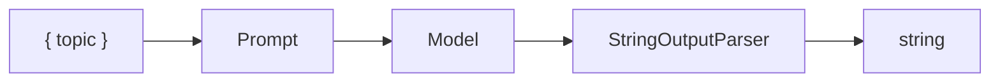
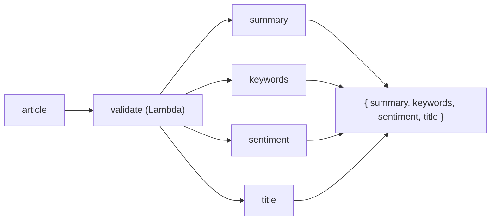

# Part 07 — Runnables & LCEL

ระดับ: Intermediate · เวลา: 90 นาที · ตัวอย่าง: `examples/part-07/` · Workshop: `workshops/part-07/`

## 1. Introduction

แอป AI จริงมักมีหลายขั้นตอน: เตรียม prompt → เรียก model → แปลงผล → ใช้ผลต่อ
**LCEL (LangChain Expression Language)** คือวิธีประกอบชิ้นส่วนเหล่านี้ด้วย `.pipe()` โดยทุกชิ้นเป็น **Runnable** ที่มี interface เดียวกัน
**ปัญหา:** ถ้าเขียนเชื่อมเองทุกครั้ง โค้ดซ้ำ ไม่ได้ streaming/batch/retry ฟรี และทดสอบยาก

> หมายเหตุการสอน: ไม่ต้องลงลึกทุก API ของ LCEL — เน้นเข้าใจ **Composition** และ **Data Flow** ส่วน workflow ที่มี state, loop และเงื่อนไข ให้ต่อยอดด้วย LangGraph

## 2. Learning Objectives

เข้าใจ function composition → Runnable → LCEL, data flow ระหว่างชิ้นส่วน, เมื่อไหร่ควร/ไม่ควรใช้ LCEL
ทำได้: ใช้ `pipe`, `StringOutputParser`, `RunnableSequence`, `RunnableLambda`, `RunnableParallel`, `RunnablePassthrough.assign`, สร้าง pipeline ที่ใช้ซ้ำ/ทดสอบได้ และใส่ retry/fallback

## 3. Concept Explanation

### 3.1 Composition
**Function composition:** output ของฟังก์ชัน A เป็น input ของ B → ต่อกันเป็น **pipeline** · **Sequential** = ทำต่อกัน · **Parallel** = ทำพร้อมกันเมื่อไม่พึ่งกัน (07-01)

### 3.2 Runnable
**Runnable** = ชิ้นส่วนมาตรฐานที่มี `invoke()` (ครั้งเดียว), `stream()` (ทีละชิ้น), `batch()` (หลาย input) พร้อมรับ **config** (เช่น callbacks, ตั้ง concurrency)
Prompt, Chat Model, Output Parser และ chain ที่ประกอบแล้ว **ล้วนเป็น Runnable** จึงต่อกันได้ และ input ของ chain = input ของชิ้นแรก, output = output ของชิ้นสุดท้าย

### 3.3 LCEL และเครื่องมือหลัก
| เครื่องมือ | ใช้ทำอะไร |
|---|---|
| `a.pipe(b)` | ต่อ a → b (Prompt → Model → Parser) |
| `StringOutputParser` | แปลง `AIMessage` → `string` |
| `RunnableSequence.from([…])` | ระบุลำดับเป็น array (เหมือน pipe) |
| `RunnableLambda.from(fn)` | ห่อฟังก์ชันธรรมดาให้เป็น Runnable (แปลง input/output เอง) |
| `RunnableParallel.from({a, b})` | ส่ง input เดียวกันให้หลายสาขา ได้ผลเป็น object |
| `RunnablePassthrough.assign({…})` | เก็บ input เดิมไว้ แล้วเพิ่ม field ใหม่ |
| `.withRetry()` / `.withFallbacks()` | ลองใหม่ / สลับตัวสำรองเมื่อล้มเหลว |

**Output Parser vs Structured Output:** parser แปลงผลที่ model ตอบมาแล้ว · structured output (Part 06) บอกให้ model ตอบตาม schema ตั้งแต่ต้น

### 3.4 เมื่อไหร่ควรใช้ LCEL
✅ Linear workflow, composition ง่ายๆ, ต้องการ parallel/stream/batch ฟรี
❌ มี loop, state ที่ต้องเก็บข้ามขั้น, เงื่อนไขซับซ้อน, human approval → **LangGraph** · ถ้าตรรกะอ่านง่ายกว่าด้วยฟังก์ชัน `async` ธรรมดา → ใช้ฟังก์ชันปกติ ไม่จำเป็นต้องใช้ LCEL

## 4. Problem Demonstration

เขียนเชื่อมเองด้วยฟังก์ชัน async:
```ts
async function summarizeAndTitle(article: string) {
  const prompt1 = await summaryPrompt.invoke({ article });
  const msg1 = await model.invoke(prompt1);
  const summary = msg1.content as string;          // ต้องจำว่าจะแปลงอย่างไร
  const prompt2 = await titlePrompt.invoke({ summary });
  …
}
```
ปัญหา: ซ้ำ/ยาว, ไม่ได้ `stream`/`batch` ให้อัตโนมัติ, สลับ model/ทดสอบต้องแก้หลายที่ และถ้าอยากรัน 2 งานขนานต้องเขียน `Promise.all` เอง

## 5. Solution

ประกอบเป็น chain ที่ทุกส่วนเป็น Runnable:
```ts
const chain = prompt.pipe(model).pipe(new StringOutputParser()); // Prompt → Model → Parser
await chain.invoke({ topic: "…" });   // string
chain.stream({ … });  chain.batch([…]); // ได้ฟรี
```
| ก่อน | หลัง |
|---|---|
| เชื่อมด้วย `await` ทีละบรรทัด | `a.pipe(b).pipe(c)` |
| Parallel เขียน `Promise.all` เอง | `RunnableParallel.from({…})` |
| เปลี่ยน model ต้องแก้ในฟังก์ชัน | ส่ง model เป็นพารามิเตอร์ของ builder function |

## 6. Visual Explanation





## 7. Coding Examples

รัน `pnpm play 7-N` ผลลัพธ์คือ *ตัวอย่างผลลัพธ์ — LLM ไม่ได้ตอบเหมือนเดิมทุกครั้ง* (ตรวจกับ Groq `openai/gpt-oss-20b`)

### 07-01 Function Composition (ไม่ใช้ LLM)
```
ซ้อนกัน : HELLO!
pipeline: HELLO!
parallel : A! B!
```

### 07-02 Prompt pipe Model
```
ชนิดของผลลัพธ์: AIMessage
content: โอริ (Ori)
chain เป็น Runnable ที่มี invoke/stream/batch: true
```

### 07-03 StringOutputParser
```
ไม่มี parser → AIMessage
มี parser    → string "มะม่วง"
ใช้ string ต่อได้ทันที: 6 ตัวอักษร
```

### 07-04 RunnableSequence
```
จำนวนขั้นตอน: 3
ผลลัพธ์: กาแฟบ้านอร่อย เติมรักทุกหยด ☕️
```

### 07-05 RunnableLambda — แปลง input ก่อนเข้า prompt และแปลง output หลัง parser
```
{ summary: 'LangChain ทำให้การเชื่อมต่อและประสานงานระหว่างโมเดล, prompt และเครื่องมือต่าง ๆ ง่ายขึ้นมาก.', characters: 92 }
```

### 07-06 RunnableParallel
```
{ cons: 'ข้อเสีย: ความสับสนระหว่างงานและชีวิตส่วนตัว …', pros: 'ความสะดวกในการจัดสรรเวลาและลดค่าใช้จ่ายเดินทาง.' }
ใช้เวลา 552 ms (สองสาขาทำพร้อมกัน)
```

### 07-07 RunnablePassthrough.assign
```
{ text: 'ขอบคุณที่ช่วยเหลือ', length: 18, english: 'Thank you for your help.' }
```

### 07-08 Multiple-step Pipeline — สรุป → (ชื่อเรื่อง ∥ คำสำคัญ)
```
{ summary: 'ร้านกาแฟเล็ก ๆ ในเชียงใหม่ได้เริ่มใช้เมล็ดกาแฟจากเกษตรกรบนดอยโดยตรง …',
  title: '“เชื่อมสายความหวัง: กาแฟเชียงใหม่สู่เกษตรกรบนดอย”',
  keywords: 'กาแฟ, เกษตรกร, เชียงใหม่' }
```

### 07-09 Reusable Pipeline — `src/pipelines/explain.ts` + model ปลอม + retry/fallback
```
[model จริง] Recursion คือวิธีแก้ปัญหาโดยให้โปรแกรมทำงานตัวเองซ้ำ ๆ …
[model ปลอม] (คำตอบจำลอง) ฟังก์ชันที่เรียกตัวเอง
[หลัก→สำรอง] (ตัวสำรองตอบแทน) | ตัวหลักถูกเรียก 2 ครั้ง
```

## 8. Common Mistakes

| ข้อผิดพลาด | สาเหตุ | ตรวจ/แก้ |
|---|---|---|
| `Missing value for input …` | key ของ input ไม่ตรงตัวแปรใน prompt | ตรวจ `prompt.inputVariables` |
| ขั้นถัดไปได้ type ผิด (เช่น `AIMessage` แทน `string`) | ลืมใส่ parser | ต่อ `StringOutputParser` |
| `RunnableLambda` input เป็น `PromptValue` ไม่ใช่ string | ใส่หลัง prompt | เช็กว่าอยู่ตำแหน่งไหนของ chain และเข้าถึงข้อมูลให้ถูก |
| ผลของ `RunnableParallel` ไม่ได้ลำดับ key ตามที่เขียน | เป็น object ที่รวมตามเวลาเสร็จ | อ่านด้วยชื่อ key ไม่พึ่งลำดับ |
| ซ่อน error ใน Lambda | `try/catch` แล้วคืนค่าว่าง | ให้ error ขึ้นไป หรือใช้ `withRetry/withFallbacks` |
| ใช้ LCEL ทำ loop/เงื่อนไขซับซ้อน | ฝืนใช้ | ย้ายไปฟังก์ชันปกติ หรือ LangGraph |

## 9. Best Practices

- **Maintainability:** ทำ pipeline เป็น `build…(model)` ที่รับ model เป็นพารามิเตอร์ → สลับ provider/ทดสอบได้ (07-09)
- **Readability:** ตั้งชื่อแต่ละชิ้น (`summarize`, `makeTitle`) แล้วค่อยประกอบ ไม่เขียนยาวบรรทัดเดียว
- **Reliability:** ใช้ `withRetry`/`withFallbacks` เฉพาะ error ชั่วคราว; จำกัดจำนวนครั้ง
- **Performance/Cost:** ใช้ `RunnableParallel` เมื่อสาขาไม่พึ่งกัน (แต่เพิ่มการเรียก API พร้อมกัน — ระวัง rate limit, Part 08)
- **Security:** แยกข้อมูลผู้ใช้ออกจากคำสั่งเหมือน Part 05 ในทุก branch

## 10. Exercises

**Basic:** แก้ 07-04 ให้ prompt รับ `{product}` และ `{tone}` สองตัวแปร
**Intermediate:** ต่อ `RunnableLambda` ท้าย 07-06 ที่รวม `pros` และ `cons` เป็นข้อความเดียว
**Challenge:** เขียนใหม่ 07-08 ให้ขั้น [2] เรียก 3 สาขา (title, keywords, sentiment) และเพิ่ม `.withRetry` ที่ขั้นสรุป

## 11. Workshop

ดู [`workshops/part-07/README.md`](../../workshops/part-07/README.md) — AI Content Processor (Summary, Keywords, Sentiment, Suggested Title)

## 12. Summary

- Runnable = ชิ้นส่วนมาตรฐาน (`invoke/stream/batch`) ที่ต่อกันได้
- LCEL: `pipe`, `RunnableSequence`, `RunnableLambda`, `RunnableParallel`, `RunnablePassthrough.assign`, `StringOutputParser`, `withRetry`, `withFallbacks`
- Data flow: input ชิ้นแรก → … → output ชิ้นสุดท้าย
- LCEL เหมาะกับ workflow เชิงเส้น/ขนาน; state/loop/เงื่อนไข → LangGraph

## 13. Knowledge Check

1. (Concept) ทำไม prompt, model และ parser จึงต่อกันด้วย `pipe` ได้?
2. (Concept) `RunnablePassthrough.assign` ต่างจากการเขียน `{...input, extra}` ใน Lambda อย่างไร และเมื่อไหร่คุ้ม?
3. (Code reading) ใน 07-08 ทำไมขั้น 2 ใช้ `summary: (x) => x.summary`?
4. (Practical) pipeline ที่ต้อง "วนถาม model ซ้ำจนผลผ่านการตรวจ" ควรใช้ LCEL หรือไม่ เพราะอะไร?
5. (Practical) จะทดสอบ pipeline โดยไม่เสียโควตา API ได้อย่างไร? (คำใบ้: 07-09)

## 14. Next Part

Part 08 ทำให้ pipeline เหล่านี้ **ตอบสนองเร็วขึ้น** ด้วย streaming, ประมวลผลหลาย input ด้วย batch และควบคุม concurrency/rate limit
