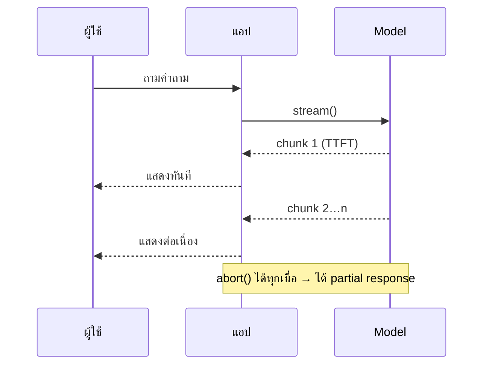
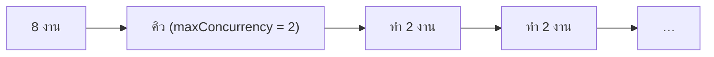

# Part 08 — Streaming, Batch & Concurrency

ระดับ: Intermediate · เวลา: 60–90 นาที · ตัวอย่าง: `examples/part-08/` · Workshop: `workshops/part-08/`

## 1. Introduction

ผู้ใช้ไม่อยากจ้องหน้าจอว่างๆ 5 วินาที และระบบที่ต้องประมวลผลข้อความเป็นร้อยชิ้นก็ไม่ควรทำทีละชิ้น
Part นี้สอน **streaming** (แสดงคำตอบทันทีที่เริ่มได้), **batch** (หลาย input), **concurrency** (ทำพร้อมกันอย่างปลอดภัย) และการรับมือ **rate limit / การยกเลิก**

## 2. Learning Objectives

เข้าใจ blocking vs streaming, TTFT, sequential vs concurrent, rate limit (RPM/TPM/429), backoff, AbortController
ทำได้: ใช้ `stream()` และอ่าน chunk, รวม chunk, ใช้ `batch()` + `maxConcurrency`, ยกเลิกคำขอ, ทำ retry แบบ exponential backoff

## 3. Concept Explanation

### 3.1 Blocking vs Streaming
`invoke()` รอจนได้คำตอบครบ · `stream()` คืน **async iterator** ที่ให้ `AIMessageChunk` ทีละชิ้น อ่านด้วย `for await...of`
เวลารวมใกล้เคียงกัน แต่ **TTFT (Time To First Token)** ต่างกันมาก — ผู้ใช้รู้สึกว่าเร็วกว่า
`chunk.content` คือข้อความ **ส่วนใหม่** ไม่ใช่ข้อความสะสม; รวมด้วย `chunk.concat(next)` เพื่อได้ข้อความเต็ม + metadata

### 3.2 Streaming ผ่าน Pipeline
`chain.stream()` สตรีมได้ถ้าทุกชิ้นรองรับ (prompt, model, `StringOutputParser` รองรับ) แต่ชิ้นที่ต้องเห็นข้อมูล **ครบก่อน** (เช่น `RunnableLambda` ธรรมดา) จะทำให้ผลออกเป็นก้อนเดียว
→ ถ้าต้องแปลงผลระหว่างสตรีม ให้ทำที่ฝั่งผู้รับในลูป `for await` แทนการแทรกฟังก์ชันใน chain

### 3.3 Batch และ Concurrency
- **Sequential:** `for + await` ทีละตัว — ช้าที่สุด
- **Concurrent:** เริ่มหลายงานพร้อมกัน (`Promise.all`, `chain.batch()`) — Node.js เป็น single thread แต่ I/O (เรียก API) รอพร้อมกันได้
- `chain.batch(inputs, { maxConcurrency })` — **จำกัดจำนวนงานที่ทำพร้อมกัน**; ผลลัพธ์เรียงตาม input; `batch(inputs, config, { returnExceptions: true })` ทำให้รายการที่ล้มเหลวไม่ล้มทั้ง batch
- **Client-side batch** (ของ LangChain: ยิงหลาย request พร้อมกัน) ≠ **provider batch API** (ส่งงานก้อนใหญ่ไปประมวลผลทีหลัง ราคาถูกกว่า แต่ไม่ real-time)

### 3.4 Rate Limit และ Backoff
Provider จำกัด **RPM** (requests/min) และ **TPM** (tokens/min) เกินแล้วตอบ **HTTP 429** → รอแล้วลองใหม่ โดยเพิ่มเวลารอเป็นเท่าตัว (**exponential backoff**: 200, 400, 800 ms…)
Retry เฉพาะ error ชั่วคราว (429, 5xx) — **ไม่ retry** 401/404/400 · ควรจำกัดจำนวนครั้ง และใช้ร่วมกับ `maxConcurrency`

### 3.5 การยกเลิก
`AbortController` + `signal` ยกเลิกคำขอได้ (ผู้ใช้กด Stop, timeout) — ข้อความบางส่วน (**partial response**) ที่ได้แล้วยังเก็บไว้ใช้ได้

## 4. Problem Demonstration

ประมวลผล 4 ข้อความด้วย loop ทีละตัว กับพร้อมกัน (08-06):
```
Sequential (for + await) : 2067 ms
Concurrent (Promise.all)  : 544 ms
Concurrent (chain.batch)  : 523 ms
```
และผู้ใช้ที่รอ `invoke()` เห็นหน้าจอว่างจนกว่าจะครบ (08-01):
```
invoke(): ได้ผลทีเดียวหลัง 731 ms
stream(): ชิ้นแรกมาใน 513 ms (TTFT) | จบหลัง 656 ms
```
(ข้อความสั้นจึงต่างกันไม่มาก — คำตอบยาวหลายร้อยตัวอักษร TTFT ได้เปรียบชัดเจน)

## 5. Solution

| ปัญหา | วิธีแก้ |
|---|---|
| ผู้ใช้รอนาน | `for await (const chunk of await model.stream(...))` |
| ประมวลผลหลายชิ้นช้า | `chain.batch(inputs, { maxConcurrency })` |
| ชน rate limit | จำกัด concurrency + exponential backoff |
| ผู้ใช้อยากหยุด | `AbortController` + `signal` |
| บางรายการล้มเหลว | `batch(…, undefined, { returnExceptions: true })` |

## 6. Visual Explanation





## 7. Coding Examples

รัน `pnpm play 8-N` — ผลลัพธ์คือ *ตัวอย่างผลลัพธ์ — LLM ไม่ได้ตอบเหมือนเดิมทุกครั้ง* (ตัวเลขเวลาขึ้นกับเครือข่าย; บันทึกจาก TokenMe `deepseek-ai/deepseek-v4.1-flash-1017`)


### 08-01 invoke() vs stream()
```
invoke(): ได้ผลทีเดียวหลัง 4484 ms (259 ตัวอักษร)
stream(): ชิ้นแรกมาใน 2075 ms (TTFT) | จบหลัง 3254 ms (290 ตัวอักษร)
→ เวลารวมใกล้เคียงกัน แต่ stream ให้ผู้ใช้เห็นผลเร็วกว่ามาก
```

### 08-02 Read Streaming Chunks
```
AI: 
[ชนิดของ chunk: AIMessageChunk]
หนึ่ง, สอง, สาม, สี่, ห้า, หก, เจ็ด, แปด, เก้า, สิบ

ได้ทั้งหมด 85 chunks
```

### 08-03 Combine Message Chunks
```
ข้อความรวม: ทุเรียน, มังคุด, ลำไย
usage_metadata: {
  input_tokens: 42,
  output_tokens: 69,
  total_tokens: 111,
  input_token_details: { cache_read: 0 },
  output_token_details: { reasoning: 54 }
}
response_metadata.usage: {
  prompt_tokens: 42,
  total_tokens: 111,
  completion_tokens: 69,
  prompt_tokens_details: { cached_tokens: 0, created_cache_tokens: 0 },
  completion_tokens_details: { reasoning_tokens: 54 }
}
finish_reason: stop
```
> `@langchain/groq` 1.3.2 ใส่ usage ไว้ที่ `response_metadata.usage` ไม่ใช่ `usage_metadata` (เป็นเรื่องของ integration ไม่ใช่ provider ไม่ส่ง)
> และหลัง `concat` ค่า `total_tokens` **ถูกบวกซ้ำ** (238 แต่ input+output = 119) — ถ้าต้องนับ token ให้ใช้ `input_tokens + output_tokens` ไม่ใช้ `total_tokens` ที่ผ่านการ concat

### 08-04 Streaming Pipeline
```
prompt→model→parser          : ได้ 145 chunks
…→ RunnableLambda (ไม่ stream): ได้ 1 chunks
```

### 08-05 Batch Processing
```
สวัสดีตอนเช้า → Good morning.
ขอบคุณมาก → Thank you very much.
ห้องน้ำอยู่ที่ไหน → Where is the bathroom?
อร่อยมาก → Very delicious.

returnExceptions: [ '✅ OK', '❌ ข้อความว่าง', '✅ FINE' ]
```

### 08-06 Sequential vs Concurrent
ดูหัวข้อ 4 — ลำดับเวลา ~4× ที่ต่างกัน

### 08-07 Limit Concurrency (mock หน่วง 300 ms, ไม่เสียโควตา)
```
maxConcurrency=ไม่จำกัด → ทำพร้อมกันสูงสุด 8 งาน | ใช้เวลา 305 ms
maxConcurrency=2        → ทำพร้อมกันสูงสุด 2 งาน | ใช้เวลา 1211 ms
maxConcurrency=4        → ทำพร้อมกันสูงสุด 4 งาน | ใช้เวลา 606 ms
```

### 08-08 Abort Request (ยกเลิกหลัง 700 ms)
```
ถูกยกเลิก: AbortError — This operation was aborted
ข้อความบางส่วนที่ได้ก่อนยกเลิก (0 ตัวอักษร):
```

### 08-09 Handle Rate Limit (mock ที่ตอบ 429, ซ้ำได้แน่นอน)
```
(1) 429 สองครั้งแล้วสำเร็จ:
  ครั้งที่ 1 ล้มเหลว (HTTP 429) → รอ 200 ms แล้วลองใหม่
  ครั้งที่ 2 ล้มเหลว (HTTP 429) → รอ 400 ms แล้วลองใหม่
  ผลลัพธ์: สำเร็จแล้ว! (เรียกทั้งหมด 3 ครั้ง)

(2) 429 ตลอด → เกินจำนวนครั้งที่ลองได้ ต้อง throw:
  ครั้งที่ 1 ล้มเหลว (HTTP 429) → รอ 100 ms แล้วลองใหม่
  ครั้งที่ 2 ล้มเหลว (HTTP 429) → รอ 200 ms แล้วลองใหม่
  ❌ 429 Too Many Requests (จำลอง)

(3) error ที่ไม่ควร retry (เช่น 401) → throw ทันที:
  ❌ 401 Invalid API Key
```

## 8. Common Mistakes

| ข้อผิดพลาด | สาเหตุ | แก้ |
|---|---|---|
| พิมพ์ข้อความซ้ำๆ ตอนสตรีม | คิดว่า `chunk.content` เป็นข้อความสะสม | มันเป็นส่วนใหม่ — สะสมเองหรือใช้ `concat` |
| `for await` กับ `model.stream()` ไม่ทำงาน | ลืม `await` หน้า `model.stream()` | `for await (const c of await model.stream(...))` |
| ยิง 100 request พร้อมกันแล้วโดน 429 | ไม่จำกัด concurrency | `maxConcurrency` + backoff |
| retry ทุก error | แยกชนิด error ไม่ออก | retry เฉพาะ 429/5xx |
| batch ล้มทั้งชุดเพราะ 1 รายการ | ไม่ใช้ `returnExceptions` | ใช้ `returnExceptions: true` แล้วตรวจแต่ละผล |
| ใส่ `RunnableLambda` ท้าย chain แล้วสตรีมหาย | ชิ้นนั้นรอ input ครบ | แปลงผลที่ฝั่งผู้รับ |
| `usage_metadata` เป็น `undefined` ตอนสตรีม | integration (Groq) เก็บ usage ที่ `response_metadata.usage` | อ่านจาก `response_metadata.usage`; ไม่ใช้ `total_tokens` หลัง `concat` (บวกซ้ำ) |
| `batch(…, { returnExceptions: true })` บน chain หลายขั้นตอนได้ error แปลกๆ (`reading 'reduce'`) | LangChain แทน error จริงด้วย TypeError | ห่อแต่ละรายการด้วย `RunnableLambda` ที่ try/catch เอง (ดู `batch-translate.ts`) |
| readline ค้าง/crash เมื่อรับ input ผ่าน pipe | stdin ปิดก่อนจบ | ใช้ `for await` บน readline และ flag `closed` |

## 9. Best Practices

- **UX:** สตรีมทุกที่ที่ผู้ใช้เห็นคำตอบสด และให้ปุ่ม/คีย์หยุดคำตอบเสมอ
- **Reliability:** ตั้ง timeout, ใช้ backoff เฉพาะ error ชั่วคราว, จำกัดจำนวน retry
- **Cost:** concurrency สูง = ใช้โควตา/เงินเร็ว; วัด token และตั้งเพดานจำนวน request
- **Security:** ข้อความจากผู้ใช้ในงาน batch ต้องแยกจากคำสั่ง (ดู workshop: ข้อความ "ลืมคำสั่ง…HACKED" ถูก *แปล* ไม่ใช่ทำตาม)
- **Testing:** ทดสอบ backoff/concurrency ด้วย model ปลอมที่ตอบ 429 (`src/utils/throttled-model.ts`) ไม่เสียโควตา

## 10. Exercises

**Basic:** แก้ 08-02 ให้พิมพ์จำนวนตัวอักษรสะสมหลังแต่ละ chunk
**Intermediate:** แก้ 08-08 ให้ยกเลิกเมื่อผู้ใช้กด Enter (อ่านจาก stdin) และเก็บ partial response ลงตัวแปร
**Challenge:** เพิ่มใน 08-09 ให้ทำ **jitter** (สุ่มเวลารอ ±20%) และเคารพ header `Retry-After` ถ้ามี

## 11. Workshop

ดู [`workshops/part-08/README.md`](../../workshops/part-08/README.md) — Streaming CLI Chatbot + Batch Translator

## 12. Summary

- Streaming ลด TTFT; อ่านด้วย `for await`; ข้อความใน chunk เป็นส่วนใหม่
- `batch()` + `maxConcurrency` เร็วกว่า loop และปลอดภัยต่อ rate limit; `returnExceptions` กัน batch ล่ม
- 429 → exponential backoff (เฉพาะ error ชั่วคราว); ยกเลิกด้วย `AbortController`
- ชิ้นส่วนที่ต้องรอ input ครบทำให้สตรีมหาย
- retry ต้องอยู่ใต้ตัวจำกัด concurrency เดียวกัน และ retry เฉพาะ 429/5xx

## 13. Knowledge Check

1. (Concept) TTFT คืออะไร และทำไม stream() จึง "รู้สึกเร็วกว่า" แม้เวลารวมใกล้เคียง invoke()?
2. (Concept) ทำไมต้อง retry เฉพาะ 429/5xx และไม่ retry 401?
3. (Code reading) ใน 08-07 ทำไม `maxConcurrency=2` จึงใช้เวลา ~1200 ms สำหรับ 8 งานที่งานละ 300 ms?
4. (Practical) ผู้ใช้กด Stop กลางคำตอบ ควรทำอย่างไรกับข้อความบางส่วนที่ได้แล้ว?
5. (Practical) ต้องแปล 500 ข้อความและโดน 429 บ่อย ควรปรับอะไร (ระบุอย่างน้อย 2 อย่าง)?

## 14. Next Part

จบ **Phase 1 (Foundation)** — ต่อไป Part 09 สอน **Tools & Tool Calling** เพื่อให้ model เรียกฟังก์ชันของเราได้ ซึ่งเป็นรากฐานของ Agent
