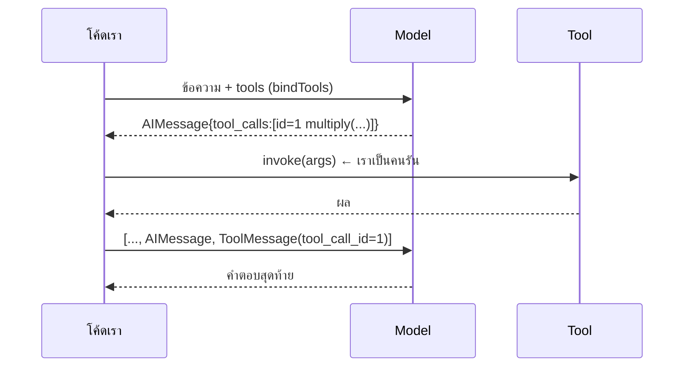

# Part 09 — Tools & Tool Calling

ระดับ: Intermediate · เวลา: 90–120 นาที · ตัวอย่าง: `examples/part-09/` · Workshop: `workshops/part-09/`

## 1. Introduction

LLM รู้แค่สิ่งที่อยู่ใน training data และ prompt — มัน **ไม่รู้อากาศวันนี้, ไม่เห็นฐานข้อมูลของเรา, คำนวณเลขใหญ่ไม่แม่น** และเรียกฟังก์ชันของเราไม่ได้
**Tool** คือฟังก์ชันที่เราเปิดให้โมเดล "ขอให้เรียก" ได้ โมเดลไม่ได้รันอะไรเอง — มันแค่บอกว่าอยากเรียก tool ไหนด้วย args อะไร แล้ว **โค้ดของเรา** เป็นคนรันและส่งผลกลับ
นี่คือรากฐานของ Agent (Part 10–11)

## 2. Learning Objectives

เข้าใจ tool = ชื่อ + คำอธิบาย + schema + ฟังก์ชัน, tool call flow, `ToolMessage` และ `tool_call_id`, ความเสี่ยงด้านความปลอดภัยของ tool
ทำได้: สร้าง tool ด้วย `tool()` + Zod, `bindTools()`, อ่าน `AIMessage.tool_calls`, รัน tool และส่งผลกลับ, จัดการหลาย call และ error

## 3. Concept Explanation

### 3.1 Tool คืออะไร
| ส่วน | หน้าที่ |
|---|---|
| `name` | ชื่อที่โมเดลใช้อ้างถึง |
| `description` | **สิ่งที่โมเดลใช้ตัดสินใจเลือก tool** — เขียนให้ชัดและต่างกัน |
| `schema` (Zod) | รูปร่าง input ที่ต้องส่ง; ถูกแปลงเป็น JSON Schema ส่งให้โมเดล |
| ฟังก์ชัน | โค้ดที่ทำงานจริง (sync/async) คืนผลเป็น string/JSON |

```ts
const add = tool(async ({ a, b }) => String(a + b), {
  name: "add", description: "บวกเลขสองจำนวน",
  schema: z.object({ a: z.number(), b: z.number() }),
});
await add.invoke({ a: 2, b: 3 }); // "5" — เรียกตรงๆ ได้โดยไม่ต้องมี LLM (ทดสอบง่าย)
```

### 3.2 Tool Calling Flow
```
1 เรา→โมเดล : ข้อความ + (bindTools) รายการ tool
2 โมเดล→เรา : AIMessage { tool_calls: [{ name, args, id }] }      ← ยังไม่มีใครรัน tool
3 เรา        : ค้น tool ตามชื่อ → ตรวจ/รัน → ได้ผล
4 เรา→โมเดล : [..ข้อความเดิม, AIMessage(tool_calls), ToolMessage(ผล, tool_call_id)]
5 โมเดล→เรา : คำตอบสุดท้าย (หรือขอ tool เพิ่ม)
```
- `bindTools([...])` บอกโมเดลว่ามี tool อะไร (ต้องเป็น model ที่รองรับ tool calling)
- `ToolMessage.tool_call_id` **ต้องตรงกับ `id` ของ call** — ไม่งั้นโมเดลไม่รู้ว่าผลนี้ของคำขอไหน
- โมเดลอาจขอ **หลาย call ในข้อความเดียว** (parallel) → ต้องตอบ **ทุก call** ก่อนเรียกโมเดลอีกรอบ
- เราไม่จำเป็นต้องรัน tool ที่โมเดลขอ: ปฏิเสธ/ขอยืนยันผู้ใช้ก่อนได้

### 3.3 ออกแบบ Tool
- **ชื่อ/คำอธิบายชัด** บอกว่าทำอะไร เมื่อไรควรใช้ ต่างจาก tool อื่นอย่างไร
- **Schema เล็กและเข้มงวด**: ใช้ enum/min/int; `.describe()` ทุก field
- **Granularity:** tool ละหนึ่งหน้าที่ ไม่รวมทุกอย่างใน `doEverything`
- **Read-only vs write:** แยกชัด; tool ที่แก้ข้อมูลต้องมีการตรวจสิทธิ์/ยืนยัน
- **Error:** คืนข้อความที่โมเดลอ่านแล้วแก้ได้ ("ไม่พบเมือง… มีเฉพาะ …") ไม่ใช่ stack trace

### 3.4 ความปลอดภัยของ Tool
1. **args มาจากโมเดล = untrusted input** — ตรวจด้วย schema เสมอ (Zod ปฏิเสธชนิดผิด, enum นอกรายการ)
2. **Authorization อยู่ในโค้ด ไม่ใช่ใน prompt** — "ห้ามลบข้อมูลคนอื่น" ใน system prompt ไม่ใช่การป้องกัน
3. ไม่ส่งข้อมูลลับกลับไปในผล tool (ผลถูกส่งเข้าโมเดลและอาจแสดงผู้ใช้)
4. tool ที่มี side effect (เขียน/ลบ/ส่งเงิน) ต้องจำกัดสิทธิ์ ตรวจ ownership และควรขอ human approval (Part 17)
5. ผล tool ที่มาจากภายนอก (เว็บ, เอกสาร) อาจแฝงคำสั่ง — ถือเป็นข้อมูล

## 4. Problem Demonstration

ถามโมเดลเรื่องที่มันทำไม่ได้ด้วยตัวเอง: คูณเลขใหญ่ / ข้อมูลสด / ข้อมูลในระบบเรา — มันเดาหรือปฏิเสธ (09-01 อธิบายช่องว่างนี้) การเรียกฟังก์ชันของเรา **ต้องมีกลไกกลาง** เพราะโมเดลเรียกโค้ดเราโดยตรงไม่ได้

## 5. Solution

ห่อฟังก์ชันเป็น tool → `bindTools()` → อ่าน `tool_calls` → รัน → ส่ง `ToolMessage` กลับ
repo นี้มีตัวช่วยที่ทดสอบแล้วใน `src/agents/execute-tools.ts`:
`executeToolCalls(tools, aiMessage)` คืน `ToolMessage` หนึ่งอันต่อ call (เรียงเดิม, id ตรง) และ **ไม่ throw** — tool ไม่พบ / args ผิด / tool พัง กลายเป็น `ToolMessage` ที่ `status: "error"`

## 6. Visual Explanation



## 7. Coding Examples

รัน `pnpm play 9-N` — ตรวจกับ Groq `openai/gpt-oss-20b` (09-10 ใช้ DeepSeek `thinking:false`); ผลจาก LLM คือ *ตัวอย่างผลลัพธ์ — LLM ไม่ได้ตอบเหมือนเดิมทุกครั้ง*

> **หมายเหตุ provider:** ค่าเริ่มต้นของ repo ตอนนี้คือ **TokenMe** (`TOKENME_API_KEY`) — ทุกตัวอย่างถูกรันซ้ำบน TokenMe แล้วผ่าน แต่ข้อความ/ตัวเลข token/เวลาที่แสดงด้านล่างบันทึกไว้จากการรันบน Groq จึงจะไม่ตรงกับที่คุณเห็นเป๊ะ (ไม่ใช่ข้อผิดพลาด)

### 09-01 Normal TypeScript Function / 09-02 Create Calculator Tool (ไม่เรียก LLM)
```
name       : calculator
description: คำนวณเลขสองจำนวนด้วยการบวก ลบ คูณ หรือหาร
schema (JSON Schema ที่ส่งให้โมเดล): { "type":"object", "properties": { "a": {"type":"number","description":"ตัวเลขตัวแรก"}, … "operation": {"enum":["add","subtract","multiply","divide"]} }, "required":["a","b","operation"] }
```

### 09-03 Execute Tool Directly (ไม่เรียก LLM)
```
7 × 6 = 42
10 ÷ 0 = Error: หารด้วยศูนย์ไม่ได้
args ผิดชนิด → ถูกปฏิเสธโดย schema: Received tool input did not match expected schema
operation ที่ไม่มีใน enum → ถูกปฏิเสธ: Received tool input did not match expected schema
```

### 09-04 Bind Tool to Model
```
content: ""
tool_calls: [ { "name": "calculator", "args": { "a": 1234, "b": 5678, "operation": "multiply" }, "type": "tool_call", "id": "fc_7786…" } ]
→ โมเดลไม่ได้ตอบเลขเอง แต่ขอให้เราเรียก calculator (ยังไม่มีใครรัน tool)
```

### 09-05 Inspect Tool Calls
```
ถาม: ลบ 100 ด้วย 37
  name=calculator  id=fc_8d4d…  args={"a":100,"b":37,"operation":"subtract"}
  invalid_tool_calls: 0
ถาม: สวัสดี ช่วยแนะนำตัวหน่อย
  ไม่มี tool call → โมเดลตอบเอง: สวัสดีครับ/ค่ะ! …
```

### 09-06 Execute Requested Tool
```
โมเดลขอ multiply({"a":15,"b":4}) → ผลลัพธ์: 60
```

### 09-07 Create ToolMessage
```
tool_call_id ของคำขอ: fc_c985…
ToolMessage: { content: '60', tool_call_id: 'fc_c985…', name: 'multiply' }
invoke(call) ได้ ToolMessage โดยตรง: ToolMessage 60
```

### 09-08 Send Tool Result to Model
```
ลำดับข้อความ: human → ai → tool
คำตอบสุดท้าย: รวมเงินทั้งหมด = 1 234 × 5 678 = **7 006 652** บาท
```
(ถ้าตัวเลขเล็ก โมเดลอาจคำนวณเองโดยไม่เรียก tool — ใน 09-08 ใช้เลขใหญ่และบอกให้ใช้เครื่องมือ)

### 09-09 Multiple Tools — โมเดลเลือก tool จาก description
```
อากาศที่เชียงใหม่เป็นอย่างไร   → getWeather({"city":"เชียงใหม่"})
มี keyboard ขายไหม ราคาเท่าไร  → searchProduct({"query":"keyboard"})
วันนี้วันที่เท่าไร             → getCurrentDate({})
7 + 8 เท่ากับเท่าไร            → add({"a":7,"b":8})
```

### 09-10 Multiple Tool Calls (DeepSeek, thinking ปิด)
```
โมเดลขอ 3 call:
  id=call_00_Luj0… getWeather({"city":"เชียงใหม่"})
  id=call_01_kPOK… getWeather({"city":"ภูเก็ต"})
  id=call_02_phoI… getWeather({"city":"กรุงเทพ"})
  ผล id=call_00_Luj0…: สภาพอากาศเชียงใหม่: อากาศดี 28°C ท้องฟ้าโปร่ง   (…อีกสองเมือง)
คำตอบ: สรุปสภาพอากาศวันนี้: - เชียงใหม่ — อากาศดี 28°C … - ภูเก็ต — ฝนตกเล็กน้อย 30°C … - กรุงเทพ — ร้อน 34°C …
```
> Groq gpt-oss-20b มักขอทีละ call แม้สั่งให้ขอพร้อมกัน — **ความสามารถ parallel calls ขึ้นกับโมเดล** อย่าสมมติ

### 09-11 Handle Tool Error (ไม่เรียก LLM)
```
[c1] status=success  3
[c2] status=error  Error: Received tool input did not match expected schema
[c3] status=error  Error: ไม่พบ tool ชื่อ "teleport" (มี: add, flaky)
[c4] status=error  Error: บริการภายนอกไม่ตอบสนอง
```

## 8. Common Mistakes

| ข้อผิดพลาด | สาเหตุ | แก้ |
|---|---|---|
| โมเดลตอบเลขเองโดยไม่เรียก tool | คำถามง่ายเกินไป/ไม่ได้บอกให้ใช้ tool | บอกใน system prompt ให้ใช้เครื่องมือเมื่อต้องคำนวณ; ไม่ถือว่าโมเดลจะเรียกเสมอ |
| ส่ง `ToolMessage` แต่ไม่ได้ push `AIMessage` ที่มี `tool_calls` เข้า history | ลำดับข้อความผิด | ลำดับต้องเป็น `[…, AIMessage(tool_calls), ToolMessage…]` |
| `tool_call_id` ไม่ตรง / ตอบไม่ครบทุก call | จัดการหลาย call ไม่ครบ | ตอบทุก call (ใช้ `executeToolCalls`) |
| โปรแกรมล้มเมื่อ tool พังหรือ args ผิด | ไม่ดักจับ error | คืนเป็น `ToolMessage` status error |
| `tool.invoke(args)` ได้ type string | ผลคืนเป็น string; เรียกด้วย `invoke(call)` ได้ `ToolMessage` | เลือกวิธีให้ตรงกับที่ต้องการ |
| เชื่อ args จากโมเดล (เช่น id ผู้ใช้) | ไม่ตรวจสิทธิ์ | ตรวจสิทธิ์ในโค้ด ใช้ userId จาก session ไม่ใช่จาก args |
| Groq ไม่ส่งหลาย call พร้อมกัน | ขึ้นกับ model | อย่าเขียนโค้ดที่พึ่งว่าต้องมีหลาย call |

## 9. Best Practices

- **Security:** args = untrusted; authorization ในโค้ด; tool ที่แก้ข้อมูลขอ approval; จำกัดขอบเขตของ tool (least privilege)
- **Reliability:** ทุก tool call ต้องได้ `ToolMessage` เสมอ แม้ error; ใส่ timeout ใน tool ที่เรียกภายนอก
- **Quality:** description บอก "เมื่อไรใช้/เมื่อไรไม่ใช้"; ตัวอย่างค่าใน `.describe()`
- **Testing:** เทสต์ tool แยกจากโมเดล (`tool.invoke`) และเทสต์ตัวรันด้วย `AIMessage` ที่เราสร้างเอง (ดู `tests/part09-tools.test.ts`)
- **Cost:** ยิ่งมี tool มาก prompt ยิ่งยาว — ให้เท่าที่จำเป็น

## 10. Exercises

**Basic:** เพิ่ม tool `divide` พร้อมจัดการหารด้วยศูนย์ แล้วเรียกผ่าน `executeToolCalls`
**Intermediate:** เพิ่ม tool `getStock({ name })` ที่คืนจำนวนคงเหลือจาก `src/data/products.ts` และทดสอบกับสินค้าที่หมด
**Challenge:** เขียน wrapper ที่ใส่ timeout 2 วินาทีให้ทุก tool และแปลง timeout เป็น `ToolMessage` error

## 11. Workshop

ดู [`workshops/part-09/README.md`](../../workshops/part-09/README.md) — AI Assistant ที่มี add, subtract, multiply, getWeather, searchProduct, getCurrentDate

## 12. Summary

- Tool = ชื่อ + description + schema + ฟังก์ชัน; โมเดลขอ เราเป็นผู้รัน
- Flow: `bindTools` → `tool_calls` → รัน → `ToolMessage(tool_call_id)` → โมเดลตอบ
- ต้องตอบทุก call, จับคู่ด้วย id, ไม่ให้ error ทำโปรแกรมล้ม
- args จากโมเดลไม่น่าไว้ใจ; authorization อยู่ในโค้ด
- API: `tool()`, `tool.invoke`, `model.bindTools`, `AIMessage.tool_calls`, `ToolMessage`, `executeToolCalls` (ของ repo)

## 13. Knowledge Check

1. (Concept) ทำไม "โมเดลเรียก tool" จึงไม่ได้แปลว่าโมเดลรันโค้ดเอง? ใครเป็นผู้รัน?
2. (Concept) `tool_call_id` ใช้ทำอะไร และเกิดอะไรขึ้นถ้าไม่ตรง?
3. (Code reading) ใน 09-11 ทำไม call ที่ args ผิดจึงได้ `status=error` แทนที่จะทำให้โปรแกรมหยุด?
4. (Practical) tool `deleteOrder({ orderId })` รับ `orderId` จากโมเดล ควรป้องกันการลบออเดอร์ของคนอื่นอย่างไร?
5. (Practical) ผู้ใช้ถาม "15 บวก 27 แล้วคูณ 3" โมเดลขอ `add` ก่อนแล้วจบ ไม่ขอ `multiply` ต่อ — ปัญหาอยู่ที่ไหนและ Part 10 จะแก้อย่างไร?

## 14. Next Part

Part 10 สร้าง **Agent Loop** เอง: วนเรียกโมเดล → รัน tool → เรียกโมเดลต่อ จนกว่าจะได้คำตอบสุดท้าย พร้อมเพดานจำนวนรอบ
