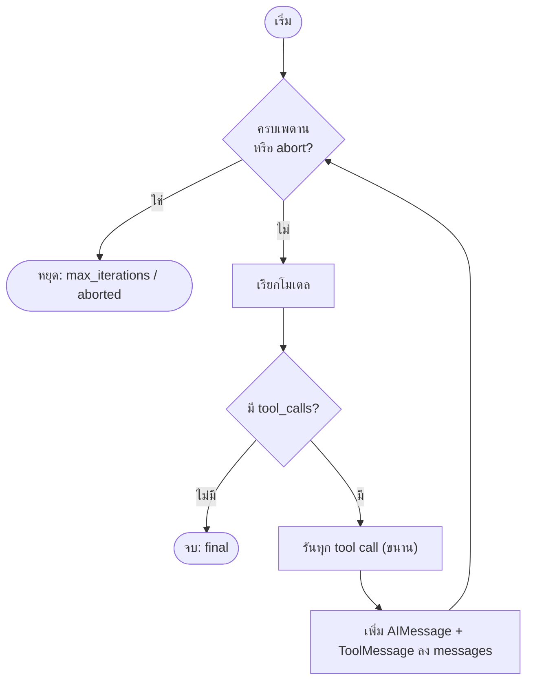

# Part 10 — Building an Agent Loop from Scratch

ระดับ: Intermediate · เวลา: 90 นาที · ตัวอย่าง: `examples/part-10/` · Workshop: `workshops/part-10/`

## 1. Introduction

Part 09 ให้โมเดลขอ tool ได้ 1 รอบ แต่งานจริงมักต้องใช้ **หลายขั้นต่อเนื่อง** ("หาราคาก่อน แล้วค่อยคูณจำนวน")
**Agent** คือโปรแกรมที่ *วนลูป* ให้โมเดลตัดสินใจ → ลงมือ (เรียก tool) → สังเกตผล → ตัดสินใจต่อ จนได้คำตอบ
Part นี้เขียน loop เองด้วย `while` เพื่อให้เห็นกลไกก่อนใช้ `createAgent()` ใน Part 11

## 2. Learning Objectives

เข้าใจ chatbot vs workflow vs agent, องค์ประกอบของ agent, ReAct pattern, เงื่อนไขหยุด, ความล้มเหลวที่พบบ่อย
ทำได้: เขียน agent loop, รัน tool ต่อเนื่อง/ขนาน, ใส่เพดานจำนวนรอบ, จัดการ tool ล้มเหลว, log การทำงานของ agent

## 3. Concept Explanation

### 3.1 Chatbot vs Workflow vs Agent
| | ใครกำหนดลำดับขั้นตอน | ตัวอย่าง |
|---|---|---|
| Chatbot | ไม่มี — ถาม/ตอบ | แชต Part 04 |
| Workflow | **เรา** เขียนลำดับตายตัวไว้ล่วงหน้า | pipeline Part 07 |
| Agent | **โมเดล** ตัดสินใจเองว่าจะเรียก tool ไหน กี่รอบ | Part นี้ |

**Agent harness** = โค้ดรอบๆ โมเดลที่ทำให้เป็น agent ได้: loop, tools, สถานะ (messages), เงื่อนไขหยุด

### 3.2 องค์ประกอบ
Model · Messages (state) · Tools · Loop · Termination · (Logging)

### 3.3 Flow และ ReAct
```
repeat:
  ai = model.invoke(messages)         ← ตัดสินใจ (decision)
  if ai ไม่มี tool_calls: จบ → ai คือคำตอบ (final answer)
  results = รันทุก tool call           ← ลงมือ (action)
  messages += [ai, ...results]         ← สังเกต (observation)
```
**ReAct** = Reason + Act: ตัดสินใจ → action → observation → ตัดสินใจใหม่ — เราไม่จำเป็นต้องเข้าถึง "ความคิดภายใน" ของโมเดล ใช้แค่ action ที่ขอและผลที่ได้

### 3.4 Sequential, Dependent และ Parallel
- **Dependent:** call ที่สองต้องใช้ผลของ call แรก → ต้องอยู่คนละรอบ (10-04: หาราคา → คูณ)
- **Parallel:** call ที่ไม่พึ่งกันถูกขอพร้อมกันได้ → `Promise.all` และจับคู่ผลด้วย `tool_call_id` (10-05); tool ที่มี side effect ต้องคิดเรื่องลำดับ/ความซ้ำซ้อนก่อนรันขนาน

### 3.5 เงื่อนไขหยุด (Termination)
| เงื่อนไข | ใน `runAgentLoop` |
|---|---|
| โมเดลไม่ขอ tool แล้ว | `stopReason: "final"` |
| ครบเพดานรอบ | `stopReason: "max_iterations"` (ค่าเริ่มต้น 8) |
| ผู้ใช้ยกเลิก / timeout | `stopReason: "aborted"` (ผ่าน `AbortSignal`) |
| tool ล้มเหลว | ไม่หยุด — ส่ง `ToolMessage` error ให้โมเดลตัดสินใจ |
| งบ token หมด | ตรวจเองใน `onStep` แล้ว abort |

### 3.6 ความล้มเหลวที่พบบ่อย
วนไม่รู้จบ · ขอ tool เดิมซ้ำๆ · args ผิด · tool ไม่มี · เลือก tool ผิด · ใช้ token มหาศาล → แก้ด้วยเพดานรอบ, log, validation (Part 09), description ที่ชัด

## 4. Problem Demonstration

10-02 เขียนมือ 3 รอบ: ซ้ำซ้อน และ "ต้องรู้ล่วงหน้าว่ากี่รอบ" — ถ้างานต้องการ 2 รอบแต่เราวน 3 รอบก็พอดี แต่ถ้าต้อง 4 รอบก็ค้าง; ถ้าวนน้อยไปก็ไม่ได้คำตอบ
```
รอบ 1: ขอ add({"a":15,"b":27})
รอบ 2: ขอ multiply({"a":42,"b":3})
รอบ 3: คำตอบสุดท้าย → ผลลัพธ์คือ **126**.
```

## 5. Solution

ใช้ loop ที่หยุดเมื่อโมเดลเลิกขอ tool พร้อมเพดานรอบ — repo นี้มีตัวที่ทดสอบแล้วคือ `runAgentLoop` (`src/agents/agent-loop.ts`):
```ts
const r = await runAgentLoop({ model, tools, messages: [new HumanMessage("…")], maxIterations: 8, signal, onStep });
// r = { messages, finalText, iterations, stopReason }
```
มี unit test ด้วย scripted model (`tests/part10-agent-loop.test.ts`): tool เดียว, สองขั้น, ขนาน (id ตรง), tool ไม่พบ, ครบเพดาน, abort

## 6. Visual Explanation



## 7. Coding Examples

รัน `pnpm play 10-N` — ตรวจกับ Groq `openai/gpt-oss-20b`; 10-05, 10-06, 10-07 ใช้ mock/scripted (ผลซ้ำได้แน่นอน, ไม่เสียโควตา) · ผลจาก LLM คือ *ตัวอย่างผลลัพธ์ — LLM ไม่ได้ตอบเหมือนเดิมทุกครั้ง*

> **หมายเหตุ provider:** ค่าเริ่มต้นของ repo ตอนนี้คือ **TokenMe** (`TOKENME_API_KEY`) — ทุกตัวอย่างถูกรันซ้ำบน TokenMe แล้วผ่าน แต่ข้อความ/ตัวเลข token/เวลาที่แสดงด้านล่างบันทึกไว้จากการรันบน Groq จึงจะไม่ตรงกับที่คุณเห็นเป๊ะ (ไม่ใช่ข้อผิดพลาด)

### 10-01 Single Tool Execution
```
1) โมเดลขอ: multiply({"a":1234,"b":5678})
2) เรารัน tool แล้วส่งผลกลับ
3) คำตอบ: ผลรวมของปากกา 1,234 ด้ามที่ราคา 5,678 บาทต่อด้ามคือ **7,006,652 บาท**.
```
### 10-02 Two-step Tool Execution — ดูหัวข้อ 4
### 10-03 Manual Agent Loop (`while` เขียนเอง)
```
รอบ 1: add({"a":15,"b":27})
รอบ 2: multiply({"a":42,"b":3})
จบที่รอบ 3: ผลคือ **126**.
```
### 10-04 Dependent Tool Calls
```
  รอบ 1: searchProduct({"query":"Mechanical Keyboard"})
  รอบ 2: multiply({"a":2490,"b":3})
หยุดเพราะ: final หลัง 3 รอบ
คำตอบ: ผลลัพธ์คือ **7,470 บาท** (2490 บาท × 3)
```
### 10-05 Parallel Tool Calls (จำลอง AIMessage 3 call)
```
ใช้เวลา 304 ms (ลำดับ: 300+100+200 = 600 ms ถ้าทำทีละตัว)
  tool_call_id=id-A → ข้อมูลของ A
  tool_call_id=id-B → ข้อมูลของ B
  tool_call_id=id-C → ข้อมูลของ C
```
### 10-06 Maximum Iterations (scripted model ที่ขอ tool ไม่หยุด)
```
maxIterations=3 → stopReason=max_iterations, เรียกโมเดล 3 ครั้ง, ข้อความทั้งหมด 7
maxIterations=5 → stopReason=max_iterations, เรียกโมเดล 5 ครั้ง, ข้อความทั้งหมด 11
```
### 10-07 Handle Tool Failures (scripted)
```
[c1] status=error: Error: ไม่พบ tool ชื่อ "teleport" (มี: add, subtract, multiply, getWeather, sear
[c2] status=error: Error: Received tool input did not match expected schema …
จบด้วย final หลัง 3 รอบ: ขออภัย ใช้เครื่องมือไม่สำเร็จ จึงไม่สามารถคำนวณให้ได้
```
### 10-08 Logging Agent Execution
```
[+659ms] รอบ 1 โมเดล → ขอ searchProduct
[+667ms] รอบ 1 tool   → Mechanical Keyboard ราคา 2490 บาท (เหลือ 3 ชิ้น)
[+1087ms] รอบ 2 โมเดล → ขอ multiply
[+1088ms] รอบ 2 tool   → 4980
[+1657ms] รอบ 3 โมเดล → ตอบสุดท้าย
สรุป: final, 3 รอบ
```

## 8. Common Mistakes

| ข้อผิดพลาด | สาเหตุ | แก้ |
|---|---|---|
| Loop ไม่หยุด/ค่าใช้จ่ายพุ่ง | ไม่มีเพดานรอบ | `maxIterations` เสมอ และตรวจ `stopReason` |
| ตอบคำถามไม่ครบเพราะวนจำนวนรอบคงที่ | เขียนวนแบบกำหนดรอบ | วนจนไม่มี `tool_calls` |
| ลืม push `AIMessage` (ที่มี tool_calls) ก่อน `ToolMessage` | ลำดับ history ผิด | ลำดับ `[…, AI, Tool…]` |
| tool พังแล้ว agent ล้ม | ไม่ดัก error | ส่ง error เป็น `ToolMessage` |
| รัน tool แก้ข้อมูลขนานโดยไม่คิด | พึ่ง `Promise.all` ทุกกรณี | tool ที่มี side effect รันทีละตัว/ตรวจซ้ำ |
| เชื่อ `finalText` ทั้งที่ `stopReason !== "final"` | ไม่ตรวจเหตุที่หยุด | ถ้า max_iterations/aborted ให้แจ้งผู้ใช้ว่าไม่สมบูรณ์ |
| ไม่มี log จึงดีบั๊กไม่ได้ | — | `onStep` เก็บทุกรอบ (ระวังไม่ log ข้อมูลลับ) |

## 9. Best Practices

- **Reliability:** เพดานรอบ + timeout + `AbortSignal`; ตรวจ `stopReason`
- **Security:** ทุก call ผ่าน validation/authorization ก่อนรัน (Part 09); ไม่ให้ agent มีสิทธิ์เกินจำเป็น
- **Cost:** ยิ่งรอบมาก token ยิ่งสะสม (ข้อความเก่าถูกส่งซ้ำทุกรอบ) — จำกัดรอบ และ tool ที่ให้
- **Observability:** log ทุกขั้น (โมเดลขออะไร/ผลอะไร/กี่ ms)
- **Testing:** ทดสอบ loop ด้วย scripted model (ไม่เสียโควตา, ทำซ้ำได้แน่นอน)

## 10. Exercises

**Basic:** แก้ 10-03 เปลี่ยนเพดานเป็น 2 แล้วอธิบายว่า stopReason เป็นอะไรและทำไม
**Intermediate:** เพิ่ม `timeoutMs` ใน `runAgentLoop` โดยสร้าง `AbortSignal.timeout()` แล้วเขียนเทสต์ด้วย scripted model ที่ช้า
**Challenge:** เพิ่มตัวตรวจ "เรียก tool เดิมด้วย args เดิมซ้ำ 3 ครั้ง" แล้วหยุดพร้อม `stopReason: "repeated_call"` (เขียนเทสต์ก่อน)

## 11. Workshop

ดู [`workshops/part-10/README.md`](../../workshops/part-10/README.md) — Shopping loop agent (ค้นสินค้า ตรวจราคา คำนวณยอดรวม)

## 12. Summary

- Agent = loop: โมเดลตัดสินใจ → รัน tool → ใส่ผลกลับ → วนจนโมเดลตอบสุดท้าย
- เงื่อนไขหยุด: ไม่มี tool_calls / เพดานรอบ / abort
- Dependent call ต้องคนละรอบ; call อิสระรันขนานได้ (จับคู่ด้วย id)
- Tool ล้มเหลวไม่ควรทำให้ agent ล้ม; มี log และเพดานเสมอ
- API: `runAgentLoop` (ของ repo), `executeToolCalls`, `AbortSignal`

## 13. Knowledge Check

1. (Concept) Workflow กับ Agent ต่างกันอย่างไร ใครเป็นผู้กำหนดลำดับขั้นตอน?
2. (Concept) ทำไมงาน "หาราคาแล้วคูณจำนวน" จึงต้องใช้อย่างน้อยสองรอบเรียกโมเดล?
3. (Code reading) ใน `10-06` `stopReason` เป็น `max_iterations` — ผู้ใช้ควรเห็นอะไร และ `finalText` เชื่อถือได้ไหม?
4. (Practical) agent มี tool `sendEmail` ที่ขนานได้ — ความเสี่ยงคืออะไรและควรป้องกันอย่างไร?
5. (Practical) log ของ agent ควรเก็บอะไร และควรหลีกเลี่ยงการเก็บอะไร?

## 14. Next Part

Part 11 ใช้ **`createAgent()`** ของ LangChain แทน loop ที่เขียนเอง — ได้ state, streaming, structured output และ recursion limit สำเร็จรูป
