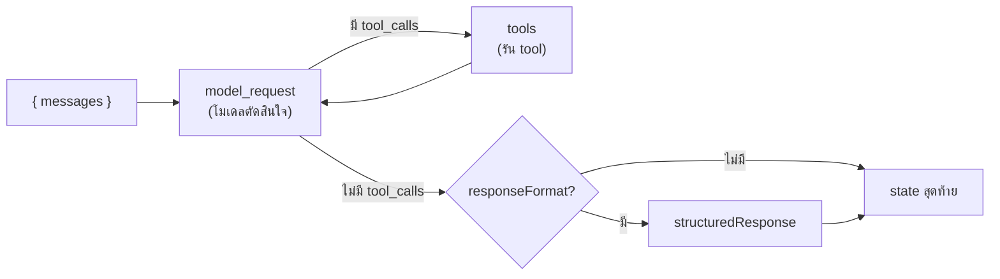

# Part 11 — Building Agents with LangChain

ระดับ: Intermediate · เวลา: 90–120 นาที · ตัวอย่าง: `examples/part-11/` · Workshop: `workshops/part-11/`

## 1. Introduction

Part 10 เขียน agent loop เอง ~40 บรรทัด Part นี้ใช้ **`createAgent()`** ของ LangChain v1 ที่ทำ loop เดียวกัน พร้อม state, streaming, structured output, recursion limit และ checkpointer (Part 12) ให้สำเร็จรูป
สิ่งที่ต้องเข้าใจไม่เปลี่ยน: โมเดลตัดสินใจ → รัน tool → ใส่ผลกลับ → วนจนจบ

## 2. Learning Objectives

เข้าใจว่า `createAgent` ทำอะไรแทนเรา, state ของ agent, system prompt, structured output (`toolStrategy`/`providerStrategy`), stream modes, recursion limit, เมื่อไรไม่ควรใช้ agent
ทำได้: สร้าง agent ด้วยหลาย tool, ตั้ง system prompt, ขอผลเป็น schema, สตรีมข้อความและความคืบหน้า, จัดการ error/recursion/ยกเลิก

## 3. Concept Explanation

### 3.1 Manual loop → `createAgent`
| Part 10 (เขียนเอง) | `createAgent` |
|---|---|
| `runAgentLoop({ model, tools, messages })` | `createAgent({ model, tools, systemPrompt })` |
| `maxIterations` | `recursionLimit` (ตอน `invoke`) — เกินแล้วโยน `GraphRecursionError` |
| `messages` ที่เราจัดการ | state `{ messages }` ที่ agent จัดการและคืนมา |
| `onStep` | `agent.stream(..., { streamMode })` |
| ผลสุดท้ายเป็นข้อความ | + `responseFormat` → `result.structuredResponse` |

### 3.2 การใช้งานพื้นฐาน
```ts
const agent = createAgent({ model, tools: [getWeather], systemPrompt: "…" });
const result = await agent.invoke({ messages: [{ role: "user", content: "…" }] });
result.messages.at(-1); // AIMessage สุดท้าย
```
`invoke` คืน state สุดท้าย (`messages` ทั้งหมด: human → ai(tool_calls) → tool → ai)

### 3.3 System prompt
กำหนดบทบาท ขอบเขต และ **กฎการใช้ tool** ("ต้องค้นก่อนตอบ ห้ามเดาราคา") — มีผลต่อคุณภาพมาก (11-04) แต่ **ไม่ใช่กลไกความปลอดภัย**: การจำกัดสิทธิ์ต้องทำในโค้ดของ tool

### 3.4 Structured output
`responseFormat: toolStrategy(zodSchema)` → agent จบด้วย object ตาม schema ที่ `result.structuredResponse`
- **toolStrategy:** แปลง schema เป็น tool พิเศษที่โมเดล "เรียก" เพื่อส่งคำตอบสุดท้าย — ใช้ได้กับโมเดลที่รองรับ tool calling
- **providerStrategy:** ใช้ structured output ในตัวของ provider (ต้องรองรับ)
(เปรียบเทียบกับ Part 06: ที่นั่นเป็นการเรียกโมเดลครั้งเดียว ที่นี่เป็นผลสุดท้ายของ agent หลายรอบ)

### 3.5 Streaming
| `streamMode` | ได้อะไร |
|---|---|
| `"messages"` | token ทีละชิ้น (`[chunk, metadata]`) — UX แบบแชต |
| `"updates"` | ความคืบหน้าทีละ node (`model_request`, `tools`) — แสดง progress |
| `"values"` | state เต็มหลังแต่ละขั้น |

### 3.6 Config และ error
`invoke(input, { recursionLimit, signal })` · tool พัง → agent ส่ง error ให้โมเดล · โมเดลวนไม่หยุด → `GraphRecursionError` · ผู้ใช้ยกเลิก → `AbortError`

### 3.7 ออกแบบ agent
เล็กและโฟกัส (3–7 tool) · tool ละหน้าที่ · ถ้าลำดับขั้นตอนรู้ล่วงหน้า **ใช้ workflow ธรรมดา ไม่ต้องใช้ agent** · agent เพิ่ม latency/ค่าใช้จ่าย/ความไม่แน่นอน

## 4. Problem Demonstration

Loop ที่เขียนเอง (Part 10) ต้องดูแลเองทั้ง: state, streaming, structured output, ยกเลิก, persistence — และทุกโปรเจกต์ก็เขียนซ้ำ
ลองเทียบ 11-02: agent ที่มี tool เดียวใช้โค้ดไม่กี่บรรทัด:
```
[human] อากาศที่เชียงใหม่เป็นอย่างไร
[ai] ขอ getWeather
[tool] สภาพอากาศเชียงใหม่: อากาศดี 28°C ท้องฟ้าโปร่ง
[ai] สภาพอากาศเชียงใหม่: อากาศดี 28 °C ท้องฟ้าโปร่ง
```

## 5. Solution

ใช้ `createAgent({ model, tools, systemPrompt, responseFormat })` และเลือก stream mode ตามหน้าจอ
Workshop ใช้ tools ใน `src/tools/shopping.ts` (ทดสอบแล้ว) + `buildShoppingAgent(model)`

## 6. Visual Explanation



## 7. Coding Examples

รัน `pnpm play 11-N` — ตรวจกับ Groq `openai/gpt-oss-20b` (11-08 ใช้ scripted model) · ผลจาก LLM คือ *ตัวอย่างผลลัพธ์ — LLM ไม่ได้ตอบเหมือนเดิมทุกครั้ง*

> **หมายเหตุ provider:** ค่าเริ่มต้นของ repo ตอนนี้คือ **TokenMe** (`TOKENME_API_KEY`) — ทุกตัวอย่างถูกรันซ้ำบน TokenMe แล้วผ่าน แต่ข้อความ/ตัวเลข token/เวลาที่แสดงด้านล่างบันทึกไว้จากการรันบน Groq จึงจะไม่ตรงกับที่คุณเห็นเป๊ะ (ไม่ใช่ข้อผิดพลาด)

### 11-01 First createAgent()
```
จำนวนข้อความใน state: 2
ชนิดข้อความ: human → ai
คำตอบ: AI agent คือซอฟต์แวร์หรือระบบคอมพิวเตอร์ที่ใช้ปัญญาประดิษฐ์เพื่อทำงานอัตโนมัติ …
```
### 11-02 Agent with One Tool — ดูหัวข้อ 4
### 11-03 Agent with Multiple Tools
```
อากาศที่ภูเก็ตเป็นอย่างไร
  tools: getWeather
  ตอบ: สภาพอากาศภูเก็ตวันนี้เป็นฝนตกเล็กน้อย อุณหภูมิประมาณ 30 °C.
ค้นหา keyboard ให้หน่อย แล้วบอกวันที่วันนี้ด้วย
  tools: searchProduct → getCurrentDate
  ตอบ: **ผลการค้นหา:** - **Mechanical Keyboard** - ราคา: 2,490 บาท - เหลือ: 3 ชิ้น  **วันที่วันนี้:** 2026-11-25
```
### 11-04 Agent System Prompt — ไม่มี vs มี systemPrompt
```
--- ไม่มี systemPrompt ---
**มี Mechanical Keyboard รุ่นที่แนะนำให้เลือก** | **Mechanical Keyboard 1** | 2,490 บาท | … (ตอบยาว มีตารางและชื่อรุ่นที่แต่งขึ้น)
--- มี systemPrompt ---
มี Mechanical Keyboard ราคา 2490 บาท (เหลือ 3 ชิ้น) ค่ะ
```
### 11-05 Agent Structured Output
```
structuredResponse: { inStock: true, price: 2490, productName: 'Mechanical Keyboard' }
typeof price: number (TypeScript รู้ type จาก schema)
```
### 11-06 Agent Streaming (`streamMode: "messages"`)
```
AI: **ภูเก็ตอากาศสวยงาม** ฝนพร่องพองพริกไทย … 
(ได้ 51 chunks ที่มีข้อความ)
```
### 11-07 Agent Execution Updates (`streamMode: "updates"`)
```
[model_request] ai: ขอ searchProduct
[tools] tool: Mechanical Keyboard ราคา 2490 บาท (เหลือ 3 ชิ้น)
[model_request] ai: ขอ getCurrentDate
[tools] tool: 2026-11-25
[model_request] ai: **ผลการค้นหา:** - **Mechanical Keyboard** - ราคา: 2,490 บาท …
```
### 11-08 Agent Error Handling (scripted — ซ้ำได้แน่นอน)
```
(1) tool พัง — agent ส่ง error ให้โมเดลแล้วโมเดลอธิบายผู้ใช้ได้
   human → ai → tool → ai | ขออภัย ระบบค้นข้อมูลขัดข้อง ลองใหม่ภายหลังนะคะ
(2) โมเดลวนขอ tool ไม่หยุด — recursionLimit ตัดให้
   GraphRecursionError: Recursion limit of 6 reached without hitting a stop condition. …
(3) ผู้ใช้ยกเลิกก่อนเริ่ม
   AbortError: This operation was aborted
```

## 8. Common Mistakes

| ข้อผิดพลาด | สาเหตุ | แก้ |
|---|---|---|
| Groq: `400 … attempted to call tool 'multiply<|channel|>commentary'` (`tool_use_failed`) | gpt-oss บน Groq บางครั้งทำชื่อ tool เพี้ยนตอนขอ tool ในรอบที่สอง (เจอจริงในการทดสอบหลักสูตรนี้ ประมาณครึ่งหนึ่งของบางคำถาม) | error ชั่วคราว → ลองใหม่ (`retryAsync` ใน `src/utils/retry.ts`) หรือใช้โมเดลอื่น (DeepSeek `thinking:false`) |
| Groq: `400 output_parse_failed` ตอนใช้ `responseFormat` | โมเดลพิมพ์ความคิดแทนที่จะเรียก tool ส่งผลลัพธ์ | ลองใหม่เหมือนข้างบน |
| Groq: `429 … tokens per minute (TPM): Limit 8000` | agent ส่ง history + tool schema ซ้ำทุกรอบ ใช้ token มาก | เว้นช่วงระหว่างรัน, ลดจำนวน tool, ใช้ TokenMe (ค่าเริ่มต้น) หรือ DeepSeek ในงานที่ยิงถี่ |
| `GraphRecursionError` | โมเดลวนเกิน `recursionLimit` (ค่าเริ่มต้น 25) | ตั้งเพดานให้เหมาะ + ตรวจ prompt/tool ที่ทำให้วน |
| โมเดล "แปล" คำค้นเป็นอังกฤษแล้วไม่พบสินค้า | โมเดลเลือก args เอง | system prompt: "ใช้ชื่อตามที่ผู้ใช้พิมพ์"; ให้ tool ตอบว่ามีสินค้าอะไรบ้างเมื่อไม่พบ เพื่อให้ลองใหม่ได้ (เจอจริงใน workshop) |
| ใช้ agent กับงานที่ลำดับรู้ล่วงหน้า | ชอบ agent เกินจำเป็น | ใช้ workflow/LCEL |
| `structuredResponse` เป็น `undefined` | ไม่ได้ตั้ง `responseFormat` หรือโมเดลไม่เรียก tool ผลลัพธ์ | ตั้ง `responseFormat`, ตรวจโมเดลรองรับ tool calling |

## 9. Best Practices

- **Reliability:** ตั้ง `recursionLimit` เสมอ; ลองใหม่เฉพาะ error ชั่วคราว; ตรวจ `structuredResponse` อีกครั้งด้วย business rules (Part 06)
- **Security:** limit สิทธิ์ที่ tool, ไม่เชื่อ args; system prompt ไม่ใช่ guardrail
- **Cost:** agent ส่ง history ซ้ำทุกรอบ — จำกัดจำนวน tool/รอบ และตรวจ token
- **Design:** agent เล็กและโฟกัส; tool ที่ error แล้วบอกทางแก้ (เช่นรายชื่อสินค้าที่มี)
- **Testing:** ทดสอบ agent ด้วย scripted model + tool จริง (ดู `tests/part11-shopping.test.ts`) ส่วนคุณภาพคำตอบดูด้วยการรันจริง

## 10. Exercises

**Basic:** เปลี่ยน 11-04 ให้ systemPrompt บังคับตอบเป็นภาษาอังกฤษ แล้วเทียบผล
**Intermediate:** เพิ่ม field `warnings: string[]` ใน schema ของ 11-05 และทดสอบกับสินค้าที่หมด
**Challenge:** เขียน wrapper `runWithBudget(agent, input, { maxToolCalls })` ที่นับ tool call จาก `streamMode: "updates"` แล้วยกเลิกด้วย `AbortController` เมื่อเกิน

## 11. Workshop

ดู [`workshops/part-11/README.md`](../../workshops/part-11/README.md) — AI Shopping Assistant (ค้นหา ราคา สต็อก เปรียบเทียบ รวมยอด ผลลัพธ์แบบ structured)

## 12. Summary

- `createAgent` = agent loop สำเร็จรูป: tools + systemPrompt + (responseFormat)
- ผลลัพธ์: `result.messages`, `result.structuredResponse`; ควบคุมด้วย `recursionLimit`, `signal`
- `streamMode`: `messages` (token), `updates` (progress), `values` (state)
- error ชั่วคราวของ provider (tool_use_failed, 429) ต้องมี retry; ผลลัพธ์ของ agent ต้องตรวจเหมือน input ที่ไม่น่าไว้ใจ
- API: `createAgent`, `toolStrategy`, `agent.invoke`, `agent.stream`, `recursionLimit`

## 13. Knowledge Check

1. (Concept) `recursionLimit` ของ `createAgent` เทียบกับ `maxIterations` ใน Part 10 เหมือน/ต่างกันอย่างไร?
2. (Concept) เมื่อไรควรใช้ workflow แทน agent?
3. (Code reading) ใน 11-08 ข้อ (1) ทำไม tool ที่พังจึงไม่ทำให้ `agent.invoke` โยน error?
4. (Practical) ผู้ใช้ถามหาสินค้าภาษาไทย แต่ agent ค้นด้วยคำภาษาอังกฤษแล้วไม่พบ แก้ได้อย่างไรบ้าง (อย่างน้อย 2 วิธี)?
5. (Practical) โมเดลตอบ `structuredResponse.total` ไม่ตรงกับผลรวมจาก tool — ควรป้องกันอย่างไร?

## 14. Next Part

Part 12 ให้ agent **จำบทสนทนา** ข้ามคำขอและข้ามการรีสตาร์ท ด้วย thread, checkpointer (`MemorySaver`, PostgreSQL) และ long-term memory
