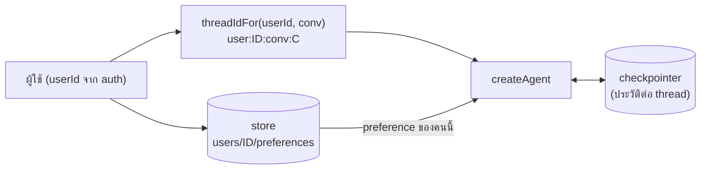

# Part 12 — Agent Memory & Persistence

ระดับ: Intermediate · เวลา: 90–120 นาที · ตัวอย่าง: `examples/part-12/` · Workshop: `workshops/part-12/`
ต้องรัน PostgreSQL ก่อนสำหรับ 12-05, 12-06, 12-08 และ workshop: `docker compose up -d` (พอร์ต 5435 — ดู README หลัก)

## 1. Introduction

LLM เป็น stateless (Part 01) — Part 04 เราส่งประวัติเองทุกครั้ง Part นี้ให้ agent **จำเอง**: จำบทสนทนาด้วย *checkpointer*, จำตัวผู้ใช้ข้ามบทสนทนาด้วย *store*, รอดการรีสตาร์ทด้วย PostgreSQL — และจัดการเรื่องที่ตามมา: ประวัติยาวเกิน, ผู้ใช้หลายคน, สิทธิ์เข้าถึง

## 2. Learning Objectives

อธิบายความต่างของ state / short-term memory / long-term memory / context · ใช้ `MemorySaver` และ `PostgresSaver` กับ `thread_id` · เก็บ preference ด้วย store แยก namespace ต่อผู้ใช้ · ตัด/สรุปประวัติโดยไม่ทำให้ลำดับข้อความพัง · ออกแบบการแยกผู้ใช้และตรวจสิทธิ์ thread

## 3. Concept Explanation

| แนวคิด | คืออะไร | อยู่ที่ไหน | อายุ |
|---|---|---|---|
| **State** | ข้อมูลของ agent ระหว่างรัน (`messages`) | ในกราฟ | 1 การรัน |
| **Short-term memory** | state ที่ถูก checkpoint ต่อ thread | checkpointer (`MemorySaver`/`PostgresSaver`) | ตลอด thread |
| **Long-term memory** | ข้อเท็จจริงเกี่ยวกับผู้ใช้ ข้ามทุก thread | store (`InMemoryStore`/`PostgresStore`) | จนกว่าจะลบ |
| **Context** | สิ่งที่ส่งให้โมเดล *ครั้งนี้* (system prompt + messages ที่เลือก + preference) | ประกอบตอนเรียก | 1 การเรียก |

- **thread_id** = กุญแจของบทสนทนา ส่งใน `{ configurable: { thread_id } }` ทุกครั้ง (12-02/12-03); thread ต่างกันแยกกันสนิท (12-04)
- **checkpointer** บันทึก state หลังทุกขั้น → ต่อบทสนทนาได้ แม้ปิดโปรแกรม (ถ้าใช้ Postgres: 12-05/12-06). `PostgresSaver` ต้องเรียก `.setup()` ครั้งแรก (helper `withPostgresMemory` ทำให้)
- **store** เก็บเป็น (namespace, key) → value; เราใช้ `["users", userId, "preferences"]` (12-07/12-08)
- **ตัดประวัติ** (12-09): `trimMessages` ต้อง `startOn: "human"` เพื่อไม่ทิ้ง `ToolMessage` ที่ไม่มี `AIMessage` ขอ tool
- **สรุปประวัติ** (12-10): สรุปข้อความเก่าเป็นข้อความเดียวแล้วเก็บของใหม่ไว้ครบ — ลด token โดยไม่ลืมสาระ (แต่สรุปอาจทิ้งรายละเอียดและมีค่าใช้จ่ายอีกหนึ่งการเรียก)

## 4. Problem Demonstration

12-01: agent ไม่มี checkpointer — ถามชื่อในการเรียกถัดไป
```
คำถามที่สอง → ตอบว่า: ขออภัย ฉันไม่ทราบว่าคุณชื่ออะไร คุณช่วยบอกฉันได้ไหม?
จำนวนข้อความใน state: 2 (มีแค่คำถามนี้กับคำตอบ)
```

## 5. Solution

`createAgent({ ..., checkpointer })` + `thread_id`; preference ใน store; ตรวจสิทธิ์ด้วย `threadIdFor` / `assertThreadOwner` (`src/memory/thread-access.ts`) และ `getPreferences`/`savePreference` (`src/memory/preferences.ts`)

## 6. Visual Explanation



## 7. Coding Examples

รัน `pnpm play 12-N` (ผล LLM เป็นตัวอย่าง — ไม่เหมือนเดิมทุกครั้ง)

**12-01 No Memory** — ดูหัวข้อ 4

**12-02 MemorySaver**
```
ตอบว่า: คุณชื่อมะลิค่ะ!
จำนวนข้อความใน state: 4
```
**12-03 Same Thread**
```
> ฉันชอบกาแฟเย็น            → [state: 2 ข้อความ]
> ฉันบอกอะไรเกี่ยวกับเครื่องดื่มไปบ้าง → คุณบอกว่าชอบกาแฟเย็น.  [state: 4 ข้อความ]
> แล้วควรสั่งอะไรกินคู่กัน    → [state: 6 ข้อความ]
ข้อความที่ checkpointer เก็บ: 6
```
**12-04 Two Threads**
```
[A] > ฉันชื่ออะไร → สมชายครับ!
[B] > ฉันชื่ออะไร → คุณชื่อสมหญิงค่ะ.
[C] > ฉันชื่ออะไร → ไม่รู้.
```
**12-05 PostgresSaver**
```
ตอบว่า: คุณชื่อมะลิค่ะ.
thread: demo-pg-1795594723728 | state ใน Postgres: 4 ข้อความ
```
**12-06 Resume After Restart** — agent + connection ใหม่หมด thread เดิม
```
--- โปรเซสที่ 1 ---   บันทึกแล้ว แล้วปิด connection ทั้งหมด
--- โปรเซสที่ 2 (agent + connection ใหม่หมด) ---
ตอบว่า: รหัสโครงการของคุณคือ ORCHID-42.
```
**12-07 Store Preferences**
```
alice: { language: 'ไทย', tone: 'สุภาพ ลงท้ายค่ะ' }
bob:   { language: 'English' }
carol: {} (ไม่เคยบันทึก)
หลังลบข้อมูลของ alice → alice: {} | bob ยังอยู่: { language: 'English' }
userId แปลกๆ ถูกปฏิเสธ: userId ไม่ถูกต้อง (ใช้ได้เฉพาะ a-z 0-9 _ -)
```
**12-08 Long-term Memory (thread ใหม่ยังรู้จักผู้ใช้)**
```
[a-…] > แนะนำวิธีจัดโต๊ะทำงานหน่อย → …เพื่อเพิ่มประสิทธิภาพและความสะดวกสบายค่ะ
[b-…] > แนะนำอาหารเช้าหน่อย        → อาหารเช้าอร่อย ๆ ลองข้าวต้มกุ้งหรือไข่เจียวกับข้าวสวยค่ะ
ลบ preference ของ demo-user-12-08 แล้ว: {}
```
**12-09 Trim Conversation**
```
เดิม      : human → ai → tool → ai → human → ai → tool → ai → human
slice(-7) : tool → ai → human → ai → tool → ai → human      ← เริ่มที่ tool
trimMessages: human → ai → tool → ai → human
slice(-7)    มี ToolMessage กำพร้า: true
trimMessages มี ToolMessage กำพร้า: false
```
**12-10 Summarize Old Messages**
```
สรุปของ 5 ข้อความเก่า: มะลิ นักบัญชี แผนเที่ยวเชียงใหม่ 3 วัน งบ 8,000 บาท เน้นคาเฟ่และแพ้ถั่ว.
ก่อน: 7 ข้อความ → หลัง: 3 ข้อความ
```

## 8. Common Mistakes

| ข้อผิดพลาด | ผล | แก้ |
|---|---|---|
| ลืมส่ง `thread_id` | error หรือไม่จำ | ส่งทุกครั้งที่มี checkpointer |
| ใช้ thread เดียวกันทุกผู้ใช้ | **ผู้ใช้เห็นข้อมูลกัน** | `threadIdFor(userId, conv)` |
| รับ `thread_id` จาก client โดยไม่ตรวจ | ผู้ใช้เปิดบทสนทนาคนอื่น (IDOR) | `assertThreadOwner(userId จาก auth, threadId)` ก่อนเสมอ |
| ใช้ `MemorySaver` ใน production | ปิดโปรแกรมแล้วหาย | `PostgresSaver` |
| ไม่เรียก `checkpointer.setup()` | ตารางไม่มี | เรียกครั้งแรก (helper ทำให้) |
| `slice(-N)` ตัดประวัติ | ToolMessage กำพร้า → provider ตอบ 400 | `trimMessages({ startOn: "human" })` |
| ใส่ preference ของผู้ใช้ทุกคนใน prompt | รั่ว/ปนกัน | อ่านเฉพาะ `userId` ของผู้เรียก |
| `agent.getState()` | เป็น internal API ของ `createAgent` (type เป็น `never`) | อ่านผ่าน `checkpointer.getTuple(config)` |

## 9. Best Practices

- **Security:** `userId` มาจาก session ที่พิสูจน์ตัวตนแล้วเท่านั้น; id ที่ประกอบเอง (`user:ID:conv:C`) ห้ามมี `:`; ตรวจสิทธิ์ก่อนแตะโมเดล/ฐานข้อมูล; preference คือข้อมูลส่วนบุคคล — อย่าเก็บเกินจำเป็น
- **Retention/Privacy:** กำหนดอายุข้อมูล และมีทางลบข้อมูลของผู้ใช้ (`deletePreferences`; checkpoint ลบตาม thread) — PII ในประวัติแชตก็เป็นข้อมูลที่ต้องดูแล
- **Cost:** ประวัติยาว = token มาก → trim หรือสรุป
- **Reliability:** ปิด connection เสมอ (`finally`); error ตอน Postgres ล่มควรบอกวิธีแก้
- **Testing:** ทดสอบ memory ด้วย scripted model + `MemorySaver`/`InMemoryStore` (ดู `tests/part12-memory.test.ts`) ส่วน Postgres ทดสอบด้วยการรันจริง

## 10. Exercises

**Basic:** ใน 12-04 เพิ่ม thread D แล้วทดสอบว่าไม่รู้ชื่อ
**Intermediate:** ทำ 12-10 ให้สรุปอัตโนมัติเมื่อประวัติเกิน 10 ข้อความ และเก็บสรุปไว้ใน store
**Challenge:** เพิ่มคำสั่ง `--list-conversations` ที่แสดงเฉพาะบทสนทนาของ `--user` (คิดว่าจะ query อย่างไรโดยไม่เห็นของผู้อื่น)

## 11. Workshop

[`workshops/part-12/README.md`](../../workshops/part-12/README.md) — Personal AI Assistant (CLI) ที่แยกผู้ใช้ จำต่อบทสนทนา เก็บ preference และต่อได้หลังรีสตาร์ท

## 12. Summary

- checkpointer + `thread_id` = จำบทสนทนา; store = จำผู้ใช้
- Postgres ทำให้ memory รอดการรีสตาร์ท
- แยกผู้ใช้ด้วย id ที่ผูก `userId` + ตรวจสิทธิ์ทุกครั้ง; ลบข้อมูลได้
- ตัดประวัติต้องรักษาลำดับ (`startOn: "human"`); หรือสรุปแทน
- API: `MemorySaver`, `PostgresSaver`, `PostgresStore`, `InMemoryStore`, `trimMessages`, `thread_id`

## 13. Knowledge Check

1. (Concept) state, short-term memory และ long-term memory ต่างกันอย่างไร? แต่ละอย่างเก็บที่ไหน?
2. (Concept) ทำไมไม่ควรให้ client ส่ง `thread_id` มาเองแล้วใช้เลย?
3. (Code reading) ใน 12-09 ทำไม `slice(-7)` อันตราย แต่ `trimMessages` ปลอดภัย?
4. (Practical) ผู้ใช้ขอให้ลบข้อมูลทั้งหมดของเขา — ต้องลบอะไรบ้างในระบบนี้?
5. (Practical) ประวัติยาวมากจนเสียค่า token เมื่อไรควรเลือก trim และเมื่อไรควรเลือกสรุป?

## 14. Next Part

Part 13 เริ่ม Module 4 (Knowledge & RAG): โหลดและแบ่งเอกสาร (Document Loaders & Text Splitters) เพื่อให้ AI ใช้ความรู้ของเรา
