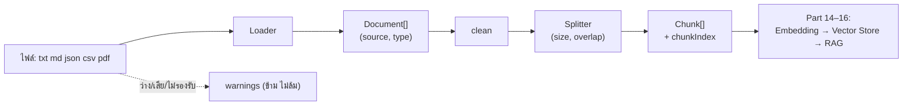

# Part 13 — Documents, Loaders & Text Splitters

ระดับ: Intermediate · เวลา: 60–90 นาที · ตัวอย่าง: `examples/part-13/` · ข้อมูล: `data/curriculum/` · Workshop: `workshops/part-13/`
Part นี้ **ไม่เรียก LLM และไม่ต้องใช้ Docker** — รันซ้ำได้ ผลเหมือนเดิมทุกครั้ง

## 1. Introduction

Module 4 เริ่มที่นี่: ให้ AI ตอบจาก "ความรู้ของเรา" (เอกสารโรงเรียน, คู่มือ, ข้อมูลบริษัท) ได้ ก้าวแรกคือแปลงไฟล์หลายชนิดให้เป็น `Document` แล้วแบ่งเป็นชิ้นเล็ก (chunk) ที่พอดีกับการค้นหาในอีก 3 Part ถัดไป (Embeddings → Vector Store → RAG)

## 2. Learning Objectives

เข้าใจ `Document` (pageContent + metadata) · โหลด txt/md/json/csv/pdf · เลือก splitter และตั้ง `chunkSize`/`chunkOverlap` ได้อย่างมีเหตุผล · รักษา metadata เพื่อย้อนไปหาไฟล์ต้นทาง · รับมือไฟล์ว่าง/เสีย/ไม่รองรับโดยไม่ล้มทั้งงาน

## 3. Concept Explanation

**Document** = `{ pageContent: string, metadata: object }` — metadata ไม่ไปถึงโมเดลเอง เราเลือกเองว่าจะใส่อะไรใน prompt (เช่นชื่อไฟล์เพื่ออ้างอิง)

| ไฟล์ | Loader (แพ็กเกจ) | 1 Document คือ |
|---|---|---|
| .txt / .md | `TextLoader` (`@langchain/classic/document_loaders/fs/text`) | ทั้งไฟล์ |
| .json | `JSONLoader` (`…/fs/json`) | ทุก string ใน JSON (หรือเฉพาะ JSON pointer ที่ระบุ) |
| .csv | `CSVLoader` (`@langchain/community/document_loaders/fs/csv`, ต้องมี `d3-dsv`) | 1 แถว |
| .pdf | `PDFLoader` (`@langchain/community/document_loaders/fs/pdf`) | 1 หน้า |

**ทำไมต้องแบ่ง:** (1) เอกสารยาวเกิน context window/เปลือง token (2) embedding ของข้อความยาวเฉลี่ยหลายเรื่องจนค้นไม่แม่น (3) ต้องการส่งโมเดลเฉพาะส่วนที่เกี่ยวข้อง

**Splitters** (`@langchain/textsplitters`)
- `CharacterTextSplitter` — ตัวคั่นเดียว (13-06) ถ้าไม่เจอตัวคั่นจะไม่ตัด
- `RecursiveCharacterTextSplitter` — ลอง `"\n\n"` → `"\n"` → `" "` → `""` ตามลำดับ (13-07) **ใช้เป็นค่าเริ่มต้น**; ตัวคั่น `""` ทำให้ข้อความไทยที่ไม่มีช่องว่างยังถูกตัดตามขนาดเสมอ

**chunkSize / chunkOverlap (13-08)**

| | เล็ก (≈150) | ใหญ่ (≈1000) |
|---|---|---|
| ข้อดี | ค้นตรงประเด็น ส่ง token น้อย | บริบทครบ ประโยคไม่ขาด |
| ข้อเสีย | ขาดบริบท จำนวน chunk/ค่า embedding มาก | ปนหลายเรื่อง ค้นไม่แม่น เปลือง token |

`chunkOverlap` ให้ chunk ติดกันซ้อนกันบางส่วน กันประโยคที่ถูกตัดกลางขาดความหมาย (ประมาณ 10% ของ chunkSize เป็นจุดเริ่ม) — ต้องน้อยกว่า `chunkSize` เสมอ

**Preprocessing:** ทำความสะอาดก่อนแบ่ง (ยุบช่องว่าง ตัด control character) · อย่าลบเนื้อหาจริง · เก็บ `source`/`type`/`chunkIndex` ทุก chunk (13-09)

## 4. Problem Demonstration

13-06: `CharacterTextSplitter` ด้วยตัวคั่น `" "` กับข้อความไทยไม่มีช่องว่าง 900 ตัวอักษร:
```
ข้อความ 900 ตัวอักษรไม่มีช่องว่าง + separator " " → 1 chunk ยาว 900 (เกิน chunkSize 300!)
```

## 5. Solution

ใช้ `RecursiveCharacterTextSplitter` (13-07) ผ่าน `chunkDocuments()` ใน `src/rag/load-curriculum.ts` (ตั้ง separators ไทย-friendly, ตรวจ overlap, ใส่ `chunkIndex`) และ `loadCurriculum()` ที่รวมทุกประเภทไฟล์ พร้อม `warnings` แทนการล้ม

## 6. Visual Explanation



## 7. Coding Examples

รัน `pnpm play 13-N` — ข้อมูลตัวอย่างอยู่ที่ `data/curriculum/` (ข้อมูลสมมติของ "โรงเรียนตัวอย่างวิทยา")

**13-01 Create Document**
```
pageContent: วิชาคณิตศาสตร์ ม.1 เรียนสัปดาห์ละ 4 คาบ คาบละ 50 นาที
metadata   : { source: 'math-m1.md', subject: 'คณิตศาสตร์', grade: 1 }
ความยาว    : 53 ตัวอักษร
```
**13-02 Load Text File**
```
จำนวน Document: 1
metadata: { source: 'data/curriculum/science-m1.txt' }
ยาว: 1223 ตัวอักษร
```
**13-03 Load JSON File** — ไม่ระบุ pointer ได้ 29 Document เล็กๆ; ระบุ pointer เลือกฟิลด์ได้
```
ทุก string: 29 Document → [ 'โรงเรียนตัวอย่างวิทยา', 'ม.1/1', 'ข้อมูลสมมติเพื่อการเรียนการสอนเท่านั้น' ]
เลือกเฉพาะ pointer: [ 'จันทร์', 'อังคาร' ] | metadata[0]: { source: 'data/curriculum/schedule.json', line: 1 }
```
**13-04 Load CSV File**
```
จำนวน Document: 5 (5 แถวข้อมูล)
รายการ: ค่าเล่าเรียนภาคเรียนที่ 1 / จำนวนเงิน (บาท): 3500 / กำหนดชำระ: ภายในวันที่ 15 พฤษภาคม / หมายเหตุ: ผ่อนชำระได้ 2 งวด
metadata: { source: 'data/curriculum/fees.csv', line: 1 }
```
**13-05 Load PDF File** (PDF ตัวอย่างเป็นภาษาอังกฤษ เพราะเครื่องมือสร้าง PDF ในเครื่องไม่ฝังฟอนต์ไทย)
```
จำนวนหน้า/Document: 1
metadata.loc: { pageNumber: 1 } | totalPages: 1
Student Handbook (extract) — Sample School / Attendance: Students must attend at least 80 percent …
```
**13-06 CharacterTextSplitter** — ดูหัวข้อ 4 + `เอกสาร 1223 ตัวอักษร → 4 chunk (แบ่งที่ย่อหน้า) [ 300, 368, 315, 233 ]`

**13-07 RecursiveCharacterTextSplitter**
```
1223 ตัวอักษร → 4 chunk: [ 300, 368, 315, 233 ]
metadata ของ chunk: { lines: { from: 7, to: 11 } }
ข้อความ 900 ตัวอักษรไม่มีช่องว่าง → 4 chunk ยาวสูงสุด 300
```
**13-08 Compare Chunk Sizes**
```
เอกสาร md/txt 5 ไฟล์ รวม 4892 ตัวอักษร
chunkSize | overlap | chunks | เฉลี่ย | สั้นสุด | ยาวสุด
      150 |      15 |     56 |    87 |      10 |    148
      400 |      40 |     17 |   286 |      85 |    378
     1000 |     100 |      7 |   698 |     233 |    987
```
**13-09 Preserve Metadata**
```
warnings: (ไม่มี)
chunk ต่อไฟล์: activities.md 2 · fees.csv 5 · handbook-extract.txt 1 · handbook.pdf 1 · math-m1.md 4 · schedule.json 29 · science-m1.txt 4 · thai-m1.md 3
ตัวอย่าง chunk: { source: 'math-m1.md', type: 'md', chunkIndex: 1, loc: { lines: { from: 8, to: 13 } } }
ทุก chunk มี source: true
```

## 8. Common Mistakes

| ข้อผิดพลาด | ผล | แก้ |
|---|---|---|
| `chunkOverlap >= chunkSize` | splitter ไม่ทำงาน/ค้าง | ตรวจก่อน (`chunkDocuments` โยน error) |
| ใช้ separator `" "` กับภาษาไทย | ไม่ตัด chunk ใหญ่เกิน | ใช้ Recursive + `""` สุดท้าย |
| แบ่งทุกชนิดไฟล์ด้วยขนาดเดียว | JSON/CSV แตกเป็นชิ้นจิ๊บจ๊อย (ดู schedule.json = 29 chunk เฉลี่ย 10 ตัวอักษร) | แยกกลยุทธ์ตามชนิด: JSON ใช้ pointer, CSV 1 แถวมักพอแล้ว |
| ทิ้ง metadata | ไม่รู้ว่า chunk มาจากไหน อ้างอิง/ลบ/อัปเดตไม่ได้ | `source`, `type`, `chunkIndex` ทุก chunk |
| ไฟล์ว่าง/เสียทำให้ทั้ง pipeline ล้ม | โหลดไม่ครบ | เก็บเป็น `warnings` แล้วทำต่อ |
| PDF สแกน (ภาพ) ได้ข้อความว่าง | ไม่มีข้อมูล | ตรวจ/เตือน; ใช้ OCR นอกขอบเขต |
| CSV loader error `Cannot find package 'd3-dsv'` | peer dependency ไม่ได้ติดตั้ง | `pnpm add d3-dsv` |
| เชื่อเนื้อหาไฟล์ทุกบรรทัด | ไฟล์อาจแฝงคำสั่ง (เช่น "ละเว้นคำสั่งก่อนหน้า…" ใน `activities.md`) | เนื้อหาเอกสารคือ *ข้อมูล* ไม่ใช่คำสั่ง — Part 16 ป้องกันใน prompt |

## 9. Best Practices

- **Security:** เอกสารภายนอกเป็น untrusted input (prompt injection) — เก็บ `source` ไว้เพื่อตรวจ/กรอง; ห้ามใส่ข้อมูลส่วนบุคคลจริงในข้อมูลตัวอย่าง
- **Reliability:** โหลดแบบ "ข้ามไฟล์เสียพร้อมแจ้ง" ไม่ใช่ล้มทั้งงาน; ทดสอบกับไฟล์ว่าง/ไม่รองรับ
- **Quality:** ปรับ `chunkSize` ด้วยการวัดกับคำถามจริง (Part 16 ประเมิน) ไม่ใช่เดา
- **Cost:** chunk มากขึ้น = embedding มากขึ้น (Part 14) เลือกเท่าที่จำเป็น
- **Testing:** ทดสอบ loader/splitter ด้วยข้อมูลจริงในโฟลเดอร์ + edge case (`tests/part13-documents.test.ts`)

## 10. Exercises

**Basic:** เพิ่มไฟล์ `.md` ใหม่ใน `data/curriculum/` แล้วรัน 13-09 ดูว่าปรากฏในรายการ
**Intermediate:** ปรับ `loadCurriculum` ให้ JSON ใช้ pointer ที่กำหนดได้ต่อไฟล์ เพื่อไม่ให้ `schedule.json` แตกเป็น 29 ชิ้น
**Challenge:** เขียน splitter เฉพาะ markdown ที่แบ่งตามหัวข้อ `##` แล้วเก็บชื่อหัวข้อใน `metadata.section` (ลองเทียบกับ `RecursiveCharacterTextSplitter.fromLanguage("markdown")`)

## 11. Workshop

[`workshops/part-13/README.md`](../../workshops/part-13/README.md) — Document Processing Pipeline: load → clean → split → สถิติต่อไฟล์

## 12. Summary

- Document = pageContent + metadata; loader ต่างชนิดให้ Document ต่างหน่วย (ไฟล์/แถว/หน้า)
- แบ่งด้วย Recursive splitter; chunk เล็ก vs ใหญ่ เป็น trade-off ที่ต้องวัด; overlap ต้อง < size
- เก็บ `source`/`type`/`chunkIndex` ทุก chunk; ข้ามไฟล์เสียแบบมี warning
- API: `Document`, `TextLoader`, `JSONLoader`, `CSVLoader`, `PDFLoader`, `CharacterTextSplitter`, `RecursiveCharacterTextSplitter`, `splitDocuments`

## 13. Knowledge Check

1. (Concept) ทำไมไม่ส่งเอกสารทั้งไฟล์ให้โมเดลเลย แต่ต้องแบ่ง chunk?
2. (Concept) `chunkOverlap` ช่วยอะไร และทำไมต้องน้อยกว่า `chunkSize`?
3. (Code reading) ใน 13-06 ทำไมข้อความ 900 ตัวอักษรจึงได้ chunk เดียวยาว 900 แต่ใน 13-07 ได้ 4 chunk?
4. (Practical) `schedule.json` ได้ 29 chunk ยาวเฉลี่ย 10 ตัวอักษร จะปรับอย่างไรให้ใช้ค้นหาได้ดีขึ้น?
5. (Practical) PDF ที่ได้ข้อความว่างควรจัดการอย่างไรในระบบจริง?

## 14. Next Part

Part 14 แปลง chunk เป็น **embedding** (เวกเตอร์ตัวเลข) เพื่อค้นหาตามความหมาย และวัดความคล้ายด้วย cosine similarity
