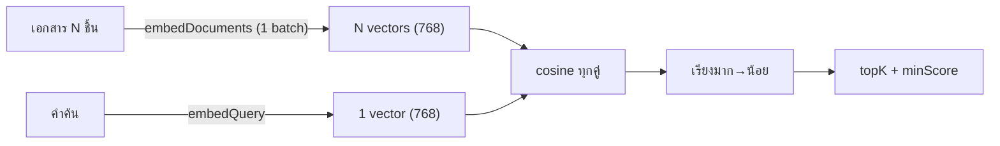

# Part 14 — Embeddings & Semantic Search

ระดับ: Intermediate · เวลา: 90 นาที · ตัวอย่าง: `examples/part-14/` · Workshop: `workshops/part-14/`
14-01, 14-02 ทำงานออฟไลน์; 14-03 ถึง 14-09 เรียก **Gemini embeddings (free tier)** ต้องมี `GOOGLE_API_KEY` ใน `.env` (ไม่ต้องใช้ Docker ใน Part นี้)

## 1. Introduction

Part 13 เตรียม chunk แล้ว — คำถามคือจะ "หา chunk ที่เกี่ยวข้อง" อย่างไร? ค้นด้วยคำ (keyword) พลาดเมื่อผู้ใช้ใช้คำคนละคำกับเอกสาร ("อุปกรณ์สำหรับเขียนโปรแกรม" ไม่มีคำนี้ในคำอธิบาย Laptop เลย) Part นี้ใช้ **embedding** แปลงข้อความเป็นเวกเตอร์ แล้วค้นด้วยความใกล้เคียงของความหมาย

## 2. Learning Objectives

อธิบาย vector/embedding และ query vs document embedding · เทียบ cosine / dot product / Euclidean · ใช้ `embedQuery`/`embedDocuments` · ทำ semantic search + top-K + minScore เอง · รู้ข้อจำกัด (ไม่เข้าใจการปฏิเสธ, คะแนนอัดแคบ, ผลไม่รับประกันความถูกต้อง)

## 3. Concept Explanation

**ประเภทการค้นหา:** exact match (`=`) · keyword/full-text (หาคำ, จัดอันดับด้วยความถี่) · **semantic** (ใกล้ตามความหมาย) — ใช้ร่วมกันได้ (hybrid)

**Embedding** = โมเดลที่แปลงข้อความเป็น vector ความยาวคงที่ (ที่นี่ 768 มิติ) ข้อความความหมายใกล้กันอยู่ใกล้กัน (14-01 วาดภาพ 2 มิติ, 14-06 วัดจริง: "โน้ตบุ๊กสำหรับนักพัฒนาซอฟต์แวร์" 0.819, ภาษาอังกฤษประโยคเดียวกัน 0.793, "ร้านนี้มีกาแฟอร่อยมาก" 0.563)

**ตัววัดความคล้าย (14-02)**

| ตัววัด | ความหมาย | ค่า | หมายเหตุ |
|---|---|---|---|
| cosine similarity | มุมระหว่าง vector | −1 … 1 (มาก = คล้าย) | ไม่สนความยาว — **ใช้เป็นค่าเริ่มต้น** |
| dot product | ผลคูณภายใน | ไม่จำกัด | เท่ากับ cosine เมื่อ vector เป็น unit |
| Euclidean | ระยะห่าง | 0 … ∞ (น้อย = คล้าย) | ไวต่อความยาว |

`gemini-embedding-001` ที่ตั้ง 768 มิติไม่ใช่ unit vector (14-04: norm ≈ 0.59) — ใช้ cosine จึงไม่กระทบ

**Query vs Document embedding:** โมเดลหลายตัวแยก "ประเภทงาน" — Gemini มี task `RETRIEVAL_DOCUMENT` (ฝั่งเอกสาร) และ `RETRIEVAL_QUERY` (ฝั่งคำค้น) ตัวห่อ LangChain กำหนด task ต่อ *instance* จึงสร้างสองตัว (`createEmbeddings("RETRIEVAL_DOCUMENT")` / `("RETRIEVAL_QUERY")`) และ `semanticSearch` รับ `queryEmbeddings` แยกได้ — วัดจริงกับชุดข้อมูลนี้ช่วยให้อันดับคมขึ้นเล็กน้อย

**เลือก provider:** มิติ (ค่าเก็บ/ความเร็ว), รองรับหลายภาษา (ไทย-อังกฤษข้ามภาษาได้ ดู 14-06), ค่าใช้จ่าย/โควตา (Gemini free tier มีโควตาต่อนาที), รันเองได้หรือไม่ — **เปลี่ยนโมเดล = ต้อง embed เอกสารใหม่ทั้งหมด** และมิติต้องตรงกับคอลัมน์ใน Vector Store (Part 15)

**API:** `embedQuery(text): number[]` · `embedDocuments(texts): number[][]` (batch ครั้งเดียว) · `semanticSearch({ query, documents, embeddings, queryEmbeddings?, topK, minScore })` ใน `src/rag/semantic-search.ts`

## 4. Problem Demonstration

14-09: keyword search ไม่พบอะไรเลยสำหรับ "อุปกรณ์สำหรับเขียนโปรแกรม" และ "computer for coding":
```
คำค้น: "อุปกรณ์สำหรับเขียนโปรแกรม"   keyword : (ไม่พบ)
คำค้น: "computer for coding"         keyword : (ไม่พบ)
```

## 5. Solution

`semanticSearch` — embed เอกสารทีเดียว (batch) + embed query → cosine → เรียง → `topK`/`minScore`

## 6. Visual Explanation



## 7. Coding Examples

รัน `pnpm play 14-N` (ผลจาก Gemini จริง; คะแนนอาจต่างเล็กน้อยตามเวอร์ชันโมเดล)

**14-01 Basic Vector** (ออฟไลน์)
```
Laptop     [ 0.95, 0.02 ]    Keyboard   [ 0.9, 0.05 ]    กาแฟ  [ 0.05, 0.9 ]    ข้าวผัด [ 0.02, 0.95 ]
ระยะห่าง Laptop↔Keyboard: 0.058 (ใกล้)   |   Laptop↔กาแฟ: 1.259 (ไกล)
```
**14-02 Simple Cosine Similarity** (ออฟไลน์)
```
เทียบกับ                cosine    dot  euclid
ทิศเดียวกัน [2, 0]       1.000    2.0    1.00
ใกล้เคียง [0.9, 0.1]     0.994    0.9    0.14
ตั้งฉาก [0, 1]           0.000    0.0    1.41
ตรงข้าม [-1, 0]         -1.000   -1.0    2.00
vector ศูนย์: 0 (ไม่หารศูนย์ — คืน 0)
```
**14-03 Initialize Embedding Model**
```
คลาส: GoogleGenerativeAIEmbeddings | มิติที่ตั้งไว้: 768 | ลองเรียก 1 ครั้ง → ความยาว vector: 768
```
**14-04 embedQuery()**
```
ความยาว vector: 768 | 5 ค่าแรก: [ 0.0548, -0.0178, 0.008, -0.0338, 0.0139 ]
ความยาว (norm): 0.590 (ไม่ใช่ unit vector — ใช้ cosine จึงไม่กระทบ)
```
**14-05 embedDocuments()**
```
ส่ง 5 ข้อความใน 1 คำขอ → ได้ 5 vector | ความยาวแต่ละ vector: [ 768, 768, 768, 768, 768 ]
```
**14-06 Compare Text Similarity** — ประโยคตั้งต้น "ฉันอยากซื้อคอมพิวเตอร์พกพาไว้เขียนโค้ด"
```
0.819 ← โน้ตบุ๊กสำหรับนักพัฒนาซอฟต์แวร์
0.793 ← I want to buy a laptop for programming
0.563 ← ร้านนี้มีกาแฟอร่อยมาก
0.836 ← ซื้อคอมพิวเตอร์พกพา
```
**14-07 Manual Semantic Search** — "อุปกรณ์สำหรับเขียนโปรแกรม" จัดอันดับทั้ง 14 รายการ
```
 1 0.682 Mechanical Keyboard     4 0.618 USB-C Hub        9 0.566 กระทะเทฟลอน
 2 0.681 Laptop                  5 0.616 สมุดโน้ตปกแข็ง     … 14 0.530 หูฟังตัดเสียงรบกวน
 3 0.678 Monitor 27 นิ้ว         6 0.597 Wireless Mouse
```
**14-08 Top-K Search**
```
topK=3                  Wireless Mouse (0.68), Monitor 27 นิ้ว (0.67), โคมไฟตั้งโต๊ะ LED (0.65)
topK=5 minScore=0.6     (5 รายการ เพราะทุกตัวผ่าน 0.6)
นอกขอบเขต topK=3         Wireless Mouse (0.58), USB-C Hub (0.56), Laptop (0.56)   ← ไม่เกี่ยวแต่ยังถูกคืนมา
นอกขอบเขต + minScore=0.6 (ไม่มีผล)
```
**14-09 Compare Keyword and Semantic**
```
"อุปกรณ์สำหรับเขียนโปรแกรม"  keyword: (ไม่พบ)                semantic: Mechanical Keyboard (0.68), Laptop (0.68), Monitor 27 นิ้ว (0.68)
"keyboard"                    keyword: Mechanical Keyboard     semantic: Mechanical Keyboard (0.64), Wireless Mouse (0.58), Webcam Full HD (0.57)
"computer for coding"         keyword: (ไม่พบ)                semantic: Laptop (0.70), Monitor 27 นิ้ว (0.65), Mechanical Keyboard (0.65)
```

## 8. Common Mistakes

| ข้อผิดพลาด | ผล | แก้ |
|---|---|---|
| ใช้ topK อย่างเดียว | คืนของไม่เกี่ยวเสมอ (14-08 "รถยนต์ไฟฟ้า" ได้ Wireless Mouse) | ใช้ `minScore` ที่ calibrate จากข้อมูลจริง |
| ตั้ง minScore จากความรู้สึก | คะแนน Gemini อัดกันแคบ ~0.5–0.7 | วัดคะแนน "ตรงเรื่อง" vs "ไม่เกี่ยว" ในชุดข้อมูลของคุณก่อน |
| embed เอกสารทีละชิ้นในลูป | ช้า เปลืองโควตา | `embedDocuments` ครั้งเดียว |
| embed เอกสารใหม่ทุกครั้งที่ค้น | เสียเงิน/โควตา | เก็บ vector ไว้ (Part 15) |
| เปลี่ยนโมเดล/มิติโดยไม่ embed ใหม่ | ผลเพี้ยน หรือ error ตอนเปรียบเทียบ | ผูกเวอร์ชันโมเดลกับข้อมูล |
| คาดหวังให้เข้าใจ "การปฏิเสธ" | "อุปกรณ์ที่ไม่ใช่คีย์บอร์ด" ได้ Mechanical Keyboard ติด top 3 | กรองเงื่อนไขด้วย metadata/โค้ด ไม่ใช่ด้วย embedding |
| Gemini free tier โควตาเต็ม | **คืน vector ว่างโดยไม่โยน error** → `Vector length mismatch: 768 vs 0` | ตรวจ vector ว่าง (`semanticSearch` ตรวจให้และบอกสาเหตุ) + retry รอแล้วลองใหม่ |
| เชื่อคะแนนเป็นความจริง | embedding ไม่รับประกันว่าผลถูกต้อง | แสดงแหล่งที่มา ให้คนตรวจในงานสำคัญ |

## 9. Best Practices

- **Reliability:** ตรวจผลจาก provider (vector ว่าง/จำนวนไม่ครบ), retry พร้อม backoff, ทดสอบด้วย `createFakeEmbeddings` และ stub 2 มิติ (`tests/part14-semantic.test.ts`) ไม่ต้องเรียก API
- **Cost/Quota:** batch, cache vector (Part 15), pace การรันตัวอย่าง
- **Quality:** แยก task ของเอกสาร/คำค้น; ตั้ง `minScore` จากข้อมูลจริง; เก็บชุดคำถามทดสอบไว้วัดเมื่อเปลี่ยนโมเดล
- **Security/Privacy:** ข้อความที่ embed ถูกส่งไปยัง provider — อย่าส่งข้อมูลส่วนบุคคลที่ไม่ได้รับอนุญาต; อย่าเก็บ API key ในโค้ด
- **Honesty:** เอกสารตัวอย่างใน `semantic-products.ts` ถูกปรับถ้อยคำเพื่อให้การสอนชัด (เช่น ใส่คำว่านักพัฒนาในคำอธิบาย Monitor) — ข้อมูลจริงของคุณต้องวัดผลเอง

## 10. Exercises

**Basic:** ใน 14-06 เพิ่มประโยคภาษาอังกฤษ/ไทยที่ความหมายตรงข้าม ("ฉันไม่อยากซื้อคอมพิวเตอร์") ดูคะแนน
**Intermediate:** ทำ hybrid: รวมคะแนน keyword กับ semantic (เช่น 0.3×keyword + 0.7×semantic) แล้วเทียบกับ 14-09
**Challenge:** วัดคุณภาพ: เขียน 10 คำค้น + สินค้าที่ "ควรเจอ" แล้วคำนวณ recall@3 ของ semantic vs keyword

## 11. Workshop

[`workshops/part-14/README.md`](../../workshops/part-14/README.md) — Semantic Product Search

## 12. Summary

- embedding แปลงความหมายเป็นเวกเตอร์; cosine เป็นตัววัดมาตรฐาน
- `embedDocuments` (batch) + `embedQuery`; ใช้ task แยกเอกสาร/คำค้น
- topK + minScore (calibrate เอง); semantic ชนะเมื่อคำไม่ตรง แต่ไม่เข้าใจการปฏิเสธ
- ตรวจผลจาก provider และจัดการโควตา
- API: `embedQuery`, `embedDocuments`, `cosineSimilarity`, `semanticSearch`, `GoogleGenerativeAIEmbeddings`

## 13. Knowledge Check

1. (Concept) ทำไม cosine ไม่สนความยาวของ vector และเมื่อไรที่ควรเลือก dot product?
2. (Concept) ทำไม semantic search หา Laptop เจอจาก "อุปกรณ์สำหรับเขียนโปรแกรม" แต่ keyword ไม่เจอ?
3. (Code reading) ใน 14-08 ทำไมคำค้น "รถยนต์ไฟฟ้ามือสอง" ที่ topK=3 ยังได้ผลลัพธ์ และ `minScore` แก้ได้อย่างไร?
4. (Practical) คุณเปลี่ยนโมเดล embedding จาก 768 เป็น 1536 มิติ ต้องทำอะไรกับข้อมูลเดิมบ้าง?
5. (Practical) ผู้ใช้ค้น "อุปกรณ์ที่ไม่ใช่คีย์บอร์ด" แล้วเจอคีย์บอร์ด จะแก้อย่างไร?

## 14. Next Part

Part 15 เก็บ vector ใน **PostgreSQL + pgvector** เพื่อค้นหาได้เร็วและไม่ต้อง embed ใหม่ทุกครั้ง
