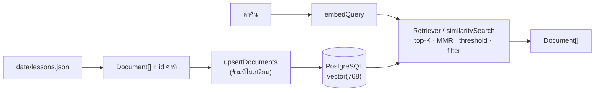

# Part 15 — Vector Stores & Retrievers

ระดับ: Intermediate · เวลา: 90–120 นาที · ตัวอย่าง: `examples/part-15/` · ข้อมูล: `data/lessons.json` · Workshop: `workshops/part-15/`
15-01 ถึง 15-07 ใช้ `MemoryVectorStore` (ต้องมี `GOOGLE_API_KEY`); 15-08 ถึง 15-11 ใช้ PostgreSQL + pgvector → รัน `docker compose up -d --wait` ก่อน (พอร์ต 5435 ดู README หลัก)

## 1. Introduction

Part 14 ค้นด้วยการ embed เอกสารใหม่ทุกครั้งและเทียบเองใน RAM — ใช้ได้กับของเล็กๆ เท่านั้น Part นี้เก็บ vector ไว้ใน **vector store** (ที่เก็บถาวรพร้อมการค้นหาความคล้าย) และครอบด้วย **retriever** (อินเทอร์เฟซมาตรฐาน "คำถามเข้า → เอกสารออก") เพื่อต่อเข้ากับ RAG ใน Part 16

## 2. Learning Objectives

ใช้ `MemoryVectorStore` (add, search, score, filter) · ตั้ง pgvector ด้วย Docker และสร้างตาราง `vector(768)` · index แบบ idempotent (id คงที่, ข้ามชิ้นที่ไม่เปลี่ยน) · อัปเดต/ลบเอกสาร · สร้าง retriever และเลือกกลยุทธ์ (top-K, MMR, threshold, filter) · อธิบาย exact vs ANN, HNSW vs IVFFlat

## 3. Concept Explanation

**Vector store** เก็บ (id, ข้อความ, metadata, vector) และค้น "k ตัวที่ใกล้ vector ของคำค้นที่สุด"

| | MemoryVectorStore | PGVectorStore (pgvector) |
|---|---|---|
| ที่เก็บ | RAM | PostgreSQL |
| รอดการรีสตาร์ท | ไม่ | ใช่ |
| filter | ฟังก์ชัน `(doc) => boolean` | object `{ subject: "math" }` (+ `in`, `gt`, …) |
| ใช้กับ | ทดลอง/เทสต์ | production ขนาดเล็ก–กลาง |

**Exact vs ANN:** exact = เทียบทุกแถว (แม่น 100% ช้าลงเมื่อข้อมูลมาก) · **ANN** (approximate nearest neighbor) = ใช้ index ค้นเร็วแต่อาจพลาดบางผล
- **HNSW:** กราฟหลายชั้น — ค้นเร็วและแม่นสูง แต่สร้างช้า/กิน RAM มาก; เพิ่มข้อมูลทีหลังได้
- **IVFFlat:** แบ่งกลุ่ม (cluster) แล้วค้นเฉพาะกลุ่มใกล้เคียง — สร้างเร็ว กิน RAM น้อย แต่ต้องมีข้อมูลก่อนสร้าง index และต้องจูน `lists`/`probes`
- **ตัวอย่างในคอร์สนี้ไม่สร้าง index** (15-08 ยืนยัน: มีแค่ primary key) เพราะข้อมูลเพียง 18 แถว — exact scan เร็วพอและแม่นที่สุด; เริ่มพิจารณา index เมื่อหลักหมื่นแถวขึ้นไปและวัดแล้วว่าช้า

**วงจรชีวิตเอกสาร (15-09, 15-10):** id = sha256(`source` + `chunkIndex`) จัดเป็น UUID → รัน index ซ้ำได้โดย "ไม่เพิ่มแถว" · เนื้อหาเดิม = ข้าม (ไม่เรียก embedding) · เนื้อหาเปลี่ยน = แทนที่ · ลบตาม `source` หรือ id · เปลี่ยนโมเดล embedding = ต้อง re-index ทั้งหมด (มิติต้องตรงกับ `vector(768)`; `createPgVectorStore` ตรวจและแจ้งชัดเจน)

**Retriever** (`store.asRetriever({ k, filter })`) เป็น Runnable: `invoke`, `batch`, `stream` ต่อเข้า chain/agent ได้

**กลยุทธ์การดึง (15-11):**
- *top-K* — ง่าย แต่ได้ผลซ้ำซ้อน (ตอนที่ 1–3 ของเรื่องเดียวกัน)
- *MMR* — ใกล้คำถามและ **ต่างจากที่เลือกแล้ว** ได้ความหลากหลาย แต่ผลบางตัวอาจเกี่ยวน้อยลง
- *score threshold* — ตัดผลที่ไม่ใกล้พอ (calibrate จากข้อมูล)
- *metadata filter* — จำกัดขอบเขต (วิชา/ชั้น/แหล่งที่มา) ก่อนจัดอันดับ
- *hybrid* (keyword + vector) — ใช้เมื่อมีคำเฉพาะ/รหัสที่ embedding จับไม่ดี (ไม่ครอบคลุมในตัวอย่าง)

**คุณภาพการดึง:** recall (เจอของที่ควรเจอไหม) vs precision (ที่เจอเกี่ยวจริงไหม); ปรับ chunk size, k, threshold ด้วยชุดคำถามทดสอบ ไม่ใช่เดา

## 4. Problem Demonstration

15-04: คำค้นที่ไม่เกี่ยวเลวยังได้ผล และ 15-11: top-K ได้ผลซ้ำ
```
คำค้น: วิธีทำต้มยำกุ้ง
  0.531  m1-03 — สมการเชิงเส้นตัวแปรเดียว ตอนที่ 1     ← ไม่เกี่ยวแต่ยังถูกคืนมา
1) top-K (k=4) : m1-05, m1-03, m1-04, m1-01             ← สมการสามตอนติดกัน
```

## 5. Solution

pgvector + `upsertDocuments` (idempotent) + กลยุทธ์ที่เหมาะกับคำถาม (`src/rag/pg-store.ts`: `createPgVectorStore`, `resetTable`, `upsertDocuments`, `deleteBySource`, `documentId`)

## 6. Visual Explanation



## 7. Coding Examples

รัน `pnpm play 15-N` (Gemini embeddings จริง; ผลอาจต่างเล็กน้อย) — ตัวช่วย `_lessons.ts` ไม่อยู่ในรายการตัวอย่าง

**15-01 MemoryVectorStore** → `จำนวนรายการที่เก็บ: 4` · รายการแรก `{ content: 'สมการเชิงเส้นตัวแปรเดียว', metadata: { subject: 'math' }, มิติ: 768 }`
**15-02 Add Documents** → `ก่อนเพิ่ม: 0` / `หลังเพิ่ม : 6 (embed ทั้ง 6 ชิ้นใน 1 batch)`
**15-03 Similarity Search**
```
คำค้น: วิธีหาค่า x ในสมการ        1. m1-04 — สมการเชิงเส้นตัวแปรเดียว ตอนที่ 2   2. m1-05 — … ตอนที่ 3
คำค้น: ราคาสินค้าลดราคา 20%        1. m1-06 — อัตราส่วนและร้อยละ                  2. m1-04 — …
```
**15-04 Similarity Search with Score** — ดูหัวข้อ 4 + `0.709 m1-04 · 0.699 m1-05 · 0.684 m1-03` สำหรับ "วิธีหาค่า x ในสมการ"
**15-05 Metadata Filtering**
```
ไม่กรอง k=3        m1-06(math), m1-03(math), s1-03(science)
subject=math       m1-06(math), m1-03(math)
subject=science    s1-03(science), s1-01(science)
subject=history    (ว่าง)
```
**15-06 Create Retriever** → `ชนิด: VectorStoreRetriever` · `เป็น Runnable (มี invoke/batch/stream): function function function`
**15-07 Retrieve Documents**
```
invoke: s1-03, s1-04
batch : s1-01, s1-03 | s1-04, s1-03
filter math: m1-06, m1-02
```
**15-08 pgvector Setup**
```
pgvector extension version: 0.8.0
 id uuid · text text · metadata jsonb · embedding vector(768)
index ที่มี: [ 'lessons_setup_demo_pkey' ] (มีแค่ primary key — ไม่มี vector index เพราะข้อมูลน้อย)
```
**15-09 Persistent Vector Store** — รันสองครั้ง
```
ครั้งที่ 1: แถวก่อน: 0 → หลัง: 18 | ข้อความที่ส่งไป embed ในรอบนี้: 18
ครั้งที่ 2: แถวก่อน: 18 → หลัง: 18 | ข้อความที่ส่งไป embed ในรอบนี้: 0
คำค้น: ลดราคา 20% เหลือเท่าไร → 1. m1-06 อัตราส่วนและร้อยละ  2. m1-02 เศษส่วนและทศนิยม
```
**15-10 Update and Delete**
```
1) เพิ่ม 3 ชิ้น → embed 3 ข้อความ | แถว: 3
2) upsert ซ้ำ ไม่แก้อะไร → embed 0 ข้อความ | แถว: 3
3) แก้ชิ้นแรก 1 ชิ้น → embed 1 ข้อความ | แถว: 3
4) deleteBySource( lesson:m1-02 ) → แถว: 2
5) delete({ ids }) → แถว: 1 [ 'm1-01' ]
```
**15-11 Compare Retrieval Strategies** — "การแก้สมการและการคำนวณทางคณิตศาสตร์"
```
1) top-K (k=4)           : m1-05, m1-03, m1-04, m1-01      (ระยะห่าง 0.289, 0.290, 0.305, 0.350)
2) MMR (k=4, fetchK=10)  : m1-03, s1-03, m1-02, t1-01      ← หลากหลายขึ้น แต่ s1-03/t1-01 เกี่ยวน้อยลง
3) threshold (distance ≤ 0.3): m1-05, m1-03
4) filter subject=science: s1-03, s1-04, s1-02, s1-01
```

## 8. Common Mistakes

| ข้อผิดพลาด | ผล | แก้ |
|---|---|---|
| ใช้ชื่อตาราง/คีย์ filter จาก input ของผู้ใช้ | **SQL injection** — ไลบรารีต่อชื่อตารางและ *คีย์* ของ filter เข้า SQL ตรงๆ (ค่าใช้ parameter) | ชื่อตารางผ่าน `assertTableName`; คีย์ filter กำหนดในโค้ด ไม่รับจากผู้ใช้ |
| insert ซ้ำด้วย id เดิม | ไลบรารีใช้ INSERT ธรรมดา → error `duplicate key` | `upsertDocuments` (เช็กแล้วข้าม/แทนที่) |
| ไม่มี id คงที่ | re-index = เพิ่มแถวซ้ำทุกครั้ง | id จาก `source + chunkIndex` |
| มิติไม่ตรง (ตารางเก่า 1536, โมเดลใหม่ 768) | error สับสนตอน insert | `createPgVectorStore` ตรวจและบอกวิธีแก้ |
| `PGVectorStore.initialize` ถือ connection ค้างไว้ | `pool.end()` ไม่จบ/โปรแกรมไม่ออก | `createPgVectorStore` คืน connection ให้ pool แล้ว; เรียก `withDb`/`pool.end()` เสมอ |
| ไม่ปิด pool | โปรเซสค้าง | `withDb` ปิดให้ |
| ใช้ top-K อย่างเดียวกับเอกสารซ้ำซ้อน | ผลซ้ำ | MMR / ลดซ้ำตอน index |
| score ของ pgvector = *ระยะห่าง* (น้อย = ใกล้) แต่ MemoryVectorStore = *similarity* (มาก = ใกล้) | ตั้ง threshold กลับด้าน | ดูชนิดคะแนนของ store ก่อนเสมอ (`1 - distance` = similarity) |
| สร้าง HNSW ตั้งแต่ข้อมูล 18 แถว | ซับซ้อนโดยไม่จำเป็น | exact scan จนกว่าจะวัดแล้วช้า |

## 9. Best Practices

- **Security:** ชื่อตาราง/คีย์ filter มาจากโค้ดเท่านั้น; DATABASE_URL อยู่ใน `.env` (git-ignored); แยก user ของ DB ตามสิทธิ์; metadata เป็นข้อมูลที่ไม่ควรเชื่อถือถ้ามาจากไฟล์ภายนอก
- **Privacy/Retention:** มีทางลบตาม `source`; ข้อมูลส่วนบุคคลที่ embed แล้วยังเป็นข้อมูลส่วนบุคคล — ลบทั้ง chunk และ vector
- **Reliability:** index แบบ idempotent, retry เมื่อโควตา embedding เต็ม, ข้อความ error ที่บอกวิธีแก้ (`docker compose up -d`) — `upsertDocuments` ไม่ลบ chunk ที่หายไปจากไฟล์ที่สั้นลง (ใช้ `deleteBySource` ก่อน หรือ `indexCurriculum` ที่ลบให้)
- **Cost:** ข้ามเอกสารที่ไม่เปลี่ยน; เก็บ `contentHash` ใน metadata
- **Testing:** `tests/part15-stores.test.ts` — ส่วน in-memory/fake รันเสมอ; ส่วน pgvector **รันเฉพาะเมื่อต่อ DB ได้** (`describe.skipIf`) — ถ้า Docker ไม่ได้เปิด เทสต์ pgvector 7 ข้อจะถูกข้าม (สรุปผลจะแสดง `skipped`)

## 10. Exercises

**Basic:** เพิ่มบทเรียนใหม่ใน `data/lessons.json` แล้วรัน 15-09 ดูว่า embed เฉพาะชิ้นใหม่
**Intermediate:** เพิ่ม filter ชั้นเรียน (`grade`) ร่วมกับ `subject` ใน workshop
**Challenge:** สร้าง HNSW index ด้วย `store.createHnswIndex({ dimensions: 768 })` กับข้อมูลสังเคราะห์ 20,000 แถว (ใช้ `createFakeEmbeddings`) แล้ววัดเวลาค้น/`EXPLAIN` ก่อน–หลัง

## 11. Workshop

[`workshops/part-15/README.md`](../../workshops/part-15/README.md) — Persistent Lesson Search (index ครั้งเดียว ค้นข้ามการรันได้)

## 12. Summary

- vector store เก็บ vector + metadata; retriever คืออินเทอร์เฟซมาตรฐานของการดึง
- pgvector = vector ใน PostgreSQL; ข้อมูลน้อยไม่ต้องมี index (exact); มากค่อย ANN (HNSW/IVFFlat)
- id คงที่ + upsert = index ซ้ำได้ ไม่ซ้ำ ไม่เสียโควตา
- top-K / MMR / threshold / filter แก้ปัญหาต่างกัน; ต้องวัดคุณภาพ
- API: `MemoryVectorStore`, `PGVectorStore`, `addDocuments`, `similaritySearch(WithScore)`, `maxMarginalRelevanceSearch`, `asRetriever`, `delete`

## 13. Knowledge Check

1. (Concept) Exact กับ ANN ต่างกันอย่างไร และเมื่อไรควรสร้าง index?
2. (Concept) ทำไมต้องกำหนด id ที่คงที่ให้เอกสารตอน index?
3. (Code reading) ใน 15-10 ข้อ 2 ทำไม embed = 0 ข้อความ และข้อ 3 ทำไม embed = 1?
4. (Practical) ผลค้นหาเป็นบทเรียน "ตอนที่ 1, 2, 3" ซ้ำกัน ควรปรับอย่างไร และต้องแลกกับอะไร?
5. (Practical) ทีมเปลี่ยนโมเดล embedding เป็น 1536 มิติ ต้องทำอะไรกับตารางเดิม?

## 14. Next Part

Part 16 นำ retriever มาประกอบกับ LLM เป็น **RAG** — ตอบจากเอกสารของเราพร้อมอ้างอิงแหล่งที่มา
